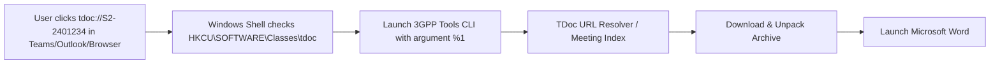
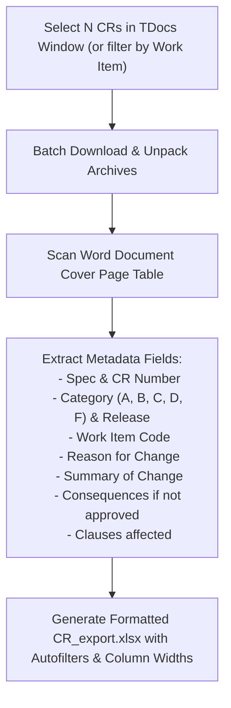
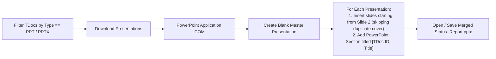
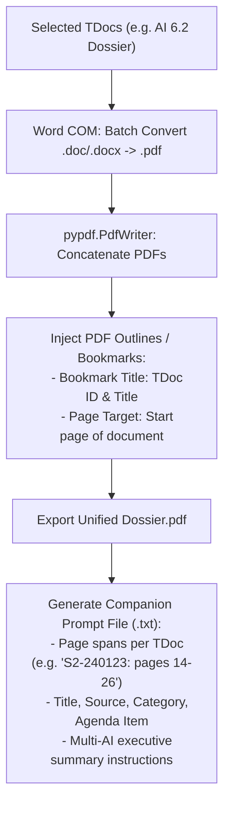
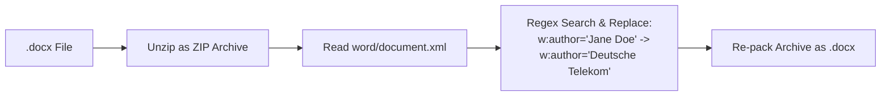
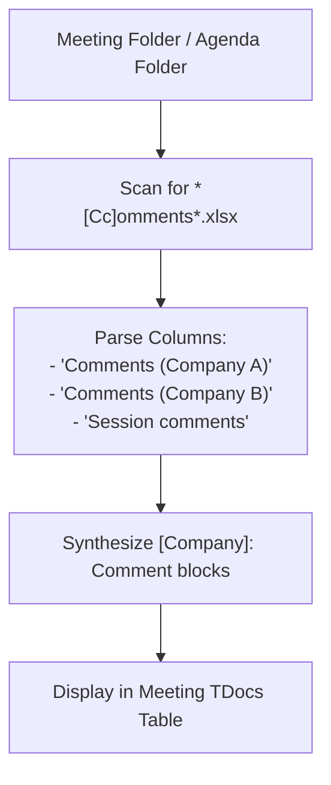
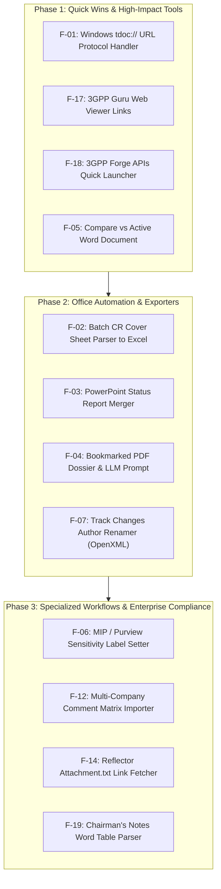

# Legacy Functionalities & Feature Porting Reference

This document provides a comprehensive technical audit of the functionalities originally implemented in the legacy **3GPP Meeting Helper** (`..\3GPP Meeting Helper`) that are not currently present in the modernized **3GPP Tools** (`3GPP Tools`) desktop application.

It serves as an architectural backlog and blueprint for future implementation, detailing the problem each feature solved, how it worked under the hood, and how it can be cleanly integrated into the modern PyQt5 modular architecture.

---

## 1. Executive Summary & Comparison Matrix

The modern **3GPP Tools** platform provides significant architectural advancements over the legacy application:
- **PyQt5 & Custom Delegate UI** replacing legacy Tkinter (`sv_ttk`).
- **PlantUML IDE & Office Converter** with live debounced SVG rendering and Visio/PowerPoint vector shape generation.
- **SQLite Trigram FTS5 Specification Search Engine** across releases with cutoff date detection and clause extraction.
- **Protocol Matrix & Evolution Engine** tracking bit-level octets and ASN.1 structures across 3GPP releases (5GS/EPS NAS, NR/LTE RRC, NGAP, GTP-U, PFCP, TS 38.415).
- **Offline AI & LLM Integration (Ollama)** for CR triage, sequence synthesis, and evidence-grounded research.
- **Interactive HTML & Plotly Meeting Analytics** replacing static tabular metrics.

However, the legacy codebase contained several **specialized desktop ergonomics, Microsoft Office COM automation routines, and standards-delegate utilities** developed over years of meeting participation that have not yet been migrated.

### Gap Analysis Matrix

> [!TIP]
> Detailed individual specifications with architectural diagrams, code samples, and implementation plans for each feature are available in the [**Legacy Features Catalog (README.md)**](legacy_features/README.md).  
> For a comprehensive business and workflow value evaluation across all features, see the [**Strategic Value & ROI Analysis (VALUE_ANALYSIS.md)**](legacy_features/VALUE_ANALYSIS.md).

| ID | Feature Domain | Legacy Feature | Detailed Specification | Current Status in 3GPP Tools | Complexity | Priority |
| :--- | :--- | :--- | :--- | :--- | :--- | :--- |
| **F-01** | **OS Integration** | Windows `tdoc://` URL Protocol Handler | [F01: Windows URL Handler](legacy_features/F01_windows_tdoc_url_handler.md) | ❌ Not implemented | Low | 🟢 High |
| **F-02** | **Word Automation** | Batch CR Cover Sheet Parser to Excel | [F02: Batch CR Cover Parser](legacy_features/F02_batch_cr_cover_sheet_parser.md) | ❌ Only 1-by-1 AI triage | Medium | 🟢 High |
| **F-03** | **Office Automation** | PowerPoint Presentation Merger | [F03: PowerPoint Merger](legacy_features/F03_powerpoint_presentation_merger.md) | ❌ Not implemented | Low | 🟡 Medium |
| **F-04** | **PDF & AI Tools** | Bookmarked PDF Dossier & LLM Prompt | [F04: Bookmarked PDF & Prompt](legacy_features/F04_bookmarked_pdf_dossier_llm_prompt.md) | ❌ Merges Excel / Markdown | Medium | 🟡 Medium |
| **F-05** | **Word Automation** | Active Word vs. TDoc Direct Compare | [F05: Active Word vs. TDoc](legacy_features/F05_active_word_vs_tdoc_comparison.md) | ❌ Slot A vs B in Cart only | Low | 🟢 High |
| **F-06** | **Security / Compliance** | MIP / Purview Sensitivity Label Setter | [F06: MIP Sensitivity Setter](legacy_features/F06_mip_sensitivity_label_setter.md) | ❌ Not implemented | Medium | 🟡 Medium |
| **F-07** | **Word Automation** | Track Changes Revision Author Renamer | [F07: Author Renamer](legacy_features/F07_track_changes_author_renamer.md) | ❌ Not implemented | Low | ⚪ Low |
| **F-08** | **Word Automation** | Word Process Watchdog / Force Killer | [F08: Word Process Watchdog](legacy_features/F08_word_process_watchdog_killer.md) | 🔴 Deprecated (Superseded by COM Task Manager Dialog) | Low | ⚪ Low |
| **F-09** | **Word Automation** | Word Meeting Contribution Report (.docx) | [F09: Word Contribution Report](legacy_features/F09_word_meeting_contribution_report.md) | 🔴 Deprecated (Superseded by HTML Dashboard & Dossiers) | High | ⚪ Low |
| **F-10** | **Word Automation** | "Accept All Changes" Clean Export | [F10: Accept All Changes Export](legacy_features/F10_word_accept_all_changes_export.md) | ❌ Not implemented | Low | ⚪ Low |
| **F-11** | **Excel Sync** | Bi-directional Excel AutoFilter Sync | [F11: Excel AutoFilter Sync](legacy_features/F11_excel_bidirectional_autofilter_sync.md) | 🔴 Deprecated (Obsolete; PyQt5 In-App Filters) | Medium | ⚪ Low |
| **F-12** | **Excel Sync** | Company Comments Matrix Importer | [F12: Comments Matrix Importer](legacy_features/F12_company_comments_matrix_importer.md) | ❌ Personal notes only | Medium | 🟡 Medium |
| **F-13** | **Excel Sync** | Native Excel Pivot Tables & Charts | [F13: Excel Pivot Tables](legacy_features/F13_native_excel_pivot_tables_charts.md) | 🔴 Deprecated (Superseded by HTML Dashboard Compiler) | Medium | ⚪ Low |
| **F-14** | **Email Reflector** | Reflector `Attachment.txt` Redirect Fetcher | [F14: Attachment Link Fetcher](legacy_features/F14_reflector_attachment_link_fetcher.md) | ❌ IMAP/HTML sync only | Low | 🟡 Medium |
| **F-15** | **Email Reflector** | Chairman Email Notes (`<<START>>...<<END>>`) | [F15: Chairman Notes Parser](legacy_features/F15_chairman_email_notes_parser.md) | ❌ Not implemented | Low | ⚪ Low |
| **F-16** | **Email Reflector** | Email Approval Excel Export | [F16: Email Approval Excel](legacy_features/F16_email_approval_excel_export.md) | ❌ Not implemented | Medium | ⚪ Low |
| **F-17** | **Web Links** | 3GPP Guru Web Viewer Integration | [F17: 3GPP Guru Integration](legacy_features/F17_3gpp_guru_web_viewer_integration.md) | ✅ Implemented (Help & Resources Menu) | Very Low | 🟢 High |
| **F-18** | **Web Links** | 3GPP Forge APIs Direct Link | [F18: 3GPP Forge APIs](legacy_features/F18_3gpp_forge_apis_launcher.md) | ✅ Implemented (Help & Resources Menu) | Very Low | 🟢 High |
| **F-19** | **Meeting Notes** | Chairman\'s Notes Word Table Parser (WIP) | [F19: Chair Notes Word Parser](legacy_features/F19_chairmans_notes_word_table_parser.md) | ❌ File download only | High | 🟡 Medium |

---

## 2. Detailed Technical Specifications

---

### F-01: Windows `tdoc://` URL Protocol Handler

#### Overview & Delegate Workflow
In 3GPP communications (meeting chat, emails, Word contribution references, intranet pages), delegates constantly exchange TDoc identifiers (e.g. `S2-2401234`, `SP-230890`). 
With this handler registered, clicking any `tdoc://S2-2401234` or `tdoc:S2-2401234` link in Microsoft Teams, Outlook, Word, Slack, or web browsers automatically triggers the desktop tool to search, fetch, unpack, and launch the document without manual copying and searching.



#### Legacy Implementation
* **Files:**
  * `3GPP Meeting Helper/search_and_open_tdoc.py`
  * `3GPP Meeting Helper/tdoc.reg`
* **Mechanism:**
  * Created a Windows Registry key in `HKEY_CURRENT_USER\SOFTWARE\Classes\tdoc`:
    ```ini
    [HKEY_CURRENT_USER\SOFTWARE\Classes\tdoc]
    "URL Protocol"=""
    @="3GPP Delegate Helper"

    [HKEY_CURRENT_USER\SOFTWARE\Classes\tdoc\shell\open\command]
    @="python \"C:\\path\\to\\search_and_open_tdoc.py\" %1"
    ```
  * `search_and_open_tdoc.py` parsed `%1` (stripping `tdoc://` or `tdoc:` prefix), resolved the meeting via `server.tdoc_search.search_download_and_open_tdoc`, unzipped the package, and called `os.startfile(doc_path)`.

#### Proposed Integration into 3GPP Tools
1. **CLI Argument Support:** Add an argument `--open-tdoc <tdoc_id>` to `src/main_tools.py` or `src/main_window.py`. If an instance is already running, utilize a single-instance local TCP/IPC socket or Windows message to bring the window to the front and open the TDoc.
2. **Settings UI Registration:** Add a 1-click button in `MeetingsConfigDialog` or `GeneralSettings`: `"Register tdoc:// protocol in Windows"`.
3. **Execution:** Automatically writes the Registry key pointing to `python.exe -m main_tools --open-tdoc %1` or `Launch.cmd %1`.

---

### F-02: Batch CR Cover Sheet Parser & Tabular Excel Exporter

#### Overview & Delegate Workflow
When reviewing hundreds of Change Requests (CRs) assigned to a meeting or Work Item, delegates need to quickly see **what is being changed and why** across all proposals in a structured spreadsheet, without opening every Word file manually.



#### Legacy Implementation
* **Files:**
  * `3GPP Meeting Helper/parsing/word/pywin32.py` (`parse_cr`, `parse_list_of_crs`)
  * `3GPP Meeting Helper/gui/tdocs_table.py` (`export_crs`)
* **Mechanism:**
  * Scanned the first table of each CR document for standardized 3GPP cover sheet cells:
    * `Spec`: cell `(1, 1)` -> `TS 23.501`
    * `CR Num`: cell `(1, 3)` -> `1245`
    * `Rev`: cell `(1, 5)` -> `1`
    * `Category`: checked for `'X'` in category selection boxes (`F`, `A`, `B`, `C`, `D`)
    * `Release`: detected active release checkbox
    * `Work Item`: matched WI code
    * Text blocks: extracted full text for `"Reason for change"`, `"Summary of change"`, `"Consequences if not approved"`, and `"Clauses affected"`
  * Assembled a `pandas.DataFrame`, wrote to `xlsxwriter` / `openpyxl`, and formatted columns, text wrapping, and autofilters via Excel COM.

#### Proposed Integration into 3GPP Tools
1. **Location:** `src/modules/meetings/ui/tdocs_menus.py` -> Add action under `📊 Reports ▾` or row context menu: `"Export Selected / Filtered CRs to Excel..."`.
2. **Worker Engine:** Implement `CRExcerptWorker` in `src/modules/meetings/core/` leveraging `python-docx` (or direct OpenXML parsing via `lxml`, similar to `src/modules/nas/core/parsing/`) for ultra-fast, headless cover sheet extraction without requiring Microsoft Word COM overhead.
3. **Output:** Formatted Excel workbook via `openpyxl` with auto-filters and wrapped text columns.

---

### F-03: PowerPoint Status Report & Presentation Merger

#### Overview & Delegate Workflow
In 3GPP TSG Plenaries (SA, RAN, CT) and Working Groups, dozens of Working Group Status Reports, Liaison Statements, and Study Item progress decks are submitted as `.pptx` presentations. Delegates must review them sequentially during marathon sessions.



#### Legacy Implementation
* **Files:**
  * `3GPP Meeting Helper/application/powerpoint.py` (`merge_presentations`)
  * `3GPP Meeting Helper/gui/tdocs_table.py` (`merge_pptx_files`)
* **Mechanism:**
  * Leveraged `win32com.client.Dispatch("PowerPoint.Application")`.
  * Called `slides.InsertFromFile(slideset_path, insert_position, SlideStart=2)` to automatically strip the cover slide.
  * Called `new_slideset.SectionProperties.AddBeforeSlide(insert_position + 1, section_name)` to create native PowerPoint sections named after the TDoc ID and title for easy navigation in Slide Sorter view.

#### Proposed Integration into 3GPP Tools
1. **Location:** `src/modules/meetings/ui/tdocs_menus.py` -> `📊 Reports ▾` -> `"Merge Filtered PowerPoint Presentations..."`.
2. **Worker:** `PowerPointMergerThread` in `src/modules/meetings/core/` executing PowerPoint COM automation in a background QThread with progress reporting.

---

### F-04: Bookmarked Multi-TDoc PDF Dossier & LLM Prompt Generator

#### Overview & Delegate Workflow
While Markdown conversion is ideal for local text processing, delegates often require a single, unified, searchable PDF compilation of all contributions under an Agenda Item or Work Item for offline reading on tablets/iPads or sharing with executives. In addition, pairing the PDF with a structured prompt file detailing the exact page boundaries of each contribution allows large-context LLMs (NotebookLM, Claude, Gemini, GPT-4) to reference specific page ranges with 100% citation accuracy.



#### Legacy Implementation
* **Files:**
  * `3GPP Meeting Helper/gui/tdocs_table_from_excel.py` (lines 550–650)
* **Mechanism:**
  * Converted Word files to PDF via `application.word.convert_tdoc_files_to_format`.
  * Utilized `pypdf.PdfWriter` to assemble pages while tracking cumulative page offsets.
  * Injected native PDF outline items (`merger.add_outline_item(title=tdoc_id, page_number=current_page, bold=True, fit=PAGE_FIT)`).
  * Synthesized a structured prompt file (`{export_id}_bookmarks.txt`):
    ```text
    The attached PDF contains a collection of 3GPP documents:
      - S2-240101, titled "Clarification on UPF Selection", is a pCR sourced by Deutsche Telekom for agenda item 6.2 and spans pages 1 to 8.
      - S2-240102, titled "SMF Triggered Redirection", is a Discussion paper sourced by Qualcomm for agenda item 6.2 and spans pages 9 to 15.
    
    Please provide a summary of the documents included in the PDF per agenda item...
    ```

#### Proposed Integration into 3GPP Tools
1. **Location:** `src/modules/meetings/ui/tdocs_menus.py` -> `📥 Export ▾` -> `"Export Merged PDF Dossier with Bookmarks & LLM Prompt..."`.
2. **Integration:** Combine Word COM headless export with `pypdf` bookmark stitching. Export directly into the meeting export folder.

---

### F-05: "Active Word vs. TDoc" Direct Comparison

#### Overview & Delegate Workflow
During active drafting sessions at 3GPP meetings, delegates often have a local draft or incoming revision open in Microsoft Word. They frequently need to run an immediate redline comparison between their active desktop Word window and an official TDoc without locating files in Windows Explorer or staging items in comparison carts.

#### Legacy Implementation
* **Files:**
  * `3GPP Meeting Helper/_3GPP_Delegate_Helper.py` (`compare_tdoc_with_active_word`)
* **Mechanism:**
  * Queried running Office instances via `win32com.client.GetActiveObject("Word.Application")`.
  * Obtained `word.ActiveDocument.FullName`.
  * Downloaded the requested TDoc via `server.tdoc_search`.
  * Executed `word.CompareDocuments(active_doc_path, downloaded_doc_path)`.

#### Proposed Integration into 3GPP Tools
1. **Location:** `src/modules/meetings/ui/meetings_actions.py` and `tdocs_menus.py`.
2. **UI Surface:** Context menu on any TDoc row -> `"Compare vs. Active Word Document"`, or an action button in the Quick Jump bar.

---

### F-06: Microsoft Information Protection (MIP) / Purview Sensitivity Label Setter

#### Overview & Delegate Workflow
Enterprise IT environments (such as Deutsche Telekom / T-Mobile) often enforce mandatory Microsoft Purview / MIP sensitivity labels. Documents without a valid classification label cannot be saved, attached to Outlook emails, or uploaded to external collaboration repositories. Because 3GPP documents are public standards contributions, setting them to `"OFFEN"` (Public) in bulk unblocks delegates from compliance restrictions.

#### Legacy Implementation
* **Files:**
  * `3GPP Meeting Helper/sensitivity_label_setter.py`
  * `3GPP Meeting Helper/application/sensitivity_label.py`
* **Mechanism:**
  * Leveraged Microsoft Office SensitivityLabel API:
    ```python
    sensitivity_label = document.SensitivityLabel.GetLabel()
    if sensitivity_label.AssignmentMethod == -1: # Not set
        new_sl = document.SensitivityLabel.CreateLabelInfo()
        new_sl.ActionId = str(uuid.uuid1())
        new_sl.AssignmentMethod = 1  # Privileged
        new_sl.LabelId = config.sensitivity_level_label_id
        new_sl.LabelName = config.sensitivity_level_label_name
        document.SensitivityLabel.SetLabel(new_sl, new_sl)
        document.Save()
    ```

#### Proposed Integration into 3GPP Tools
1. **Location:** `src/core/config/` (add optional MIP settings in `settings.py` / `MeetingsConfigDialog`).
2. **Trigger:** Hook into `tdoc_file_handler.py` or export pipeline: when opening or exporting Word documents on Windows, optionally invoke `set_sensitivity_label` if configured.
3. **Standalone Dialog:** Provide a small utility dialog under `Tools ▾` -> `"Set Word Sensitivity Labels in Folder..."`.

---

### F-07: Track Changes Revision Author Replacement

#### Overview & Delegate Workflow
When delegates co-author contributions with multiple internal company colleagues, Word documents often contain dozens of different author names for Track Changes. Before submitting to 3GPP, delegates frequently need to consolidate all comments and edits under a single unified company name (e.g. replacing individual reviewer names with `"Deutsche Telekom"` or `"Editor"`), or anonymize comments.



#### Legacy Implementation
* **Files:**
  * `3GPP Meeting Helper/application/word.py` (`get_reviews_for_active_document`)
  * `3GPP Meeting Helper/gui/tools_overview.py` (`replace_document_revisions_author`)
* **Mechanism:**
  * Operated directly at the OpenXML package level:
    1. Saved and closed the Word document.
    2. Extracted `.docx` as a ZIP archive.
    3. Read `word/document.xml`.
    4. Replaced `w:author="{matching_author}"` with `w:author="{replace_author}"`.
    5. Re-compressed into `.docx` and re-opened in Word.

#### Proposed Integration into 3GPP Tools
1. **Location:** `src/modules/word_tools/` -> Add a tab or dialog: `"Author Anonymizer / Track Changes Consolidator"`.
2. **Implementation:** Pure Python `zipfile` operation, completely independent of Word COM. Fast, reliable, and operates cross-platform.

---

### F-08: Word Process Watchdog / Force Killer ("Close Word")

#### Overview & Delegate Workflow
Microsoft Word COM automation frequently leaves orphaned `WINWORD.EXE` background processes running when automation scripts encounter unexpected COM exceptions or when Protected View intercepts a file. These orphaned processes hold read/write locks on downloaded 3GPP files, preventing subsequent file unzipping or comparisons.

#### Legacy Implementation
* **Files:**
  * `3GPP Meeting Helper/application/word.py` (`close_word`)
* **Mechanism:**
  * Iterated through `word.Documents` to close unsaved files, followed by `word.Quit()`. If unresponsive, called Windows taskkill on `WINWORD.EXE`.

#### Proposed Integration into 3GPP Tools
1. **Location:** `src/modules/word_tools/` or bottom status bar menu.
2. **Implementation:** Add a safe `"Close All Word Instances"` button that attempts graceful COM termination first, followed by process cleanup if stuck.

---

### F-09: Microsoft Word Meeting Contribution Summary Report (.docx)

#### Overview & Delegate Workflow
Generates a formal Word document (`.docx`) compiling meeting contributions organized by Work Item or Agenda Item with native Word styling, Table of Contents, and statistics.

#### Legacy Implementation
* **Files:**
  * `3GPP Meeting Helper/parsing/word/pywin32.py` (`insert_doc_data_to_doc`, `insert_cr_summary_to_report`, `insert_index_at_begin`)
* **Mechanism:**
  * Built formatted tables via Word COM (`doc.Tables.Add`).
  * Styled headings with Word styles (`Überschrift 1`, `Überschrift 2`).
  * Injected native Table of Contents (`doc.TablesOfContents.Add`).

#### Proposed Integration into 3GPP Tools
* Note: The current application produces superior Markdown and HTML dashboards. However, if formal corporate Word reporting is needed, `python-docx` can generate `.docx` reports without Word COM.

---

### F-10: Automated "Accept All Changes" Word Export Option

#### Overview & Delegate Workflow
In 3GPP, CRs are submitted with change tracking enabled (revision marks). When distributing approved CRs or reading clean text, delegates need a 1-click option to accept all revisions and strip change markings before exporting to clean PDF or HTML.

#### Legacy Implementation
* **Files:**
  * `3GPP Meeting Helper/application/word.py` (`export_document(accept_all_changes=True)`)
* **Mechanism:**
  * Called `doc.Revisions.AcceptAll()` before calling `doc.ExportAsFixedFormat(wdExportFormatPDF)`.

#### Proposed Integration into 3GPP Tools
1. **Location:** Integrate into Word comparator and PDF exporter options in `src/modules/word_tools/` and `src/modules/meetings/`.

---

### F-11: Bi-directional Excel AutoFilter Synchronization

#### Overview & Delegate Workflow
Allows delegates who prefer navigating in Microsoft Excel to filter the 3GPP Tools TDoc table (e.g. by Work Item, Source, and Status) and click one button to instantly apply the identical filter criteria to the open 3GU Excel workbook in Microsoft Excel.

#### Legacy Implementation
* **Files:**
  * `3GPP Meeting Helper/gui/tdocs_table_from_excel.py` (`open_and_filter_excel`)
  * `3GPP Meeting Helper/application/excel.py` (`set_autofilter_values`, `clear_autofilter`)
* **Mechanism:**
  * Controlled running Excel instance via `win32com.client.Dispatch("Excel.Application")`.
  * Passed active TDoc IDs as an array to `AutoFilter(Field=1, Criteria1=value_list, Operator=7)`.

#### Proposed Integration into 3GPP Tools
1. **Location:** `src/modules/meetings/ui/tdocs_menus.py` -> `"Sync View to Microsoft Excel"`.

---

### F-12: Multi-Company Review Comments Matrix Importer

#### Overview & Delegate Workflow
During 3GPP meeting preparation and electronic review phases, companies exchange comment sheets (e.g. `Comments_Qualcomm.xlsx`, `Comments_Ericsson.xlsx`, or `Session Comments.xlsx`). The importer scans the meeting folder, extracts each company's comments, and aggregates them into unified `[Company]: comment` entries per TDoc in the main table.



#### Legacy Implementation
* **Files:**
  * `3GPP Meeting Helper/parsing/excel.py` (`read_comments_file`, `get_comments_from_dir`)
* **Mechanism:**
  * Scanned local agenda folder with regex `.*[Cc]omments.*\.xlsx`.
  * Extracted company names from column headers via regex `Comment[s]? [\(]?([\w]+)[\)]?`.
  * Merged comment strings into the DataFrame indexed by TDoc ID.

#### Proposed Integration into 3GPP Tools
1. **Location:** `src/modules/meetings/core/` (add comment scanner in `tdocs_parser.py` or a dedicated review manager).
2. **UI Surface:** Add a `"Review Comments"` toggle or column in `TDocsWindow`.

---

### F-13: Native Excel COM Pivot Tables & Charts

#### Overview & Delegate Workflow
Generates native Microsoft Excel Pivot Tables and Pivot Charts (`TDocs per AI`, `Delegate Summary`, `Company Summary`) inside exported workbooks.

#### Legacy Implementation
* **Files:**
  * `3GPP Meeting Helper/parsing/excel.py` (`add_pivot_table_to_workbook_active_sheet`, `generate_pivot_chart_from_tdocs_by_agenda`)
* **Mechanism:**
  * Created Excel `PivotCaches` via COM and added stacked bar charts.

#### Proposed Integration into 3GPP Tools
* Note: Current application HTML analytics (`Statistics_Report.html`) with Plotly/Chart.js and openpyxl tables cover this effectively. Considered low priority for migration.

---

### F-14: Reflector `Attachment.txt` Redirect Link Resolution

#### Overview & Delegate Workflow
The 3GPP ETSI email listserv frequently strips large document attachments (`.doc`, `.zip`) from reflector emails to reduce server bandwidth, replacing them with a plain text file named `Attachment.txt` containing a secure download URL. Delegates reading archived emails cannot access the contribution without resolving this URL.

#### Legacy Implementation
* **Files:**
  * `3GPP Meeting Helper/parsing/outlook.py` (`get_attachment_data`)
* **Mechanism:**
  * Parsed text content of `Attachment.txt` with regex `Attachment:[\r\n]\"(.*)\"[\r\n](.*)[\r\n](.*)`.
  * Extracted real filename and target download URL, then downloaded the actual document.

#### Proposed Integration into 3GPP Tools
1. **Location:** `src/modules/emails/core/email_parser.py`.
2. **Integration:** When encountering `Attachment.txt` in reflector emails or `.msg` files, automatically parse and surface the target URL or download the file.

---

### F-15: Chairman Email Discussion Notes Parser (`<<START>>...<<END>>`)

#### Overview & Delegate Workflow
During e-meetings, Working Group Chairmen and Vice-Chairs post official decisions and revision requests in reflector email threads bracketed by standard tokens (`<<START>>...<<END>>`). Parsing these blocks allows instant extraction of official interim decisions before the formal TDoc list is updated.

#### Legacy Implementation
* **Files:**
  * `3GPP Meeting Helper/parsing/outlook.py` (lines 160–185)
* **Mechanism:**
  * Extracted text between `<<START>>` and `<<END>>`.
  * Extracted requested revision tags (`r[\d]{2}`).

#### Proposed Integration into 3GPP Tools
1. **Location:** `src/modules/emails/core/email_summary_worker.py`.

---

### F-16: Email Approval Excel Export

#### Overview & Delegate Workflow
Exports a meeting's entire email approval discussion history into a structured Excel workbook with sender, company, timestamp, agenda item, and direct `mailto:` / `file://` hyperlinks to `.msg` files.

#### Legacy Implementation
* **Files:**
  * `3GPP Meeting Helper/parsing/excel.py` (`export_email_approval_list`)

#### Proposed Integration into 3GPP Tools
1. **Location:** `src/modules/emails/ui/email_window.py` -> `Export Discussion to Excel`.

---

### F-17: 3GPP Guru Web Viewer Integration

#### Overview & Delegate Workflow
[3GPP Guru](https://3gpp.guru) is a popular third-party HTML specification viewer that renders 3GPP specifications directly in the browser with hyperlinked cross-references. Having direct 1-click links to 3GPP Guru saves delegates from downloading and unzipping Word files when doing quick online clause lookups.

#### Legacy Implementation
* **Files:**
  * `3GPP Meeting Helper/gui/specs_table.py` (`get_3gpp_guru_url_for_version_text`)
* **Mechanism:**
  * Generated URL formatted as:
    ```python
    url = f"https://3gpp.guru/trts/Rel-{release}/{spec_without_dots}-{file_version}.html"
    # Example: https://3gpp.guru/trts/Rel-19/23502-j00.html
    ```

#### Proposed Integration into 3GPP Tools
1. **Location:** `src/modules/specifications/ui/` (`spec_menu.py`, `ui_tabs.py`, `spec_info_dialog.py`) and `src/modules/spec_search/`.
2. **Action:** Add `"🌐 Open in 3GPP Guru"` to specification version context menus and action menus (`Get Word ▾`).

---

### F-18: 3GPP Forge APIs Direct Link

#### Overview & Delegate Workflow
One-click access to the official 3GPP Forge OpenAPI repository (`https://forge.3gpp.org/rep/all/apis`), where 5G Core (5GC) YAML/JSON API specifications are hosted.

#### Legacy Implementation
* **Files:**
  * `3GPP Meeting Helper/_3GPP_Delegate_Helper.py` (`apis_3gpp_forge_url`)

#### Proposed Integration into 3GPP Tools
1. **Location:** Add to main window top bar or `Specifications` / `Protocols` tab menus.

---

### F-19: Chairman's Notes Word Table Parser (Experimental / WIP)

#### Overview & Delegate Workflow
In 3GPP meetings, Chairmen and Session Chairs periodically upload interim notes files (`ChairNotes_<chair>_<timestamp>.doc`) containing tables of active discussions, straw polls, and interim statuses. Parsing these tables directly from Word documents allows delegates to view up-to-the-minute meeting progress before the official agenda is published.

#### Legacy Implementation
* **Files:**
  * `3GPP Meeting Helper/Tests for Chair Notes.ipynb`
  * `3GPP Meeting Helper/parsing/html/chairnotes.py`
  * `3GPP Meeting Helper/gui/tools_overview.py` (`process_chairnotes`)
* **Mechanism:**
  * Converted downloaded ChairNotes `.doc` files to `.docx`.
  * Scanned table rows for `['TD#', 'AI', 'Subject', 'Source', 'Discussion', 'Result']`.
  * Extracted latest discussion entry per TDoc (`df.groupby('TD#').tail(1)`).

#### Proposed Integration into 3GPP Tools
1. **Location:** `src/modules/meetings/core/chair_notes_downloader.py`.
2. **Enhancement:** After downloading Chairman's Notes, add an optional background parser to extract and display session notes alongside TDoc rows in `TDocsWindow`.

---

## 3. Recommended Implementation Roadmap

To maximize immediate value for standards delegates, the migration should be staged in three prioritized phases:



### Phase 1: Quick Wins & Ergonomics (Estimated Effort: Low)
1. **`tdoc://` URL Protocol Handler:** Register protocol in Windows to seamlessly connect web/chat links to 3GPP Tools.
2. **3GPP Guru & Forge Links:** Add 1-click links to `3gpp.guru` specifications and `forge.3gpp.org` APIs.
3. **"Compare vs Active Word Document":** Add single-click comparison against whatever document is currently open on the user's desktop.

### Phase 2: Office Batch Automation (Estimated Effort: Medium)
1. **Batch CR Cover Sheet Parser:** Extract Reason for Change / Summary of Change across all CRs to Excel using headless `python-docx` / `lxml`.
2. **PowerPoint Presentation Merger:** Combine plenary slide decks into a single presentation with section labels.
3. **Bookmarked PDF Dossier & AI Prompt Generator:** Compile unified PDF packages with outline bookmarks and prompt instructions.
4. **Track Changes Author Consolidator:** OpenXML ZIP-level tool to standardize revision author names before submission.

### Phase 3: Specialized Delegate Workflows (Estimated Effort: Medium)
1. **MIP Sensitivity Label Setter:** Add optional enterprise sensitivity label configuration for Word exports.
2. **Company Comments Matrix Ingestion:** Parse multi-company review comments from Excel sheets.
3. **Reflector Attachment Resolver & Chair Notes Parser:** Handle indirect reflector downloads and interim session notes.
