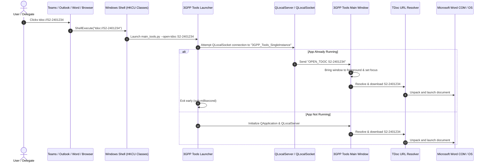

# F-01: Windows `tdoc://` URL Protocol Handler (🔴 Deprecated & Abandoned)

> [!CAUTION] Status: Deprecated & Abandoned (Non-Viable in Enterprise Environments)
> Following technical double-checking, code audit, and git history inspection (Commit `23ffa2f`: *"Initial (unsuccessful) try to automatically open TDocs from the browser"*), this feature has been formally **abandoned and deprecated**.
>
> **Key Reasons for Abandonment:**
> 1. **Administrator Rights & Registry Execution:** The legacy prototype attempted to import `tdoc.reg` using `os.startfile()`, which launches Windows `regedit.exe`. In corporate enterprise environments (e.g. non-admin corporate laptops), `regedit.exe` immediately prompts for elevated UAC administrator credentials or is blocked by Group Policy. The registry key was never successfully registered on the user's machine.
> 2. **Corporate Application Protocol Sanitization:** Target collaboration tools (notably Microsoft Teams Desktop/Web) strictly whitelist protocols (`http:`, `https:`, `mailto:`). Custom protocols such as `tdoc://` are stripped and rendered as inert, unclickable plain text in chat and channels. Microsoft Outlook and Word display severe security alerts (*"Microsoft Office has identified a potential security concern..."*) or block non-standard schemes under Defender for Office 365 / SafeLinks policies.
> 3. **The "Chicken-and-Egg" Standards Reality:** No standards delegates, 3GPP agendas, portal pages, email reflectors, or CRs ever write `tdoc://S2-2401234`—they use plain text IDs or official HTTPS FTP URLs. Thus, clickable `tdoc://` links do not naturally occur in real-world workflows.
> 4. **Superseded by Superior Zero-Privilege Alternatives:** The modern in-app `⚡ TDoc:` jump box in the **Meetings** tab and **TDocs Window** (backed by `tdoc_url_resolver.py`) resolves, unzips, and launches TDocs in ~1s with zero administrative privileges or OS registry modifications. An optional clipboard-aware quick open or global hotkey provides a frictionless, permissionless alternative without OS protocol risks.

## 1. Executive Summary & Objective

In 3GPP standards workflows, delegates and engineers continuously exchange TDoc identifiers (e.g., `S2-2401234`, `SP-230890`, `R2-2405678`) across various communication channels, including Microsoft Teams, Outlook emails, Word review comments, meeting agendas, and intranet portals. 

The original objective of **F-01** was to explore registering a native Windows Shell URL protocol handler (`tdoc://` and `tdoc:`) so that clicking any hyperlinked TDoc in external applications would immediately trigger 3GPP Tools to resolve, download, unzip, and launch the document in Microsoft Word.

However, as audited below, this approach is fundamentally incompatible with locked-down corporate IT environments and modern enterprise messaging security.

---

## 2. Legacy Codebase Analysis

### Files & Locations
* `3GPP Meeting Helper/search_and_open_tdoc.py`
* `3GPP Meeting Helper/tdoc.reg`
* `3GPP Meeting Helper/server/tdoc_search.py`

### Mechanism & Implementation Details

#### Registry Configuration (`tdoc.reg`)
The legacy tool registered an application protocol directly in the Windows Current User registry hive:
```ini
Windows Registry Editor Version 5.00

[HKEY_CURRENT_USER\SOFTWARE\Classes\tdoc]
"URL Protocol"=""
@="3GPP Delegate Helper"

[HKEY_CURRENT_USER\SOFTWARE\Classes\tdoc\shell]

[HKEY_CURRENT_USER\SOFTWARE\Classes\tdoc\shell\open]

[HKEY_CURRENT_USER\SOFTWARE\Classes\tdoc\shell\open\command]
@="python \"C:\\path\\to\\search_and_open_tdoc.py\" %1"
```

#### Self-Registration Logic (`search_and_open_tdoc.py`)
The script provided a `-register` flag that dynamically generated the `.reg` file with the resolved absolute path to the Python script and invoked `os.startfile(reg_file)` to prompt user confirmation:
```python
def register_application():
    script_path_for_reg = script_path.replace("\\", "\\\\")
    reg_str = f"""Windows Registry Editor Version 5.00

[HKEY_CURRENT_USER\SOFTWARE\Classes\\tdoc]
"URL Protocol"=""
@="3GPP Delegate Helper"

[HKEY_CURRENT_USER\SOFTWARE\Classes\\tdoc\\shell]

[HKEY_CURRENT_USER\SOFTWARE\Classes\\tdoc\\shell\\open]

[HKEY_CURRENT_USER\SOFTWARE\Classes\\tdoc\\shell\\open\\command]
@="python \\\"{script_path_for_reg}\\\" %1"
"""
    reg_file = os.path.join(folder, 'tdoc.reg')
    with open(reg_file, 'w') as f:
        f.write(reg_str)
    os.startfile(reg_file)
```

#### URI Sanitization & Resolution (`server/tdoc_search.py`)
When invoked with an argument such as `tdoc://S2-2401234` or `tdoc:SP-230890/`:
1. Stripped protocol headers (`tdoc://`, `tdoc:`, trailing slashes, and URL-encoded entities like `%20`).
2. Parsed the TDoc group prefix (`S2`, `SP`, `R1`, `C1`, etc.) and year digits (`24`, `23`).
3. Looked up cached meeting folders or queried the 3GPP FTP/Sync server to locate the hosting meeting.
4. Downloaded the `.zip` archive, extracted files, and launched `parsing.word.pywin32.open_files()` or `os.startfile()`.

### Limitations of Legacy Implementation
* **Spawned New Process Every Time:** Each click spawned a new standalone Python interpreter process rather than communicating with an already running instance of the GUI.
* **No Single-Instance IPC:** If 3GPP Delegate Helper was already open, clicking a link did not focus or highlight the document within the running UI.
* **Manual Admin/Registry Import:** Relied on prompting the Windows UAC / registry confirmation dialog rather than using `winreg` programmatically without security warnings.

---

## 3. Current State in 3GPP Tools

* **CLI Argument Parsing:** `src/main_tools.py` has no command-line argument parsing for `--open-tdoc`.
* **Single Instance Management:** Currently, launching `Launch.cmd` launches a new `QApplication` instance without checking for a primary running instance.
* **TDoc Resolution:** `src/modules/meetings/core/tdoc_url_resolver.py` and `src/modules/meetings/core/url_router.py` exist and have high-performance FTP/Sync resolving logic, but are only accessible via in-GUI actions.

---

## 4. Modern Architecture & Design Specification

### Architectural Flow



### Proposed Component Structure

#### 1. Single Instance & IPC Server (`src/core/network/ipc.py`)
Utilize Qt's `QLocalServer` and `QLocalSocket` (named pipe on Windows `\\.\pipe\3gpp_tools_ipc`):
```python
class SingleInstanceApp(QApplication):
    message_received = pyqtSignal(str)

    def __init__(self, argv, app_key="3GPP_Tools_SingleInstance"):
        super().__init__(argv)
        self.app_key = app_key
        self._socket = QLocalSocket()
        self._socket.connectToServer(self.app_key)
        
        if self._socket.waitForConnected(500):
            self._is_running = True
        else:
            self._is_running = False
            self._server = QLocalServer()
            self._server.removeServer(self.app_key)
            self._server.listen(self.app_key)
            self._server.newConnection.connect(self._handle_connection)

    def is_running(self) -> bool:
        return self._is_running

    def send_message(self, message: str) -> bool:
        if not self._is_running:
            return False
        self._socket.write(message.encode("utf-8"))
        return self._socket.waitForBytesWritten(1000)
```

#### 2. Windows Registry Manager (`src/core/utils/win_registry.py`)
Use Python's built-in `winreg` module for silent, seamless registration under `HKEY_CURRENT_USER` (no admin privileges or UAC prompts required):
```python
import winreg
import sys
from pathlib import Path

def register_tdoc_protocol(python_exe: str = sys.executable, script_path: str = None) -> bool:
    """Registers tdoc:// in HKCU\SOFTWARE\Classes\tdoc."""
    try:
        key_path = r"SOFTWARE\Classes\tdoc"
        with winreg.CreateKey(winreg.HKEY_CURRENT_USER, key_path) as key:
            winreg.SetValueEx(key, "", 0, winreg.REG_SZ, "URL:3GPP TDoc Protocol")
            winreg.SetValueEx(key, "URL Protocol", 0, winreg.REG_SZ, "")
            
        cmd_path = rf"{key_path}\shell\open\command"
        with winreg.CreateKey(winreg.HKEY_CURRENT_USER, cmd_path) as cmd_key:
            if not script_path:
                script_path = str(Path(__file__).resolve().parents[2] / "main_tools.py")
            cmd = f'"{python_exe}" "{script_path}" --open-tdoc "%1"'
            winreg.SetValueEx(cmd_key, "", 0, winreg.REG_SZ, cmd)
        return True
    except Exception as e:
        logging.error(f"Failed to register tdoc protocol: {e}")
        return False

def is_tdoc_protocol_registered() -> bool:
    try:
        with winreg.OpenKey(winreg.HKEY_CURRENT_USER, r"SOFTWARE\Classes\tdoc\shell\open\command"):
            return True
    except FileNotFoundError:
        return False
```

#### 3. CLI Integration (`src/main_tools.py`)
```python
parser = argparse.ArgumentParser(description="3GPP Tools Desktop Environment")
parser.add_argument("--open-tdoc", type=str, help="Open and download a specific TDoc ID")
parser.add_argument("--register-protocol", action="store_true", help="Register tdoc:// protocol in Windows Registry")
```

#### 4. UI Settings Toggle (`src/modules/meetings/ui/dialogs.py`)
In `MeetingsConfigDialog`:
* Checkbox: `[x] Register tdoc:// URL handler in Windows (allow opening TDocs from Teams, Outlook, Word)`
* Button: `[Register Now]` / `[Unregister]` with instant status badge indicator.

---

## 5. Architectural Verdict & Replacement Strategy

### Final Verdict: Abandoned & Deprecated
* **Status:** 🔴 **Deprecated (Do Not Implement)**
* **Reason:** The feature was never successfully registered or operational due to UAC administrator restrictions on `.reg` imports. In modern corporate environments, Microsoft Teams, Outlook, and Edge actively sanitize or block custom URI schemes (`tdoc://`). Furthermore, real-world 3GPP collaboration does not produce `tdoc://` links.

### Recommended Zero-Privilege Alternatives
1. **Existing In-App Jump Box (Fully Implemented):**
   * Use the `⚡ TDoc:` entry box in the **Meetings** tab or **TDocs Window** (powered by `src/modules/meetings/core/tdoc_url_resolver.py`). Delegates paste any standard TDoc identifier (`S2-2401234`) and press `[Enter]` to instantly resolve and open the Word document in ~1s.
2. **Clipboard-Aware Quick Open (Optional Future Enhancement):**
   * Instead of registering OS URL protocols, 3GPP Tools can inspect the system clipboard upon receiving application focus or via an optional user-triggered global hotkey (e.g. `Ctrl+Alt+T`). If a valid TDoc string pattern is detected in the clipboard, it presents a subtle 1-click toast notification to fetch and unpack the document. This requires zero administrator rights, zero registry modifications, and works universally across all applications.
