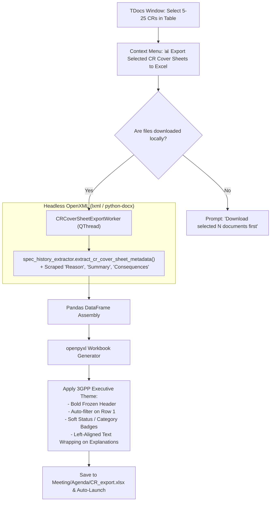

# F-02: Batch CR Cover Sheet Parser & Tabular Excel Exporter

> [!NOTE]
> **Status:** 🟡 **Low Priority / Backlog (Niche & Largely Superseded)**  
> **Evaluation Outcome:** While conceptually attractive, a full batch CR cover sheet parser has severe practical limitations (network download bottlenecks on meeting Wi-Fi, template variations in pCRs) and has been largely superseded by in-app 60 FPS filtering, local **AI TDoc Triage** (`tdoc_triage_worker.py`), and headless OpenXML clause attribution in [`spec_history_extractor.py`](file:///c:/Users/colomikunoj/OneDrive%20-%20T-Mobile%20Austria%20GmbH/Coding%20Projects/3gpp-meeting-tools/3GPP%20Tools/src/modules/specifications/core/spec_history_extractor.py). If implemented in the future, it should strictly be scoped as a lightweight context-menu export for *locally downloaded* selected CRs.

---

## 1. Executive Summary & Objective

In 3GPP Working Groups and Plenaries, a single meeting frequently handles between 500 and 2,500 Change Requests (CRs). A Change Request is submitted as a Microsoft Word document (`.docx` or legacy `.doc`) structured with a standardized front cover sheet followed by revision-marked text.

The cover sheet contains critical normative metadata:
* **Target Specification:** (e.g. `TS 23.501`)
* **CR Number & Revision:** (e.g. `CR 1245 rev 2`)
* **Category:** (`F` - Correction, `A` - Corresp. to earlier release, `B` - Addition of feature, `C` - Functional modification, `D` - Editorial)
* **Release:** (e.g. `Rel-18`, `Rel-19`)
* **Work Item Code:** (e.g. `FS_eSBA`, `5G_URLLC`)
* **Reason for Change:** High-level problem statement.
* **Summary of Change:** Technical resolution and architecture impacts.
* **Consequences if not approved:** Operational risks and specification ambiguities.
* **Clauses affected:** (e.g. `5.2.3, 6.4.1, Table 8.2-1`)

Historically, in the legacy **3GPP Meeting Helper** (commit `c2c9e97`), an `Export CRs` button was added to batch-extract these fields into an Excel workbook (`CR_export.xlsx`) to avoid manually opening dozens of Word documents.

---

## 2. Strategic Use Cases & Reality Check: Do We Even Need This?

A thorough workflow and business value re-evaluation reveals that while there are legitimate theoretical use cases, they represent niche requirements rather than daily necessities for active 3GPP delegates.

### 2.1. Valid Use Cases (When is this actually useful?)
1. **Delegation Coordination & Sharing with Non-Delegates (Offline Review Matrix):**
   * *Scenario:* A corporate delegation (e.g. T-Mobile / Deutsche Telekom) needs to review all 30–50 CRs submitted under a specific Agenda Item or Work Item with subject-matter experts, patent/IP attorneys, or engineering managers back home who **do not use 3GPP Tools**.
   * *Utility:* An exported Excel spreadsheet containing `Reason for Change`, `Summary of Change`, and `Clauses Affected` allows external colleagues to read the core issues quickly and add review columns (*"Company Stance: Support / Object"*, *"Assigned Reviewer"*, *"Internal Comments"*).
2. **Clause Collision Detection (Rapporteurs & Delegates):**
   * *Scenario:* Ten competing companies submit CRs targeting the same specification (e.g. `TS 23.501`).
   * *Utility:* Seeing a consolidated column of `Clauses Affected` allows a delegate or session chair to quickly spot if Company A and Company B both attempt to rewrite clause `5.2.8.2`, forecasting a drafting clash before the agenda item is called.
3. **Plenary Package Verification (Work Item Rapporteurs):**
   * *Scenario:* Rapporteurs compiling formal CR packs for TSG Plenary approval must verify that all agreed CRs have valid categories, releases, and non-empty reasons for change.

### 2.2. Critical Counterarguments & Practical Limitations (Why you probably do NOT need it)
1. **The Massive Download & Bandwidth Bottleneck:**
   * In order to parse the cover sheets of 200–1,000 CRs, the application **must first download every single `.zip` file from the 3GPP FTP server**.
   * On hotel or convention center Wi-Fi (where 3GPP meetings take place), downloading 1–2 GB of ZIP archives just to scrape page 1 of each document is sluggish, prone to network drops/throttling, and clutters local disk storage.
2. **Superseded by Local AI TDoc Triage:**
   * In 2022, LLMs were not integrated into 3GPP tools. In modern **3GPP Tools**, the model-agnostic **AI TDoc Triage dialog** ([`tdoc_triage_worker.py`](file:///c:/Users/colomikunoj/OneDrive%20-%20T-Mobile%20Austria%20GmbH/Coding%20Projects/3gpp-meeting-tools/3GPP%20Tools/src/modules/meetings/core/tdoc_triage_worker.py)) directly ingests the document preamble (cover table) and tracked revisions, providing instant on-demand technical critiques, problem summaries, and voting stance suggestions without needing static spreadsheets.
3. **Existing Headless OpenXML Parsing in Core:**
   * The codebase already contains high-speed OpenXML cover-sheet extraction in [`spec_history_extractor.py`](file:///c:/Users/colomikunoj/OneDrive%20-%20T-Mobile%20Austria%20GmbH/Coding%20Projects/3gpp-meeting-tools/3GPP%20Tools/src/modules/specifications/core/spec_history_extractor.py#L136-L267) (`extract_cr_cover_sheet_metadata`), extracting `affected_clauses`, `category`, `cr_number`, `spec_number`, and `work_item` headless via `lxml` for the **Specification History** dialog and clause attribution.
4. **In-App 60 FPS Search & Filtering:**
   * Modern PyQt5 filter models allow instant multi-faceted filtering (by Agenda Item, Work Item, Status, Type, and text) directly in the UI, eliminating the need to leave the application to browse in Microsoft Excel.
5. **Incomplete Coverage on Discussion Papers & pCRs:**
   * In early study item phases or ad-hoc drafting sessions, contributions are frequently submitted as Discussion Papers with embedded pseudo-CRs (pCRs) or changes to Technical Reports (TRs) that lack formal standardized cover sheet tables, producing blank or corrupted rows.

---

## 3. Recommended Architectural Scoping (If Ever Implemented)

If this functionality is retained for future implementation, it should **NOT** be built as an ambitious, meeting-wide batch downloader. Instead, it should be strictly scoped as:

> **Lightweight On-Demand Export for Selected Documents:**
> * Surface via Context Menu: `Right-Click Selected TDoc(s) > 📊 Export Selected CR Cover Sheets to Excel`
> * Operate **only on locally downloaded / cached `.docx` files** (typically 5 to 25 documents).
> * Reuse the existing [`spec_history_extractor.py`](file:///c:/Users/colomikunoj/OneDrive%20-%20T-Mobile%20Austria%20GmbH/Coding%20Projects/3gpp-meeting-tools/3GPP%20Tools/src/modules/specifications/core/spec_history_extractor.py) OpenXML engine, extending it with text extraction for Reason, Summary, and Consequences.

---

## 2. Legacy Codebase Analysis

### Files & Locations
* `3GPP Meeting Helper/parsing/word/pywin32.py` (functions: `parse_cr`, `parse_list_of_crs`, `CrMetadata`, `CrCategory`)
* `3GPP Meeting Helper/gui/tdocs_table.py` (function: `export_crs`)

### Data Structures & Legacy Extraction Logic

#### Legacy Data Model (`parsing/word/pywin32.py`)
```python
class CrCategory(Enum):
    F = 1  # Correction
    A = 2  # Corresponds to a correction in an earlier release
    B = 3  # Addition of feature
    C = 4  # Functional modification of feature
    D = 5  # Editorial modification

class CrMetadata(NamedTuple):
    spec: str
    cr: str
    rev: str
    current_version: str
    new_version: str
    category: CrCategory
    release: str
    work_item: str
    clauses_affected: str
    reason_for_change: str
    summary_of_change: str
    consequences_if_not_approved: str
    path: str
    ai: str
    tdoc: str
```

#### Table Cell Matrix Parsing (`parse_cr`)
The legacy implementation used Word COM (`win32com.client.Dispatch("Word.Application")`) to inspect the first table in the CR document:
1. **Spec Number:** Cell `(1, 1)` -> Text like `"23.501"` (stripped of `"TS"` / `"TR"` prefixes).
2. **CR Number:** Cell `(1, 3)` -> e.g. `"1420"`.
3. **Revision:** Cell `(1, 5)` -> e.g. `"1"` or `"-"`.
4. **Category Checkboxes:** Cell `(5, 1)` contained checkboxes `F | A | B | C | D`. It checked for `'X'` characters inside the respective box cells.
5. **Release Checkboxes:** Checked row 6 for `'X'` in release columns (Rel-15 through Rel-20).
6. **Descriptive Text Blocks:** Scanned succeeding rows for cell labels matching `"Reason for change:"`, `"Summary of change:"`, `"Consequences if not approved:"`, and `"Clauses affected:"`, extracting the adjacent or nested text blocks.

#### Excel Generation & Formatting (`gui/tdocs_table.py`)
```python
crs_df = parse_list_of_crs(file_path_list)
crs_df = crs_df.set_index('TDoc')
crs_df.to_excel(excel_export_filename, sheet_name="CRs", engine='xlsxwriter')

wb = open_excel_document(excel_export_filename)
set_first_row_as_filter(wb)
vertically_center_all_text(wb)
set_wrap_text(wb)
set_column_width('A', wb, 11)  # TDoc
set_column_width('B', wb, 9)   # Spec
set_column_width('C', wb, 9)   # CR#
set_column_width('F', wb, 20)  # WI
set_column_width('I', wb, 50)  # Reason for Change
```

### Bottlenecks of Legacy Implementation
* **Heavy Word COM Dependency:** Required launching Microsoft Word in the background for every single file. Parsing 50 CRs took 2–3 minutes and occasionally hung if Word displayed a security alert or macro prompt.
* **Single-Threaded COM Apartment:** Word COM could not be easily multi-threaded without complex COM marshaling (`pythoncom.CoInitialize()`).
* **Table Coordinate Fragility:** Relied on fixed row/column indices which occasionally failed on non-standard rapporteur CR templates or older meeting files.

---

## 4. Legacy Codebase Analysis

### Files & Locations
* `3GPP Meeting Helper/parsing/word/pywin32.py` (functions: `parse_cr`, `parse_list_of_crs`, `CrMetadata`, `CrCategory`)
* `3GPP Meeting Helper/gui/tdocs_table.py` (function: `export_crs`)

### Data Structures & Legacy Extraction Logic

#### Legacy Data Model (`parsing/word/pywin32.py`)
```python
class CrCategory(Enum):
    F = 1  # Correction
    A = 2  # Corresponds to a correction in an earlier release
    B = 3  # Addition of feature
    C = 4  # Functional modification of feature
    D = 5  # Editorial modification

class CrMetadata(NamedTuple):
    spec: str
    cr: str
    rev: str
    current_version: str
    new_version: str
    category: CrCategory
    release: str
    work_item: str
    clauses_affected: str
    reason_for_change: str
    summary_of_change: str
    consequences_if_not_approved: str
    path: str
    ai: str
    tdoc: str
```

#### Table Cell Matrix Parsing (`parse_cr`)
The legacy implementation used Word COM (`win32com.client.Dispatch("Word.Application")`) to inspect the first table in the CR document:
1. **Spec Number:** Cell `(1, 1)` -> Text like `"23.501"` (stripped of `"TS"` / `"TR"` prefixes).
2. **CR Number:** Cell `(1, 3)` -> e.g. `"1420"`.
3. **Revision:** Cell `(1, 5)` -> e.g. `"1"` or `"-"`.
4. **Category Checkboxes:** Cell `(5, 1)` contained checkboxes `F | A | B | C | D`. It checked for `'X'` characters inside the respective box cells.
5. **Release Checkboxes:** Checked row 6 for `'X'` in release columns (Rel-15 through Rel-20).
6. **Descriptive Text Blocks:** Scanned succeeding rows for cell labels matching `"Reason for change:"`, `"Summary of change:"`, `"Consequences if not approved:"`, and `"Clauses affected:"`, extracting the adjacent or nested text blocks.

#### Excel Generation & Formatting (`gui/tdocs_table.py`)
```python
crs_df = parse_list_of_crs(file_path_list)
crs_df = crs_df.set_index('TDoc')
crs_df.to_excel(excel_export_filename, sheet_name="CRs", engine='xlsxwriter')

wb = open_excel_document(excel_export_filename)
set_first_row_as_filter(wb)
vertically_center_all_text(wb)
set_wrap_text(wb)
set_column_width('A', wb, 11)  # TDoc
set_column_width('B', wb, 9)   # Spec
set_column_width('C', wb, 9)   # CR#
set_column_width('F', wb, 20)  # WI
set_column_width('I', wb, 50)  # Reason for Change
```

### Bottlenecks of Legacy Implementation
* **Heavy Word COM Dependency:** Required launching Microsoft Word in the background for every single file. Parsing 50 CRs took 2–3 minutes and occasionally hung if Word displayed a security alert or macro prompt.
* **Single-Threaded COM Apartment:** Word COM could not be easily multi-threaded without complex COM marshaling (`pythoncom.CoInitialize()`).
* **Table Coordinate Fragility:** Relied on fixed row/column indices which occasionally failed on non-standard rapporteur CR templates or older meeting files.

---

## 5. Current State & Existing Infrastructure in 3GPP Tools

* **AI TDoc Triage:** [`tdoc_triage_worker.py`](file:///c:/Users/colomikunoj/OneDrive%20-%20T-Mobile%20Austria%20GmbH/Coding%20Projects/3gpp-meeting-tools/3GPP%20Tools/src/modules/meetings/core/tdoc_triage_worker.py) extracts preamble cover sheet text and tracked revisions from `.docx` files via `python-docx` for Ollama prompting.
* **Existing Headless Cover Sheet Parser:** [`spec_history_extractor.py`](file:///c:/Users/colomikunoj/OneDrive%20-%20T-Mobile%20Austria%20GmbH/Coding%20Projects/3gpp-meeting-tools/3GPP%20Tools/src/modules/specifications/core/spec_history_extractor.py#L136-L267) (`extract_cr_cover_sheet_metadata`) already implements ultra-fast, headless OpenXML (`lxml`) extraction of `affected_clauses`, `category`, `cr_number`, `spec_number`, and `work_item` (<0.05s per document).
* **Document Resolution:** [`tdoc_file_handler.py`](file:///c:/Users/colomikunoj/OneDrive%20-%20T-Mobile%20Austria%20GmbH/Coding%20Projects/3gpp-meeting-tools/3GPP%20Tools/src/modules/meetings/core/tdoc_file_handler.py) provides high-speed, parallel pre-download and unzipping of meeting contributions.

---

## 6. Lightweight Architecture Specification (For Future / Optional Implementation)

Instead of a heavy meeting-wide downloader, any future implementation should be scoped as a lightweight, on-demand context-menu action operating exclusively on **locally downloaded** CRs:



---

## 7. Status & Implementation Decision

* **Priority:** 🟡 **Low / Backlog (Optional)**.
* **Decision:** Deferred indefinitely unless delegate feedback specifically requests structured Excel matrices for corporate sharing. Daily triage and specification clause correlation needs are already fully satisfied by the in-app AI triage and Spec Search subsystems.
