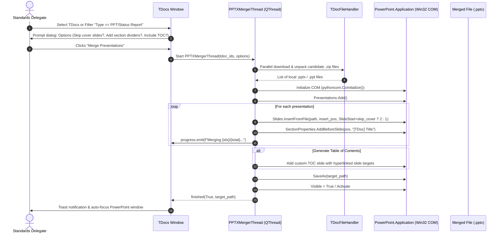

# F-03: PowerPoint Status Report & Presentation Merger (🔴 Deprecated & Abandoned)

> [!CAUTION] Status: Deprecated & Abandoned (No Practical Workflow Need)
> Following technical evaluation and standards delegate workflow review, this feature has been formally **abandoned and deprecated**.
>
> **Key Reasons for Deprecation:**
> 1. **Standards Contribution Reality (>98% Word Documents):** In 3GPP technical Working Groups (SA2, SA3, RAN1, RAN2, CT1, etc.), contributions are virtually 100% Word (`.docx`) Change Requests and Discussion Papers. PowerPoint TDocs are practically non-existent.
> 2. **Plenary Workflow Mismatch & Monolithic Bloat:** Even in TSG Plenaries (SA, RAN, CT), delegates follow presentations item-by-item as each WG chair speaks on their assigned agenda item. Merging 12–15 slide decks creates an unwieldy 500-to-1,000 slide monolith that is clunky to navigate, slow to render, and prone to PowerPoint hangs compared to opening target presentations on demand in ~1s via the in-app `⚡ TDoc:` jump box.
> 3. **Template, Aspect Ratio & Visual Corruption:** Different Working Group chairs and MCC officials use conflicting slide master templates, custom color palettes, and aspect ratios (16:9 widescreen vs. legacy 4:3). When merged via PowerPoint COM `InsertFromFile`, slides get distorted or black-barred, and conflicting master slides overwrite each other, corrupting logos, headers, and bullet formatting.
> 4. **Arbitrary "Skip First Slide" Data Loss:** The legacy script hardcoded `SlideStart=2` assuming slide 1 is always an uninformative title slide. In actual practice, many 3GPP status decks include critical approval recommendations or executive summaries on slide 1 or 2, causing silent loss of crucial information.
> 5. **Corporate Debrief Workflow Mismatch:** When delegates assemble internal company debriefs (e.g. for T-Mobile or Deutsche Telekom), they cherry-pick 1 or 2 summary slides or figures into their own corporate-branded presentation template; dumping 500 raw external slides into an unbranded deck provides zero value.
> 6. **Superior Modern Alternatives:** For reading/annotating offline or on tablets (iPad / reMarkable / flights), [F-04 (Bookmarked PDF Dossier)](F04_bookmarked_pdf_dossier_llm_prompt.md) provides 100% visual fidelity, table of contents bookmarks, and cross-platform reading without COM corruption. For sequence diagrams in presentations, 3GPP Tools already provides `powerpoint_converter.py` to append PlantUML call-flow diagrams directly as native Office vector shapes into open decks.

## 1. Executive Summary & Objective

In 3GPP TSG Plenaries (SA, RAN, CT) and Working Groups, delegates must digest dozens of status report presentations, study item wrap-ups, and liaison slide sets submitted as Microsoft PowerPoint presentations (`.pptx` or `.ppt`). 

During plenary sessions, reviewing 30 to 50 individual presentations is cumbersome and inefficient:
* Each presentation must be separately downloaded, unzipped, and opened in a new PowerPoint window.
* Delegates lose their place across tens of open PowerPoint application windows.
* Each slide deck contains a redundant title/cover slide and end slide that clutters presentation reviews.

The objective of **F-03** is to provide a 1-click PowerPoint merging engine that filters the meeting TDoc list for all PowerPoint contributions (or takes user-selected presentations), downloads and unzips them, strips redundant cover slides, and compiles them into a single consolidated master presentation (`Status_Report_Merged.pptx`) organized with labeled PowerPoint section headers (`SectionProperties.AddBeforeSlide`) named after each TDoc ID and title.

---

## 2. Legacy Codebase Analysis

### Files & Locations
* `3GPP Meeting Helper/application/powerpoint.py` (functions: `get_powerpoint`, `new_presentation`, `merge_presentations`)
* `3GPP Meeting Helper/gui/tdocs_table.py` (method: `merge_pptx_files`)

### Legacy Implementation Details

```python
# application/powerpoint.py
def merge_presentations(list_of_ppts, list_of_section_labels=None, headlines_for_toc=None):
    try:
        new_slideset = new_presentation()
        slides = new_slideset.Slides
        section_properties = new_slideset.SectionProperties
        inserts = []
        for idx, slideset_path in enumerate(list_of_ppts):
            file_name = os.path.splitext(slideset_path)[0]
            insert_position = slides.Count

            # Skip first slide (cover slide) by setting SlideStart=2
            slides.InsertFromFile(slideset_path, insert_position, SlideStart=2)

            if list_of_section_labels is not None:
                section_name = '{0}, {1}'.format(list_of_section_labels[idx], headlines_for_toc[idx])
                section_properties.AddBeforeSlide(insert_position + 1, section_name)

            inserts.append((insert_position + 1, section_name))

        print('Merged {0} slidesets'.format(len(inserts)))
    except Exception as e:
        print(f'Could not merge presentations: {e}')
```

#### Meeting TDocs UI Trigger (`gui/tdocs_table.py`)
```python
def merge_pptx_files(self, *args):
    tdoc_list_to_merge = list(self.current_tdocs.index)
    all_extracted_files = []
    all_titles = []
    for tdoc_id in tdoc_list_to_merge:
        extracted_files = self.download_and_open_tdoc(tdoc_id, skip_opening=True)
        if extracted_files is not None:
            all_extracted_files.extend(extracted_files)
            all_titles.append(self.current_tdocs.at[tdoc_id, 'Title'])

    # Filter only PowerPoint files
    all_extracted_files = [e for e in all_extracted_files if '.ppt' in e.lower()]
    powerpoint.merge_presentations(
        all_extracted_files,
        list_of_section_labels=tdoc_list_to_merge,
        headlines_for_toc=all_titles)
```

### Strengths & Limitations of Legacy Implementation
* **Strengths:** 
  * Native PowerPoint COM preserves vector graphics, animations, embedded objects, and slide layouts without formatting loss.
  * Section dividers allowed delegates to jump between reports using PowerPoint's built-in Slide Sorter and Navigation pane.
* **Limitations:**
  * Synchronous execution on the main UI thread froze Tkinter during downloads and COM merges.
  * Required PowerPoint desktop installation on Windows.
  * Did not handle `.ppt` legacy files that required conversion before insertion.

---

## 3. Current State in 3GPP Tools

* **PlantUML to Visio/PowerPoint:** `src/modules/puml2visio/` has extensive Office shape export for PlantUML diagrams.
* **Missing Feature:** There is no tool or menu action in `src/modules/meetings/` to merge multiple downloaded presentation slide decks into one master deck.

---

## 4. Modern Architecture & Design Specification

### Architectural Flow



### Proposed Component Details

#### 1. Background Worker (`src/modules/meetings/core/pptx_merger.py`)
```python
from PyQt5.QtCore import QThread, pyqtSignal
from pathlib import Path
import platform
import logging

class PPTXMergerThread(QThread):
    progress = pyqtSignal(str)
    finished = pyqtSignal(bool, str)

    def __init__(self, items: list, output_path: Path, skip_cover: bool = True, parent=None):
        super().__init__(parent)
        self.items = items  # list of tuples: (tdoc_id, title, file_path)
        self.output_path = output_path
        self.skip_cover = skip_cover

    def run(self):
        if platform.system() != 'Windows':
            self.finished.emit(False, "PowerPoint merging requires Windows and Microsoft Office.")
            return

        import pythoncom
        import win32com.client

        pythoncom.CoInitialize()
        try:
            ppt = win32com.client.Dispatch("PowerPoint.Application")
            ppt.Visible = True
            presentation = ppt.Presentations.Add()
            slides = presentation.Slides
            section_props = presentation.SectionProperties

            total = len(self.items)
            for idx, (tdoc_id, title, file_path) in enumerate(self.items, 1):
                if self.isInterruptionRequested():
                    return
                self.progress.emit(f"Adding ({idx}/{total}) {tdoc_id}...")
                insert_pos = slides.Count
                start_slide = 2 if self.skip_cover else 1
                
                # Insert slides
                slides.InsertFromFile(str(file_path), insert_pos, SlideStart=start_slide)
                
                # Add section title
                clean_title = (title[:60] + "...") if len(title) > 60 else title
                sec_name = f"{tdoc_id} · {clean_title}"
                section_props.AddBeforeSlide(insert_pos + 1, sec_name)

            presentation.SaveAs(str(self.output_path))
            self.finished.emit(True, str(self.output_path))
        except Exception as e:
            logging.error(f"Failed to merge presentations: {e}", exc_info=True)
            self.finished.emit(False, str(e))
        finally:
            pythoncom.CoUninitialize()
```

#### 2. UI Entry Points
* **TDocs Window Action Menu:** `📊 Reports ▾` -> `"Merge PowerPoint Presentations..."`
* **Selection Context Menu:** Right-click selected rows -> `"Merge Selected Presentations into One Deck"`

---

## 5. Architectural Verdict & Deprecation Status

* **Status:** 🔴 **Deprecated & Abandoned (Not Recommended for Porting)**
* **Decision Rationale:** The combination of near-zero occurrence of PowerPoint documents in Working Groups (<2%), layout and master-slide corruption during COM imports, meeting workflow friction from 600+ slide decks, and the availability of superior solutions (F-04 PDF Dossiers for reading, native PowerPoint "Reuse Slides" for debriefs, and `powerpoint_converter.py` for call-flow diagrams) makes F-03 unnecessary.
* **Archival Notice:** The reference code above is preserved solely for historical documentation of the legacy `3GPP Meeting Helper` feature set. No engineering resources will be allocated to porting this feature.
