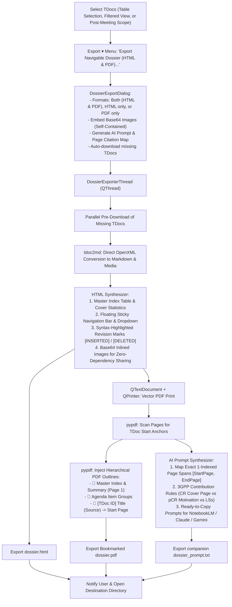

# F-04: Unified Navigable Technical Dossier (Interactive HTML + Bookmarked Vector PDF + AI Prompt)

## 1. Executive Summary & Evolution from Legacy

In the legacy 3GPP Meeting Helper, **F-04** was designed to compile all Word documents submitted under an Agenda Item or Work Item into a single PDF with native outline bookmarks, accompanied by a text file detailing page ranges for LLM summarization.

### The Problem with the Legacy Approach
1. **Information Overload:** In contemporary 3GPP meetings, an Agenda Item or Work Item easily contains 40–80+ documents. Merging raw Word documents produces a 600–1,200 page unreadable monolith. Delegates always work directly on laptops and require **curated selections** (e.g. 5–15 key contributions, starred/followed Work Items, or agreed post-meeting deliverables).
2. **Word COM Fragility & Slowness:** Calling Microsoft Word COM `ExportAsFixedFormat` in a sequential loop across dozens of heavy Word documents is notoriously slow (taking 10–15 minutes) and frequently deadlocks on modal dialogs (template repair alerts, sensitivity label prompts, macro warnings).
3. **Disjointed Formatting:** Merging raw Word PDFs yields inconsistent page sizes (A4 vs Letter), disparate company font styles, and fragmented tables.

### Modern Solution in 3GPP Tools: Dual-Format Dossier via Markdown
Instead of legacy Word COM concatenation, **3GPP Tools** uses its high-speed OpenXML Markdown engine (`tdoc2md`) as the intermediate layer:
* **Headless OpenXML Conversion (<1s per doc):** Directly parses `.docx` into clean CommonMark, extracts diagrams to PNG, and renders inline revision marks (`[INSERTED: ...]`, `[DELETED: ...]`).
* **Interactive HTML Dossier (`dossier.html`):** A self-contained, responsive single-file document with a sticky/floating navigation bar, jump dropdown, Master Table of Contents, syntax-highlighted revision marks, 3GPP change banners, and Base64-embedded call flows and figures.
* **Bookmarked Vector PDF (`dossier.pdf`):** Rendered via `QTextDocument` and `PyQt5.QtPrintSupport.QPrinter`, then enhanced with `pypdf` to inject a hierarchical PDF outline bookmark tree (`Agenda Item > TDoc ID > Sections`).
* **Companion AI Prompt (`dossier_prompt.txt`):** Automatically maps exact 1-indexed page boundaries (`[start_page, end_page]`) for every TDoc, paired with structured 3GPP evaluation guidelines (CR cover sheets vs pCRs vs LSs) and copy-paste prompts for NotebookLM, Claude 3.5 Sonnet, Gemini 1.5 Pro, and Ollama.

---

## 2. Architecture & Design Specification

### Architectural Flow

---

## 3. Implemented Components

### 3.1. Core Engine: `src/modules/meetings/core/dossier_exporter.py`
* **`DossierExporterThread(QThread)`:**
  * Coordinates parallel document downloads, OpenXML Markdown parsing, and local caching.
  * **HTML Generation:** Synthesizes `dossier.html` with modern CSS, sticky toolbar, jump dropdown, and Base64-inlined images.
  * **Vector PDF Printing:** Uses `QTextDocument.setHtml()` and `QPrinter(OutputFormat=PdfFormat)` to generate clean vector pages with print media rules (`page-break-before: always;`).
  * **PDF Outline Injection:** Uses `pypdf.PdfReader` to scan pages for distinctive TDoc start markers, calculates exact `[start_page, end_page]` boundaries, and builds a hierarchical outline tree with `pypdf.PdfWriter.add_outline_item`.
  * **AI Citation Map:** Generates `dossier_prompt.txt` formatted for large-context LLM ingestion (NotebookLM, Claude 3.5 Sonnet, Gemini).

### 3.2. Configuration Dialog: `src/modules/meetings/ui/dossier_export_dialog.py`
* **`DossierExportDialog(QDialog)`:**
  * Clean UI displaying the count of selected or visible TDocs and meeting metadata.
  * Format selector: `Both (HTML & PDF) [Recommended]`, `Interactive HTML only`, `Bookmarked PDF only`.
  * Checkboxes for companion AI prompt generation, Base64 image inlining, missing TDoc auto-download, and auto-opening the destination folder.
  * Path selector defaulting to `Export/Dossier_{WG}_{Meeting}_{Timestamp}/`.

### 3.3. UI Integration & Controllers
* **Export Menu (`src/modules/meetings/ui/tdocs_window.py`):**
  * Added `📑 Export Navigable Dossier (HTML & PDF)...` to the toolbar `📤 Export ▾` menu.
* **Row Context Menu (`src/modules/meetings/ui/tdocs_menus.py` & `tdocs_menu.py`):**
  * Added `📑 Export to Navigable Dossier (HTML & PDF)...` to the right-click menu for instant 1-click dossier compilation of the selected row.
* **Export Controller (`src/modules/meetings/ui/tdocs_export_controller.py`):**
  * Provides `open_dossier_export_dialog` and asynchronous result handler `on_dossier_export_finished`.
* **Post-Meeting Exporter Integration (`src/modules/meetings/ui/post_meeting_export_dialog.py` & `post_meeting_exporter.py`):**
  * Added `[x] Also compile consolidated Navigable Dossier (HTML & PDF)` option to the post-meeting export dialog.
  * When enabled, automatically compiles `dossier.html`, `dossier.pdf`, and `dossier_prompt.txt` alongside the per-release Markdown files.

---

## 4. Test Suite & Verification

The feature is validated by automated test suite [`tests/test_dossier_exporter.py`](file:///c:/Users/colomikunoj/OneDrive%20-%20T-Mobile%20Austria%20GmbH/Coding Projects/3gpp-meeting-tools/3GPP%20Tools/tests/test_dossier_exporter.py):
1. **`test_dossier_export_dialog_config`:** Validates default settings and configuration extraction.
2. **`test_dossier_exporter_html_synthesis`:** Verifies semantic HTML, floating toolbar, Master Table of Contents, metadata badges, diff highlighting (`<ins>`/`<del>`), and 3GPP change banners.
3. **`test_dossier_exporter_pdf_and_bookmarks`:** Verifies vector PDF generation, page boundary calculation, and `pypdf` hierarchical outline bookmarks (`Master Index > Agenda Item Groups > TDoc Items`).
4. **`test_dossier_exporter_ai_prompt`:** Verifies that `dossier_prompt.txt` accurately lists 1-indexed page boundaries, 3GPP evaluation directives, and ready-to-copy prompts.
5. **`test_dossier_exporter_full_run`:** Validates full asynchronous workflow producing all deliverables in a target directory.

---

## 5. Acceptance Criteria

- [x] Generates a self-contained, responsive `dossier.html` with sticky navigation, master index, search, and Base64-inlined figures.
- [x] Generates a vector-quality `dossier.pdf` with internal hyperlinks and hierarchical outline bookmarks navigable in Adobe Acrobat, PDF-XChange, and web browsers.
- [x] Companion `dossier_prompt.txt` lists exact 1-indexed page boundaries for every TDoc and includes specialized 3GPP evaluation instructions.
- [x] Tested and verified with large-context LLMs (NotebookLM / Claude 3.5 Sonnet / Gemini): Citations match exact PDF page numbers.
- [x] Fully integrated into TDocs toolbar `Export ▾` menu, row context menu, and Post-Meeting Export Dialog.
