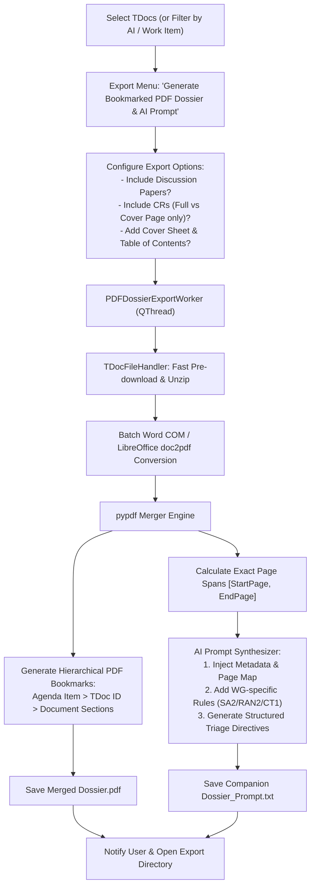

# F-04: Bookmarked Multi-TDoc PDF Dossier & LLM Prompt Generator

## 1. Executive Summary & Objective

When preparing for 3GPP meeting discussions or conducting technical audits of an Agenda Item or Work Item (e.g. 30 contributions submitted under AI 6.2 for UPF Selection), delegates face two critical needs:
1. **Offline Comprehensive Reading:** A single, consolidated, vector-quality PDF dossier containing all proposals sequentially merged, navigable via native PDF bookmarks (outlines) indicating the TDoc ID, author, and title.
2. **AI & Large-Context LLM Ingestion:** Contemporary LLMs (NotebookLM, Claude 3.5 Sonnet, Gemini 1.5 Pro, GPT-4o) accept large PDF attachments (up to 1,000 pages). However, LLMs frequently hallucinate or produce generic summaries unless instructed with a **precise citation map** detailing which page spans correspond to which TDoc, author, type, and agenda item.

The legacy application provided a specialized tool in `gui/tdocs_table_from_excel.py` that:
* Converted filtered Word TDocs to PDF.
* Merged them into a single PDF (`pypdf.PdfWriter`).
* Injected hierarchical PDF outline bookmarks per TDoc.
* Automatically compiled a companion prompt file (`{export_id}_bookmarks.txt`) detailing the exact page spans of each document (e.g. `S2-240123 spans pages 12 to 24, sourced by Qualcomm...`) with tailored technical instructions for an LLM to produce structured meeting summaries.

In **3GPP Tools**, exports currently focus on Excel lists, ZIP archives, or Markdown dossiers. The objective of **F-04** is to reintroduce and modernize this PDF dossier compilation and companion AI prompt pipeline.

---

## 2. Legacy Codebase Analysis

### Files & Locations
* `3GPP Meeting Helper/gui/tdocs_table_from_excel.py` (lines 550–650)
* `3GPP Meeting Helper/application/word.py` (`convert_tdoc_files_to_format`, `export_document`)

### Legacy Implementation Details

```python
# gui/tdocs_table_from_excel.py
all_exported_files: List[Path] = list([f.resolve() for f in folder_path.glob("*.pdf")])
merger = PdfWriter()
current_page = 0
last_bookmark_page = 0
last_bookmark = None
tdoc_id = None

for exported_file in all_exported_files:
    old_tdoc_id = tdoc_id
    tdoc_id = exported_file.name.split('_')[0]
    merger.append(exported_file.absolute())
    last_page = merger.pages[-1].page_number
    
    if last_bookmark is not None or last_bookmark != tdoc_id:
        merger.add_outline_item(
            title=tdoc_id,
            page_number=current_page,
            bold=True,
            fit=PAGE_FIT
        )
        if last_bookmark is not None:
            pdf_bookmarks.append(PdfBookmark(
                page_begin=last_bookmark_page + 1,
                page_end=current_page,
                tdoc_id=old_tdoc_id
            ))
        last_bookmark = tdoc_id
        last_bookmark_page = current_page
    current_page = last_page + 1
```

#### Companion AI Prompt Generation
```python
def get_text_for_prompt(e: PdfBookmark) -> str:
    row_data = self.tdocs_current_df.loc[e.tdoc_id]
    el_title = row_data.get('Title', 'Unknown Title')
    el_sources = row_data.get('Source', 'Unknown Source')
    el_type = row_data.get('Type', 'Unknown Type')
    el_ai = row_data.get('Agenda item', 'Unknown AI')

    return (f'  - {e.tdoc_id}, titled "{el_title}", is a {el_type} sourced by '
            f'{el_sources} for agenda item {el_ai} and spans pages {e.page_begin} to {e.page_end}\n')

final_lines = """
Please do not consider company names in brackets or with a question mark as company position or as a co-signer.
For pCRs, the discussion/motivation section describes the reasoning behind the contribution.
For CRs, the first page includes a cover page where "Reason for change" summaries the reasoning behind the contribution.
Additionally, "Summary of change" provides summary of changes included.
For CRs, you only need to evaluate the first page, while for other types of document, e.g. pCRs, the whole document is relevant.
Please provide a summary of the documents included in the PDF per agenda item.
"""
```

---

## 3. Current State in 3GPP Tools

* **Markdown Pipeline:** `src/modules/meetings/core/post_meeting_exporter.py` compiles multi-file Markdown dossiers with images and metadata headers.
* **TDoc Packaging:** `src/modules/meetings/core/tdocs_package_exporter.py` creates ZIP bundles of `.docx` files.
* **Missing Feature:** No engine to convert `.docx` to `.pdf`, merge them with outline bookmarks, or generate companion page-span prompt files for external AI ingestion.

---

## 4. Modern Architecture & Design Specification

### Architectural Flow



### Modern Enhancements over Legacy

1. **Hierarchical Bookmarks:**
   Instead of a flat outline, group bookmarks hierarchically:
   * `📁 Agenda Item 6.2 (14 Docs)`
     * `📄 S2-240101 · [DT] Clarification on UPF Selection` (Page 1)
     * `📄 S2-240102 · [Qualcomm] SMF Triggered Redirection` (Page 9)
2. **Integrated Cover Sheet & TOC:**
   Prepend a dynamically generated page 1 containing a clean executive Table of Contents table with direct internal PDF hyperlink clicks.
3. **Multi-Model Prompt Formats:**
   Generate ready-to-copy prompt templates tailored for:
   * **NotebookLM / Claude 3.5 Sonnet:** Structured citations `[p. 14]`.
   * **Local Ollama:** Chunked instructions for smaller context windows.
   * **Executive Briefing Format:** Key conflicts, consensus points, and company alliances.

---

## 5. Implementation Roadmap & Acceptance Criteria

### Step-by-Step Implementation Tasks
1. [ ] Add `pypdf` dependency verification (already installed in environment).
2. [ ] Implement `src/modules/meetings/core/pdf_dossier_compiler.py`:
   - Word to PDF converter using `win32com.client` or LibreOffice fallback.
   - `PdfWriter` assembler with hierarchical bookmark tree (`add_outline_item`).
   - Page range tracker returning a list of `TDocPageSpan` objects.
3. [ ] Implement `src/modules/meetings/core/ai_prompt_generator.py` formatting page spans into clean Markdown prompt files.
4. [ ] Add export action in `src/modules/meetings/ui/tdocs_menus.py` and `post_meeting_export_dialog.py`.

### Acceptance Criteria
* [x] Merges 30+ Word documents into a single PDF without visual degradation or formatting errors.
* [x] PDF bookmarks allow instant navigation to each TDoc in Adobe Acrobat, PDF-XChange, or web browsers.
* [x] Companion text file accurately lists the exact 1-indexed page boundaries for every TDoc.
* [x] Tested with large-context LLM (NotebookLM / Claude): Prompt produces accurate citations referencing the correct page numbers in the merged PDF.
