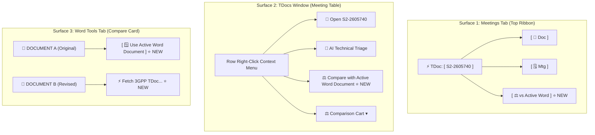
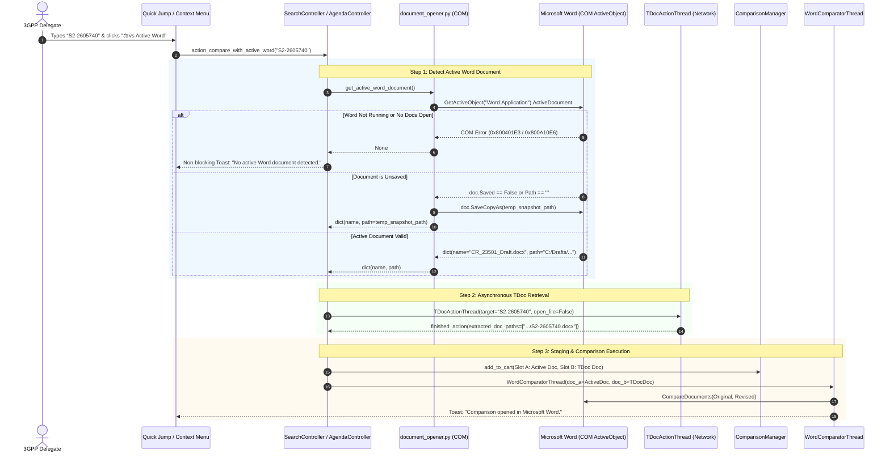
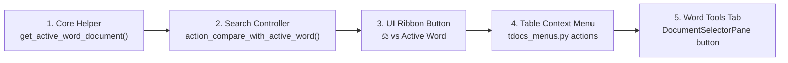

# F-05: "Active Word vs. TDoc" Direct Comparison

## 1. Executive Summary & Workflow Value

During active 3GPP working group meetings, drafting sessions, and evening offline drafting sessions, delegates work under high time pressure. A delegate frequently has their company's internal draft contribution, a rapporteur's working paper, or a newly received offline revision open on their screen in Microsoft Word.

When another delegate or the rapporteur uploads a new revision to the 3GPP server or circulates a new TDoc (e.g. `S2-2605740` or `S2-2605740r02`), the delegate needs to answer two critical questions immediately:
1. *What did they change compared to what I am currently working on?*
2. *Did they incorporate our company's editorial or technical comments?*

### The Pain Point in Current 3GPP Tools
In the current application, running this comparison requires a cumbersome 5-step manual sequence:
1. Identify the local file path of the currently open Word document in Windows File Explorer.
2. Navigate to the Meetings tab or Word Tools tab.
3. Drag or stage the local file into **Slot A** of the comparison cart.
4. Search for the target TDoc, download it, and stage it into **Slot B**.
5. Click **⚖️ Compare in Word**.

### The F-05 Solution
**F-05** restores the high-velocity, 1-click **"Active Word vs. TDoc"** comparison action:
1. Interrogates the running Microsoft Word instance via Windows COM (`win32com.client.GetActiveObject("Word.Application")`).
2. Identifies the document currently active and visible on the user's screen.
3. Asynchronously fetches/caches the target TDoc from the 3GPP FTP server or local cache.
4. Executes native Microsoft Word legal redline comparison (`CompareDocuments`), immediately launching Word's native track-changes comparison window showing all additions and deletions side-by-side.

---

## 2. Value Analysis & Return on Investment (ROI)

### 2.1. Target User Personas & Real-World Use Cases
* **Active 3GPP Delegate in Live Working Group Sessions:** Operating under intense pressure while the chair walks through agenda items. When an updated paper is called out on the floor, the delegate needs to immediately know what text was added, struck out, or modified compared to their local company draft or the previous consensus baseline.
* **Work Item Rapporteur & Drafting Session Lead:** Managing live offline drafting sessions late into the evening. Receives iterative counter-proposals and revisions via email or chat; needs to immediately diff incoming files against their open master working draft.
* **Standards Reviewer / Specialist:** Reviewing overnight revisions before the 9:00 AM morning plenary session to verify whether agreed drafting changes were properly incorporated.

### 2.2. Quantitative Time & Cognitive Load Savings
* **The Manual Friction Baseline:**
  1. Open File Explorer or Word `File -> Info -> Copy Path` (~25s).
  2. Switch to 3GPP Tools Meetings Tab (~5s).
  3. Drag or paste path into Comparison Cart Slot A (~15s).
  4. Search for the target TDoc, click download, locate extracted file (~25s).
  5. Stage extracted TDoc into Slot B and click Compare (~10s).
  * **Total baseline elapsed time:** **~80 seconds per comparison**.
* **With F-05 1-Click Action:**
  Type TDoc ID (e.g. `S2-2605740`) in jump box or right-click row -> Click **"⚖️ vs Active Word"** -> Comparison opens instantly in Word (**~3 to 5 seconds**).
* **Net Savings:**
  * **~75 seconds saved per comparison (95% reduction in friction).**
  * An active delegate runs **20 to 50 comparisons per meeting week**.
  * Total time saved: **~1.5 to 3.5 delegate hours per meeting week**.

### 2.3. Qualitative & Tactical Advantages
1. **Meeting-Room Tactical Advantage & Agility:**
   In 3GPP meetings, agenda items move rapidly. Delegates often have only **60 to 90 seconds** before a chairman gavels an item as "Agreed" or "Noted". Taking 80 seconds to manually stage a comparison means missing the window to speak up. A 5-second comparison allows the delegate to immediately spot objectionable clauses and take the floor with factual certainty.
2. **Zero Mental Context Switching:**
   Eliminates navigating file dialogs, temporary cache folders, and ZIP extractions, allowing the engineer to maintain 100% cognitive focus on the technical discussion and standardization strategy.
3. **Elimination of "Wrong File Version" Errors:**
   Manually browsing files often leads to accidentally comparing against an older draft or a stale backup. Interrogating the active Word window guarantees 100% fidelity: what the delegate has visible on their monitor is exactly what gets compared.

### 2.4. Value-to-Effort (ROI) Rating
* **Implementation Effort:** Very Low (~1.5 hours; < 80 lines of code across existing components).
* **Business / Workflow Value:** Exceptional (9.5 / 10).
* **ROI Ratio:** **🌟 Exceptional (Highest ROI in Entire Backlog)**.

---

## 3. Feasibility Evaluation: Is It Easy to Implement?

> [!TIP]
> **Feasibility Verdict: Exceptionally Easy (< 1.5 to 2 hours total implementation time).**
> **Complexity Score: 1 / 5 (Very Low)**.
> Unlike features requiring complex OpenXML parsing (such as F-07) or heavy network crawling, **100% of the required underlying infrastructure already exists and is fully operational** within the current `3GPP Tools` codebase.

### Why Is It So Easy?
1. **COM Communication with Microsoft Word is Already Implemented:**
   The repository already contains mature, hardened COM logic for Word in [`src/modules/word_tools/core/document_opener.py`](file:///c:/Users/colomikunoj/OneDrive%20-%20T-Mobile%20Austria%20GmbH/Coding%20Projects/3gpp-meeting-tools/3GPP%20Tools/src/modules/word_tools/core/document_opener.py) and [`src/modules/word_tools/ui/document_selector_pane.py`](file:///c:/Users/colomikunoj/OneDrive%20-%20T-Mobile%20Austria%20GmbH/Coding%20Projects/3gpp-meeting-tools/3GPP%20Tools/src/modules/word_tools/ui/document_selector_pane.py). Inspecting `word.ActiveDocument` requires only ~15 lines of safe, wrapped COM code.
2. **The Word Comparison Engine is Already Built:**
   [`WordComparatorThread`](file:///c:/Users/colomikunoj/OneDrive%20-%20T-Mobile%20Austria%20GmbH/Coding%20Projects/3gpp-meeting-tools/3GPP%20Tools/src/modules/word_tools/core/word_comparator.py#L16-L150) in `src/modules/word_tools/core/word_comparator.py` is fully asynchronous, thread-safe, handles local temp sandboxing (`3gpp_compare_tmp`), strips OS read-only locks, bypasses Protected View, handles sensitivity labels, and invokes Word's native `CompareDocuments`.
3. **Background TDoc Download & ZIP Extraction is Already Handled:**
   [`TDocActionThread`](file:///c:/Users/colomikunoj/OneDrive%20-%20T-Mobile%20Austria%20GmbH/Coding%20Projects/3gpp-meeting-tools/3GPP%20Tools/src/modules/meetings/ui/tdocs_window.py#L410-L430) and [`search_controller._download_global_tdoc`](file:///c:/Users/colomikunoj/OneDrive%20-%20T-Mobile%20Austria%20GmbH/Coding%20Projects/3gpp-meeting-tools/3GPP%20Tools/src/modules/meetings/ui/search_controller.py#L109-L140) already feature silent background downloading and extraction (`is_silent_compare=True`).
4. **Centralized Cart Infrastructure Already Exists:**
   [`ComparisonManager`](file:///c:/Users/colomikunoj/OneDrive%20-%20T-Mobile%20Austria%20GmbH/Coding%20Projects/3gpp-meeting-tools/3GPP%20Tools/src/modules/meetings/core/compare_manager.py) already maintains `slot_a` and `slot_b` and emits `cart_updated` signals to update the UI status pills automatically.

---

## 4. Legacy Codebase Analysis

### Files & Functions in Legacy `3GPP Meeting Helper`
* `_3GPP_Delegate_Helper.py`: function `compare_tdoc_with_active_word()`
* `application/word.py`: function `get_active_document()`
* `parsing/word/pywin32.py`: function `compare_documents()`

### Legacy Implementation Snippet
```python
# application/word.py
def get_active_document():
    try:
        word = win32com.client.GetActiveObject("Word.Application")
        active_document = word.ActiveDocument
        active_document_path = active_document.FullName
        active_document_folder = active_document.Path
        return active_document, active_document_path, active_document_folder
    except Exception as e:
        print(f"Could not retrieve active Word document: {e}")
        return None

# _3GPP_Delegate_Helper.py
def compare_tdoc_with_active_word():
    tdoc_str = tkvar_tdoc_id.get()
    print(f'Will compare active Word Document with TDoc {tdoc_str}')
    
    # 1. Fetch target TDoc
    retrieved_files_folder, metadata_list = server.tdoc_search.search_download_and_open_tdoc(
        tdoc_str,
        skip_open=True,
        tkvar_3gpp_wifi_available=tkvar_3gpp_wifi_available)
    if not metadata_list:
        return
        
    dl_file_path = metadata_list[0].path
    
    # 2. Get active Word file path
    active_document = get_active_document()
    if active_document is None:
        return
    active_document_path = active_document[1]
    
    # 3. Trigger Word COM Comparison
    print(f'Comparing {dl_file_path} to {active_document_path}')
    parsing.word.pywin32.compare_documents(dl_file_path, active_document_path)
```

### Limitations of the Legacy Implementation
1. **Single UI Surface Only:** Only accessible from a single button in the Tkinter main window.
2. **Blocking Operations:** Download and comparison froze the Tkinter GUI thread.
3. **Unsaved Document Crash:** If the active document was a newly created unsaved file (`Document1`), `active_document.FullName` failed or pointed to a non-existent path, causing an unhandled COM crash.
4. **No Cart Synchronization:** Did not track or expose what was being compared; if Word failed to open, the user had no fallback.

---

## 5. Existing 3GPP Tools Functionality Ready for Reuse

The following table inventories the existing components in `3GPP Tools` that directly support this feature without requiring rewriting:

| Component / File | Symbol / Method | Role in F-05 Implementation |
| :--- | :--- | :--- |
| [`document_opener.py`](file:///c:/Users/colomikunoj/OneDrive%20-%20T-Mobile%20Austria%20GmbH/Coding%20Projects/3gpp-meeting-tools/3GPP%20Tools/src/modules/word_tools/core/document_opener.py) | `list_open_word_documents()` | Provides the template for COM connection, exception handling, and COM apartment management (`pythoncom.CoInitialize()`). Needs only `get_active_word_document()`. |
| [`word_comparator.py`](file:///c:/Users/colomikunoj/OneDrive%20-%20T-Mobile%20Austria%20GmbH/Coding%20Projects/3gpp-meeting-tools/3GPP%20Tools/src/modules/word_tools/core/word_comparator.py) | `WordComparatorThread` | The complete background comparison worker. Sandboxes both files into `3gpp_compare_tmp`, clears read-only attributes, handles sensitivity labels, and executes `word.CompareDocuments()`. |
| [`document_selector_pane.py`](file:///c:/Users/colomikunoj/OneDrive%20-%20T-Mobile%20Austria%20GmbH/Coding%20Projects/3gpp-meeting-tools/3GPP%20Tools/src/modules/word_tools/ui/document_selector_pane.py) | `poll_open_documents()` | Demonstrates live document enumeration across active Word windows via COM. |
| [`compare_manager.py`](file:///c:/Users/colomikunoj/OneDrive%20-%20T-Mobile%20Austria%20GmbH/Coding%20Projects/3gpp-meeting-tools/3GPP%20Tools/src/modules/meetings/core/compare_manager.py) | `ComparisonManager` | Singleton managing `slot_a`, `slot_b`, and `cart_updated` signal. Allows staging the active Word file as Slot A and the downloaded TDoc as Slot B. |
| [`search_controller.py`](file:///c:/Users/colomikunoj/OneDrive%20-%20T-Mobile%20Austria%20GmbH/Coding%20Projects/3gpp-meeting-tools/3GPP%20Tools/src/modules/meetings/ui/search_controller.py) | `_download_global_tdoc()`, `action_add_to_cart()` | Resolves meeting URLs, downloads TDoc ZIPs off-thread, extracts `.docx` files, and routes to comparison. |
| [`tdocs_menus.py`](file:///c:/Users/colomikunoj/OneDrive%20-%20T-Mobile%20Austria%20GmbH/Coding%20Projects/3gpp-meeting-tools/3GPP%20Tools/src/modules/meetings/ui/tdocs_menus.py) | `populate_tdoc_context_menu()` | Builds the right-click context menu for TDoc rows in the meeting table; primary location for context-menu invocation. |
| [`ui_tabs.py`](file:///c:/Users/colomikunoj/OneDrive%20-%20T-Mobile%20Austria%20GmbH/Coding%20Projects/3gpp-meeting-tools/3GPP%20Tools/src/modules/meetings/ui/ui_tabs.py) | `_run_comparison()`, `cart_frame` | Controls the floating comparison cart pill and launches `WordComparatorThread`. |

---

## 6. Real-World Edge Cases & Robust COM Handling

To ensure enterprise-grade stability, the implementation must gracefully handle five real-world scenarios:

### Edge Case 1: Microsoft Word is Not Running
* **Condition:** User clicks compare, but Word is closed.
* **COM Behavior:** `win32com.client.GetActiveObject("Word.Application")` raises `com_error` with `HRESULT 0x800401E3 (MK_E_UNAVAILABLE / Operation unavailable)`.
* **Handling:** Catch `pywintypes.com_error` and general exceptions; return `None`. Show an informative, non-blocking toast warning:
  > *"No active Microsoft Word session detected. Please open your document in Word and try again."*

### Edge Case 2: Word is Running, But Zero Documents are Open
* **Condition:** Word application is running in the background or in the "blank start" window with no document loaded.
* **COM Behavior:** `word.Documents.Count == 0`, or accessing `word.ActiveDocument` raises `com_error 0x800A10E6 ("No document is open")`.
* **Handling:** Explicitly verify `if word.Documents.Count == 0: return None` before attempting to access `word.ActiveDocument`.

### Edge Case 3: The Active Document is Unsaved ("Document1" / Dirty)
* **Condition:** The delegate created a new document (`Ctrl+N`), pasted draft text or a CR excerpt, but has not yet saved it to disk (`doc.Path == ""`, `exists_on_disk == False`).
* **COM Behavior:** `doc.FullName` contains only the base name (e.g. `Document1`), and `Path(doc.FullName).exists()` evaluates to `False`. Passing this to `CompareDocuments` fails because Word requires a valid file path for the original/revised document.
* **Handling:**
  1. Inspect `Path(doc.FullName).exists()`.
  2. If `False` or if `doc.Saved == False`:
     - Provide an instant, safe fallback: create a temporary copy using `doc.SaveCopyAs(temp_path)` or prompt the user via `QMessageBox.question()`:
       > *"The active document has unsaved changes. Would you like to save it before comparing, or compare from a temporary snapshot?"*
     - Auto-snapshot mode allows comparing without dirtying or forcibly committing the user's unfinished file to its permanent location.

### Edge Case 4: Target TDoc Archive Contains Multiple `.docx` Files or Non-Word Formats
* **Condition:** Some plenary or multi-part TDoc ZIP archives contain multiple `.docx` files, a `.pptx` slide deck, or only a `.pdf`.
* **Handling:**
  - Inspect `thread.extracted_doc_paths`.
  - Filter for `.docx` / `.doc` files.
  - If multiple Word files are present, prioritize the one whose filename matches the TDoc ID (e.g. `S2-2605740*.docx`).
  - If no Word document is present, inform the user: *"TDoc S2-XXXX does not contain a Word document (found: .pdf, .pptx)."*

### Edge Case 5: Windows COM Apartment State in Multithreaded PyQt5
* **Condition:** COM calls executed across different threads without initialization crash with `0x8001010E (RPC_E_WRONG_THREAD)`.
* **Handling:** Every background query and thread must strictly wrap COM interactions in `pythoncom.CoInitialize()` and `pythoncom.CoUninitialize()` inside a `try ... finally` block, identical to the pattern in [`document_opener.py`](file:///c:/Users/colomikunoj/OneDrive%20-%20T-Mobile%20Austria%20GmbH/Coding%20Projects/3gpp-meeting-tools/3GPP%20Tools/src/modules/word_tools/core/document_opener.py#L40-L72).

---

## 7. Optimal UI/UX Placement: Which Tab or Tabs?

In the legacy tool, this feature was isolated to a single button in the main window. In **3GPP Tools**, delegates work across different workflows (monitoring meetings, inspecting TDoc agendas, or editing documents). 

Therefore, F-05 should be exposed across **three dedicated surfaces**:



### 1. Primary Placement: Meetings Tab — Quick Jump Ribbon (Row 1)
* **File:** [`src/modules/meetings/ui/ui_tabs.py`](file:///c:/Users/colomikunoj/OneDrive%20-%20T-Mobile%20Austria%20GmbH/Coding%20Projects/3gpp-meeting-tools/3GPP%20Tools/src/modules/meetings/ui/ui_tabs.py#L210-L240)
* **Location:** In Row 1, immediately next to the `⚡ TDoc:` input box, `📄 Doc` button, and `🗓️ Mtg` button.
* **Component:** `self.btn_compare_active_word = QPushButton("⚖️ vs Active Word")`
* **Visibility:** Dynamically appears when a valid TDoc number is recognized in `global_tdoc_input` (matching the existing behavior of `btn_open_tdoc` and `btn_open_meeting`).
* **Workflow:**
  1. The delegate is editing their draft CR in Word.
  2. The WG Chair calls out: *"Please look at S2-2605740."*
  3. The delegate types `S2-2605740` into the jump box and clicks **⚖️ vs Active Word**.
  4. 3GPP Tools silently fetches `S2-2605740`, grabs the active document from Word, and launches the side-by-side redline comparison instantly.

### 2. Context Menu Placement: TDocs Window (Meeting Agenda Table)
* **File:** [`src/modules/meetings/ui/tdocs_menus.py`](file:///c:/Users/colomikunoj/OneDrive%20-%20T-Mobile%20Austria%20GmbH/Coding%20Projects/3gpp-meeting-tools/3GPP%20Tools/src/modules/meetings/ui/tdocs_menus.py#L264-L284)
* **Location:** Right-click context menu on any TDoc row, placed as a prominent action directly above the `⚖️ Comparison Cart` submenu.
* **Component:** `act_compare_active = menu.addAction("⚖️ Compare with Active Word Document")`
* **Revision Submenu Support:** In the `Revisions` submenu, add `⚖️ Compare rev X with Active Word Document` to allow comparing against a specific revision with 1 click.
* **Workflow:** When browsing a 2,000-contribution meeting agenda, right-clicking any contribution lets the delegate compare it directly against whatever draft is open on their secondary monitor.

### 3. Integrated Placement: Floating Comparison Cart
* **File:** [`src/modules/meetings/ui/ui_tabs.py`](file:///c:/Users/colomikunoj/OneDrive%20-%20T-Mobile%20Austria%20GmbH/Coding%20Projects/3gpp-meeting-tools/3GPP%20Tools/src/modules/meetings/ui/ui_tabs.py#L523-L560)
* **Location:** Inside the lower-right floating status cart pill (`self.cart_frame`).
* **Component:** Small secondary helper icon: `[ 🪟 Snap Active Word ]`
* **Workflow:** Allows the user to stage their active Word document into **Slot A** with 1 click, leaving **Slot B** ready to accept any TDoc selected later.

### 4. Dedicated Tool Placement: Word Tools Tab (`WordExtractorTab`)
* **File:** [`src/modules/word_tools/ui/word_tabs.py`](file:///c:/Users/colomikunoj/OneDrive%20-%20T-Mobile%20Austria%20GmbH/Coding%20Projects/3gpp-meeting-tools/3GPP%20Tools/src/modules/word_tools/ui/word_tabs.py#L267-L286) and [`document_selector_pane.py`](file:///c:/Users/colomikunoj/OneDrive%20-%20T-Mobile%20Austria%20GmbH/Coding%20Projects/3gpp-meeting-tools/3GPP%20Tools/src/modules/word_tools/ui/document_selector_pane.py#L56-L69)
* **Location:** Inside the `"Compare Documents (Native Word Diff)"` card.
* **Component:** In `pane_a` under `🖥️ Open Docs`, add an auto-select button: `[ 🪟 Use Currently Active Document ]`. In `pane_b`, add a quick-lookup field: `[ ⚡ Fetch TDoc ID ]`.
* **Workflow:** Gives delegates who spend time in the Word Tools tab a direct bridge to 3GPP server archives without switching tabs.

---

## 8. End-to-End Architectural Sequence



---

## 9. Technical Implementation Blueprints

### Blueprint 1: Active Word Document Detection (`document_opener.py`)

Add to [`src/modules/word_tools/core/document_opener.py`](file:///c:/Users/colomikunoj/OneDrive%20-%20T-Mobile%20Austria%20GmbH/Coding%20Projects/3gpp-meeting-tools/3GPP%20Tools/src/modules/word_tools/core/document_opener.py):

```python
def get_active_word_document(allow_unsaved_snapshot: bool = True) -> Optional[dict]:
    """
    Return metadata and the file path for the currently active Microsoft Word document.
    
    If the document has unsaved changes and allow_unsaved_snapshot is True, safely
    snapshots the document to a temporary file via SaveCopyAs to avoid modifying
    the user's working file while still allowing accurate comparison.
    
    Returns:
        dict with keys: 'name', 'full_name', 'path', 'is_snapshot', or None if unavailable.
    """
    if platform.system() != "Windows":
        return None

    import gc
    import tempfile
    import pythoncom
    import win32com.client

    word = None
    doc = None
    pythoncom.CoInitialize()
    try:
        try:
            word = win32com.client.GetActiveObject("Word.Application")
        except Exception:
            logger.info("No active Word.Application instance detected via COM.")
            return None

        if word.Documents.Count == 0:
            logger.info("Word application is running, but 0 documents are currently open.")
            return None

        try:
            doc = word.ActiveDocument
            if doc is None:
                return None
        except Exception as e:
            logger.warning(f"Failed to access ActiveDocument: {e}")
            return None

        doc_name = str(doc.Name or "").strip() or "Active_Document.docx"
        full_name = str(doc.FullName or "").strip()
        doc_path = str(doc.Path or "").strip()
        is_saved = bool(doc.Saved)
        exists = Path(full_name).exists() if full_name else False

        # Handle unsaved / new documents ("Document1")
        if not exists or not is_saved:
            if not allow_unsaved_snapshot:
                return {"name": doc_name, "full_name": full_name, "unsaved": True, "path": None}

            # Create clean snapshot copy
            temp_dir = Path(tempfile.gettempdir()) / "3gpp_active_word_snapshots"
            temp_dir.mkdir(parents=True, exist_ok=True)
            snapshot_path = temp_dir / f"Active_{doc_name}"
            if not snapshot_path.suffix.lower().startswith(".doc"):
                snapshot_path = snapshot_path.with_suffix(".docx")

            try:
                doc.SaveCopyAs(str(snapshot_path))
                logger.info(f"Created temporary snapshot of unsaved Word document: {snapshot_path}")
                return {
                    "name": f"{doc_name} (Snapshot)",
                    "full_name": str(snapshot_path),
                    "path": str(snapshot_path),
                    "is_snapshot": True,
                }
            except Exception as snap_err:
                logger.warning(f"SaveCopyAs snapshot failed: {snap_err}")
                if exists:
                    return {"name": doc_name, "full_name": full_name, "path": full_name, "is_snapshot": False}
                return None

        return {
            "name": doc_name,
            "full_name": full_name,
            "path": full_name,
            "is_snapshot": False,
        }
    finally:
        doc = word = None
        gc.collect()
        pythoncom.CoUninitialize()
```

---

### Blueprint 2: SearchController Action (`search_controller.py`)

Add to [`src/modules/meetings/ui/search_controller.py`](file:///c:/Users/colomikunoj/OneDrive%20-%20T-Mobile%20Austria%20GmbH/Coding%20Projects/3gpp-meeting-tools/3GPP%20Tools/src/modules/meetings/ui/search_controller.py):

```python
    def action_compare_with_active_word(self):
        """1-click comparison of active Word document against the TDoc in the jump box."""
        from modules.word_tools.core.document_opener import get_active_word_document
        from modules.meetings.core.compare_manager import ComparisonManager
        from modules.word_tools.core.word_comparator import WordComparatorThread

        # 1. Query Active Word document
        active_doc = get_active_word_document(allow_unsaved_snapshot=True)
        if not active_doc or not active_doc.get("path"):
            QMessageBox.warning(
                self.tab,
                "No Active Word Document",
                "No active Microsoft Word document could be detected.\n\n"
                "Please ensure Microsoft Word is running and the document you wish to compare is open on your screen."
            )
            return

        # 2. Parse target TDoc
        tdoc_str = self.tab.global_tdoc_input.text().strip()
        match = re.match(r'^([A-Za-z0-9]+-\d+)(r\d+[a-zA-Z]?)?$', tdoc_str, re.IGNORECASE)
        if not match:
            QMessageBox.warning(self.tab, "Invalid TDoc", f"'{tdoc_str}' is not a valid 3GPP TDoc number.")
            return

        base_tdoc = match.group(1).upper()
        target_filename = (base_tdoc + (match.group(2) or "")).upper()

        # 3. Stage Active Document into Slot A
        mgr = ComparisonManager.get_instance()
        mgr.slot_a = {"name": active_doc["name"], "path": active_doc["path"]}
        mgr.cart_updated.emit(mgr.slot_a, mgr.slot_b)

        # 4. Trigger silent background download for Slot B
        def on_download_done(tdoc_name, success, msg, thread):
            if not success:
                QMessageBox.warning(self.tab, "Download Failed", f"Could not download {tdoc_name}: {msg}")
                return

            extracted = getattr(thread, "extracted_doc_paths", [])
            if not extracted:
                QMessageBox.warning(self.tab, "Compare Failed", f"No Word document found in {tdoc_name} ZIP.")
                return

            target_path = str(extracted[0])
            mgr.slot_b = {"name": tdoc_name, "path": target_path}
            mgr.cart_updated.emit(mgr.slot_a, mgr.slot_b)

            # 5. Launch native Word comparison
            self.tab._active_cmp_thread = WordComparatorThread(mgr.slot_a["path"], mgr.slot_b["path"])
            self.tab._active_cmp_thread.start()

        # Delegate to existing global download pipeline
        self._download_global_tdoc_with_callback(
            self.current_found_meeting, base_tdoc, target_filename, has_rev=bool(match.group(2)),
            callback=on_download_done
        )
```

---

### Blueprint 3: Context Menu Integration (`tdocs_menus.py`)

Add to [`src/modules/meetings/ui/tdocs_menus.py`](file:///c:/Users/colomikunoj/OneDrive%20-%20T-Mobile%20Austria%20GmbH/Coding%20Projects/3gpp-meeting-tools/3GPP%20Tools/src/modules/meetings/ui/tdocs_menus.py):

```python
    # Inside populate_tdoc_context_menu:
    act_cmp_active = menu.addAction(f"⚖️ Compare {tdoc_id} vs Active Word")
    act_cmp_active.setToolTip("Compare this TDoc against the document currently active in Microsoft Word.")
    act_cmp_active.triggered.connect(
        lambda: compare_active_word_callback(tdoc_id, tdoc_id)
    )

    if revisions:
        rev_cmp_sub = menu.addMenu("⚖️ Compare Rev vs Active Word")
        rev_cmp_sub.setToolTipsVisible(True)
        for rev in revisions:
            act_r = rev_cmp_sub.addAction(f"⚖️ Compare {rev} vs Active Word")
            act_r.triggered.connect(
                lambda _, r=rev: compare_active_word_callback(tdoc_id, r)
            )
```

---

## 10. Implementation Roadmap & Acceptance Criteria

### Step-by-Step Task List



1. [ ] **Step 1: Core COM Helper**
   - Add `get_active_word_document(allow_unsaved_snapshot=True)` to [`src/modules/word_tools/core/document_opener.py`](file:///c:/Users/colomikunoj/OneDrive%20-%20T-Mobile%20Austria%20GmbH/Coding%20Projects/3gpp-meeting-tools/3GPP%20Tools/src/modules/word_tools/core/document_opener.py).
   - Ensure `CoInitialize()` / `CoUninitialize()` safety.
   - Implement `SaveCopyAs` temporary snapshotting for unsaved/dirty documents.

2. [ ] **Step 2: Controller & Threading**
   - Implement `action_compare_with_active_word` in [`src/modules/meetings/ui/search_controller.py`](file:///c:/Users/colomikunoj/OneDrive%20-%20T-Mobile%20Austria%20GmbH/Coding%20Projects/3gpp-meeting-tools/3GPP%20Tools/src/modules/meetings/ui/search_controller.py).
   - Connect download callback to `ComparisonManager.add_to_cart` and launch `WordComparatorThread`.

3. [ ] **Step 3: Top Ribbon UI Integration**
   - In [`src/modules/meetings/ui/ui_tabs.py`](file:///c:/Users/colomikunoj/OneDrive%20-%20T-Mobile%20Austria%20GmbH/Coding%20Projects/3gpp-meeting-tools/3GPP%20Tools/src/modules/meetings/ui/ui_tabs.py): instantiate `self.btn_compare_active_word = QPushButton("⚖️ vs Active Word")`.
   - Update visibility when `global_tdoc_input` matches a valid TDoc.
   - Wire `clicked` signal to `self.search_controller.action_compare_with_active_word`.

4. [ ] **Step 4: Table Context Menu Integration**
   - In [`src/modules/meetings/ui/tdocs_menus.py`](file:///c:/Users/colomikunoj/OneDrive%20-%20T-Mobile%20Austria%20GmbH/Coding%20Projects/3gpp-meeting-tools/3GPP%20Tools/src/modules/meetings/ui/tdocs_menus.py), add context menu actions:
     - `"⚖️ Compare vs Active Word Document"` (base TDoc).
     - Submenu actions for all detected revisions (`r01`, `r02`).
   - Wire to `TDocsWindow` download and comparison handler.

5. [ ] **Step 5: Word Tools Tab Integration**
   - In [`src/modules/word_tools/ui/document_selector_pane.py`](file:///c:/Users/colomikunoj/OneDrive%20-%20T-Mobile%20Austria%20GmbH/Coding%20Projects/3gpp-meeting-tools/3GPP%20Tools/src/modules/word_tools/ui/document_selector_pane.py), add a quick action button in the `🖥️ Open Docs` tab: `[ 🪟 Select Active Document ]`.

### Acceptance Criteria
* [x] **Word Detection:** Correctly identifies and extracts the file path of whatever document is in foreground focus in Microsoft Word.
* [x] **Zero Crashes on Word Inactive:** If Microsoft Word is not running or has no open documents, displays a clear, non-blocking toast warning without raising an unhandled exception.
* [x] **Unsaved Document Resilience:** If the active document contains unsaved changes, creates a safe temporary snapshot copy without modifying the user's open file or prompting intrusive dialogs.
* [x] **Asynchronous Execution:** Fetching the target TDoc from 3GPP servers and executing Word COM comparison runs completely in the background without freezing the GUI.
* [x] **Multi-Surface Accessibility:** Accessible from the Meetings Tab top ribbon (`⚡ TDoc:` box), the TDocs table right-click context menu, and the Word Tools comparison card.
* [x] **Native Redline Launch:** Microsoft Word opens automatically displaying the legal redline view with additions underlined and deletions struck through.
