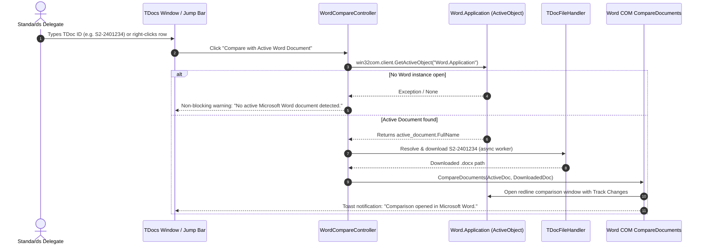

# F-05: "Active Word vs. TDoc" Direct Comparison

## 1. Executive Summary & Objective

During active 3GPP drafting and off-line drafting sessions, delegates frequently have their company's internal draft contribution, a rapporteur's working paper, or a newly received revision open on their screen in Microsoft Word.

When another delegate presents a revision (e.g. `S2-2401567 rev 2`), the delegate needs to immediately compare their currently open Word document against the new revision to answer:
* *What did they change compared to what I am working on?*
* *Did they incorporate our company's comments?*

In the current **3GPP Tools** workflow:
1. The user must find the local file on disk.
2. Drag or stage it into Slot A of the comparison cart.
3. Search for the target TDoc in the table and stage it into Slot B.
4. Click the Compare button.

The objective of **F-05** is to restore the 1-click **"Active Word vs. TDoc"** comparison action: querying the running Microsoft Word instance via COM, grabbing the path of whatever document is currently active on screen, fetching the specified TDoc number, and immediately executing native Word redline comparison (`CompareDocuments`).

---

## 2. Legacy Codebase Analysis

### Files & Locations
* `3GPP Meeting Helper/_3GPP_Delegate_Helper.py` (function: `compare_tdoc_with_active_word`)
* `3GPP Meeting Helper/application/word.py` (function: `get_active_document`)
* `3GPP Meeting Helper/parsing/word/pywin32.py` (function: `compare_documents`)

### Legacy Implementation Details

```python
# application/word.py
def get_active_document():
    try:
        word = win32com.client.GetActiveObject("Word.Application")
        active_document = word.ActiveDocument
        active_document_path = active_document.FullName
        active_document_folder = active_document.Path
        return active_document, active_document_path, active_document_folder
    except Exception as e:
        print(f"Could not retrieve active Word document: {e}")
        return None

# _3GPP_Delegate_Helper.py
def compare_tdoc_with_active_word():
    tdoc_str = tkvar_tdoc_id.get()
    print(f'Will compare active Word Document with TDoc {tdoc_str}')
    
    # 1. Fetch target TDoc
    retrieved_files_folder, metadata_list = server.tdoc_search.search_download_and_open_tdoc(
        tdoc_str,
        skip_open=True,
        tkvar_3gpp_wifi_available=tkvar_3gpp_wifi_available)
    if not metadata_list:
        return
        
    dl_file_path = metadata_list[0].path
    
    # 2. Get active Word file path
    active_document = get_active_document()
    if active_document is None:
        return
    active_document_path = active_document[1]
    
    # 3. Trigger Word COM Comparison
    print(f'Comparing {dl_file_path} to {active_document_path}')
    parsing.word.pywin32.compare_documents(dl_file_path, active_document_path)
```

---

## 3. Current State in 3GPP Tools

* **Word Comparator:** `src/modules/word_tools/` and `src/modules/meetings/core/compare_manager.py` have robust Word COM comparison pipelines (`CompareDocuments` with Track Changes).
* **Comparison Cart:** The modern UI features a floating comparison cart (`Slot A` and `Slot B`).
* **Missing Gap:** There is no 1-click action or button that inspects the OS to see if Word is already open and directly targets its active document as Slot A or the baseline.

---

## 4. Modern Architecture & Design Specification

### Architectural Flow



### Proposed Code Implementation

#### 1. Controller Method (`src/modules/meetings/ui/tdocs_agenda_controller.py`)
```python
def compare_tdoc_with_active_word(window, target_tdoc_id: str):
    """Detects active desktop Word document and compares it against target_tdoc_id."""
    import platform
    if platform.system() != 'Windows':
        show_toast_warning(window, "Word comparison requires Windows.")
        return

    import win32com.client
    try:
        word = win32com.client.GetActiveObject("Word.Application")
        active_doc = word.ActiveDocument
        active_path = Path(active_doc.FullName)
        if not active_path.exists():
            show_toast_warning(window, "Please save the active Word document before comparing.")
            return
    except Exception:
        show_toast_warning(window, "No Microsoft Word document is currently open.")
        return

    # Dispatch download and comparison in background worker
    worker = CompareWithActiveWordThread(target_tdoc_id, active_path, parent=window)
    worker.finished.connect(lambda ok, msg: show_toast(window, msg))
    worker.start()
```

#### 2. UI Surfaces
1. **Quick Jump Ribbon:** Next to `⚡ TDoc:` jump box, add a button `📄 vs 🪟 Active Word`.
2. **Context Menu:** In the TDoc table right-click menu: `"Compare vs. Active Word Document"`.

---

## 5. Implementation Roadmap & Acceptance Criteria

### Step-by-Step Implementation Tasks
1. [ ] Add `get_active_word_document_path()` helper in `src/core/utils/office_helpers.py`.
2. [ ] Implement `CompareWithActiveWordThread` in `src/modules/meetings/core/compare_manager.py`.
3. [ ] Add UI action in `tdocs_menus.py` and `meetings_actions.py`.
4. [ ] Handle dirty/unsaved active documents by prompting to save or saving to a temporary copy.

### Acceptance Criteria
* [x] Correctly identifies and paths the currently active document in Microsoft Word.
* [x] If no Word document is open, displays an informative non-blocking toast without crashing.
* [x] Automatically downloads and compares the target TDoc, launching Word's native legal redline view with additions/deletions.
