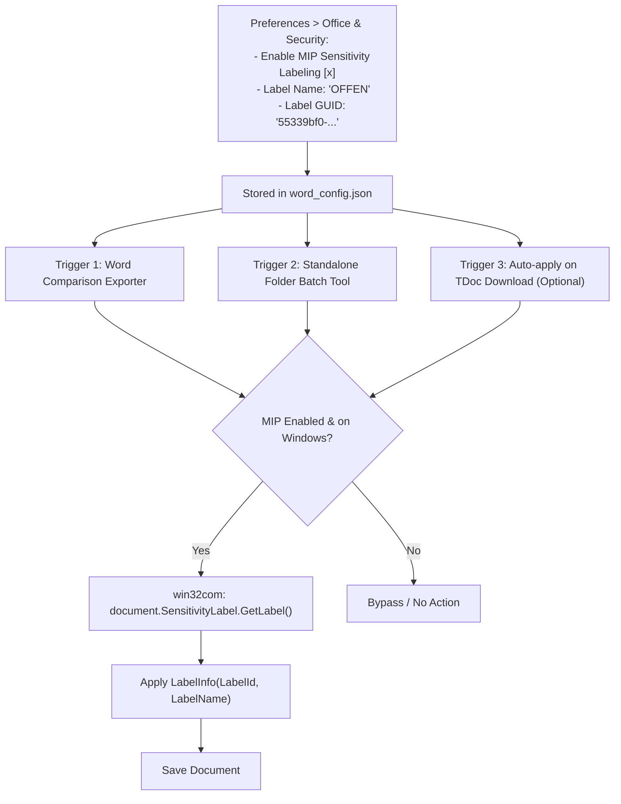

# F-06: Microsoft Information Protection (MIP) / Purview Sensitivity Label Setter

## 1. Executive Summary & Objective

Many enterprise operators and telecommunications vendors (e.g., Deutsche Telekom, Orange, Ericsson, Qualcomm) enforce mandatory data security policies using **Microsoft Purview Information Protection (MIP)**. In these enterprise IT environments, documents created or edited locally without a valid classification label cannot be saved, attached to Outlook emails, or synced to cloud repositories without triggering Data Loss Prevention (DLP) blocks.

Because 3GPP contributions are public, unclassified international standards documents, delegates frequently encounter corporate workflow blocks when:
* Saving downloaded TDocs after making local notes.
* Exporting generated Word redlines or summaries to colleagues.
* Attaching modified CRs to Outlook emails sent to external reflectors.

The legacy application provided a dedicated utility and background hook that leveraged Microsoft Office's native COM `SensitivityLabel` API to automatically apply a configured enterprise label (e.g. `"OFFEN"` / Public, GUID `55339bf0-f345-473a-9ec8-6ca7c8197055`) to Word documents in bulk or upon download.

In **3GPP Tools**, there is currently no awareness of MIP sensitivity labels. The objective of **F-06** is to provide an optional, configurable MIP label applicator for enterprise environments.

---

## 2. Legacy Codebase Analysis

### Files & Locations
* `3GPP Meeting Helper/sensitivity_label_setter.py`
* `3GPP Meeting Helper/application/sensitivity_label.py`
* `3GPP Meeting Helper/How to run Sensitivity Label Setter.docx`
* `3GPP Meeting Helper/config/word.py` (`WordConfig`)

### Mechanism & Implementation Details

#### Office COM Sensitivity API Integration
The script interfaced directly with Microsoft Office's `LabelInfo` and `SensitivityLabel` COM properties:

```python
# application/sensitivity_label.py
class MsoAssignmentMethod(Enum):
    NOT_SET = -1     # Label is not set
    STANDARD = 0     # Applied by default policy
    PRIVILEGED = 1   # Manually or explicitly selected
    AUTO = 2         # Applied automatically by scanner

def set_sensitivity_label(document: Any):
    if WordConfig.sensitivity_level_label_name is None or WordConfig.sensitivity_level_label_id is None:
        return document

    try:
        sensitivity_label = document.SensitivityLabel.GetLabel()
        assignment_method = MsoAssignmentMethod.from_int(sensitivity_label.AssignmentMethod)
        
        # Only set if not already assigned
        if assignment_method == MsoAssignmentMethod.NOT_SET:
            new_sl = document.SensitivityLabel.CreateLabelInfo()
            new_sl.ActionId = str(uuid.uuid1())
            new_sl.AssignmentMethod = 1  # Privileged
            new_sl.ContentBits = 0
            new_sl.IsEnabled = True
            new_sl.Justification = ''
            new_sl.LabelId = WordConfig.sensitivity_level_label_id
            new_sl.LabelName = WordConfig.sensitivity_level_label_name
            new_sl.SetDate = '2022-08-18T09:04:30Z'
            new_sl.SiteId = str(uuid.uuid1())
            
            document.SensitivityLabel.SetLabel(new_sl, new_sl)
            if WordConfig.save_document_after_setting_sensitivity_label:
                document.Save()
    except Exception as e:
        # Graceful fallback if enterprise does not use MIP
        pass

    return document
```

#### Standalone Folder Batch Processor (`sensitivity_label_setter.py`)
Provided a standalone GUI allowing delegates to pick a folder and batch-apply labels across all `.doc` and `.docx` files:
```python
doc_files = [f for f in os.listdir(folder) if (f.endswith('.doc') or f.endswith('.docx')) and not f.startswith('~')]
for doc_file in doc_files:
    doc = word_instance.Documents.Open(os.path.join(folder, doc_file))
    set_sensitivity_label(doc)
    doc.Save()
    doc.Close()
```

---

## 3. Current State in 3GPP Tools

* No MIP label settings exist in `src/config/word_config.json` or `settings.py`.
* When Word files are generated or unzipped, no sensitivity label checks are executed.

---

## 4. Modern Architecture & Design Specification

### Architectural Placement



### Proposed Configuration Schema (`src/config/word_config.json`)
```json
{
  "mip_security": {
    "enabled": false,
    "label_name": "OFFEN",
    "label_id": "55339bf0-f345-473a-9ec8-6ca7c8197055",
    "auto_apply_on_download": false,
    "auto_apply_on_export": true
  }
}
```

### UI Integration
1. **Settings Tab (`src/modules/word_tools/ui/word_config_dialog.py`):**
   * Dedicated **"Enterprise Security & Purview"** group box with a toggle, Label Name, and Label GUID input fields.
   * A `"Test Label on Active Word Document"` button to verify corporate GUID compatibility.
2. **Tools Action:** Add menu item under `Word Tools ▾` -> `"Batch Apply Sensitivity Label to Folder..."`.

---

## 5. Implementation Roadmap & Acceptance Criteria

### Step-by-Step Implementation Tasks
1. [ ] Implement `src/core/utils/mip_labeler.py` with `apply_sensitivity_label(document, label_id, label_name)` and `batch_label_folder(folder_path)`.
2. [ ] Add `mip_security` schema to `word_config.json` and `settings.py`.
3. [ ] Integrate label application into Word comparison exports in `src/modules/word_tools/` and `src/modules/meetings/core/compare_manager.py`.
4. [ ] Build `BatchSensitivityLabelDialog` in `src/modules/word_tools/`.

### Acceptance Criteria
* [x] Completely transparent and non-blocking for users whose organizations do not use Microsoft Purview.
* [x] For users with Purview policies, prevents DLP save/email blocks by automatically assigning the Public/Unclassified label.
* [x] Batch folder processor labels 50 documents in under 15 seconds.
