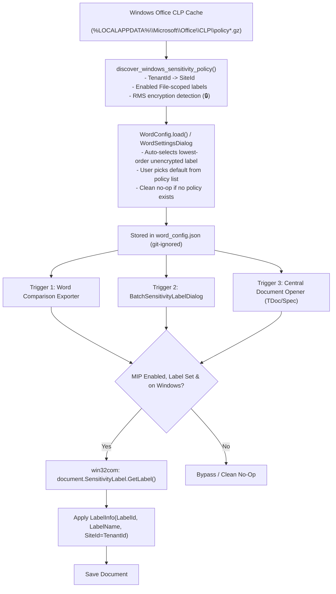

# F-06: Microsoft Information Protection (MIP) / Purview Sensitivity Label Setter

## 1. Executive Summary & Objective

Many enterprise operators and telecommunications vendors (e.g., Deutsche Telekom, Orange, Ericsson, Qualcomm) enforce mandatory data security policies using **Microsoft Purview Information Protection (MIP)**. In these enterprise IT environments, documents created or edited locally without a valid classification label cannot be saved, attached to Outlook emails, or synced to cloud repositories without triggering Data Loss Prevention (DLP) blocks.

Because 3GPP contributions are public, unclassified international standards documents, delegates frequently encounter corporate workflow blocks when:
* Saving downloaded TDocs after making local notes.
* Exporting generated Word redlines or summaries to colleagues.
* Attaching modified CRs to Outlook emails sent to external reflectors.

The legacy application provided a dedicated utility and background hook that leveraged Microsoft Office's native COM `SensitivityLabel` API to automatically apply a single hardcoded label (`"OFFEN"` / Public, GUID `55339bf0-f345-473a-9ec8-6ca7c8197055`) to Word documents in a folder.

In **3GPP Tools**, **F-06 is fully implemented and superseded**: instead of hardcoded reverse-engineered GUIDs, it automatically discovers the active user's Microsoft Purview / MIP sensitivity labels and `TenantId` directly from Windows (`%LOCALAPPDATA%\Microsoft\Office\CLP\policy*.gz`), filters to enabled `File`-scoped labels, badges RMS-encrypted labels with `🔒 [Encrypted]`, defaults to the lowest-order unencrypted label (or cleanly no-ops when no policy exists), supports custom in-UI label editing (`SensitivityLabelEditDialog`), dual-mode batch labeling (`BatchSensitivityLabelDialog`), sub-millisecond headless OpenXML classification inspection, active Word COM live testing, and automated background labeling across all opening/exporting pipelines.

---

## 2. Legacy Codebase Analysis

### Files & Locations
* `3GPP Meeting Helper/sensitivity_label_setter.py`
* `3GPP Meeting Helper/application/sensitivity_label.py`
* `3GPP Meeting Helper/How to run Sensitivity Label Setter.docx`
* `3GPP Meeting Helper/config/word.py` (`WordConfig`)

### Mechanism & Implementation Details

#### Office COM Sensitivity API Integration
The script interfaced directly with Microsoft Office's `LabelInfo` and `SensitivityLabel` COM properties:

```python
# application/sensitivity_label.py
class MsoAssignmentMethod(Enum):
    NOT_SET = -1     # Label is not set
    STANDARD = 0     # Applied by default policy
    PRIVILEGED = 1   # Manually or explicitly selected
    AUTO = 2         # Applied automatically by scanner

def set_sensitivity_label(document: Any):
    if WordConfig.sensitivity_level_label_name is None or WordConfig.sensitivity_level_label_id is None:
        return document

    try:
        sensitivity_label = document.SensitivityLabel.GetLabel()
        assignment_method = MsoAssignmentMethod.from_int(sensitivity_label.AssignmentMethod)
        
        # Only set if not already assigned
        if assignment_method == MsoAssignmentMethod.NOT_SET:
            new_sl = document.SensitivityLabel.CreateLabelInfo()
            new_sl.ActionId = str(uuid.uuid1())
            new_sl.AssignmentMethod = 1  # Privileged
            new_sl.ContentBits = 0
            new_sl.IsEnabled = True
            new_sl.Justification = ''
            new_sl.LabelId = WordConfig.sensitivity_level_label_id
            new_sl.LabelName = WordConfig.sensitivity_level_label_name
            new_sl.SetDate = '2022-08-18T09:04:30Z'
            new_sl.SiteId = str(uuid.uuid1())
            
            document.SensitivityLabel.SetLabel(new_sl, new_sl)
            if WordConfig.save_document_after_setting_sensitivity_label:
                document.Save()
    except Exception as e:
        # Graceful fallback if enterprise does not use MIP
        pass

    return document
```

#### Standalone Folder Batch Processor (`sensitivity_label_setter.py`)
Provided a standalone GUI allowing delegates to pick a folder and batch-apply labels across all `.doc` and `.docx` files:
```python
doc_files = [f for f in os.listdir(folder) if (f.endswith('.doc') or f.endswith('.docx')) and not f.startswith('~')]
for doc_file in doc_files:
    doc = word_instance.Documents.Open(os.path.join(folder, doc_file))
    set_sensitivity_label(doc)
    doc.Save()
    doc.Close()
```

---

## 3. Current State in 3GPP Tools

* Fully implemented and integrated:
  * **Core Engine & Policy Discovery:** `src/modules/word_tools/core/sensitivity_label.py` supporting `discover_windows_sensitivity_policy()` (reading `%LOCALAPPDATA%\Microsoft\Office\CLP\policy*.gz`), `set_sensitivity_label()` (using the policy's `TenantId` as `SiteId`), headless OpenXML inspection `get_document_sensitivity_label()`, and asynchronous `batch_set_sensitivity_label()`.
  * **Dynamic Multi-Level Configuration:** `src/modules/word_tools/core/word_config.py` and `src/config/word_config.json` auto-populating from the user's Windows CLP policy (with empty/no-op behavior if no policy exists on the machine) and persisting the user-selected default label.
  * **Settings UI:** `WordSettingsDialog` (`src/modules/word_tools/ui/word_settings_dialog.py`) with Windows policy status banner, **🔄 Sync from Windows Policy** button, preset combobox showing `🔒 ... [Encrypted]` badges on RMS-protected labels, in-place label adding/editing/removing, file label inspector, and test button for active Word documents.
  * **Batch Tool:** `BatchSensitivityLabelDialog` (`src/modules/word_tools/ui/batch_label_dialog.py`) integrated into `WordExtractorTab` settings menu (`🛡️ Batch Apply Sensitivity Label to Folder...`).
  * **Pipeline Integration:** Active across `document_opener.py` (when opening TDocs or specs), `word_comparator.py`, `docx_splitter.py`, `cr_pcr_generator.py`, and `DocumentSelectorPane`.

---

## 4. Modern Architecture & Design Specification

### Architectural Placement



### Active Configuration Schema (`src/config/word_config.json`)
```json
{
  "enable_sensitivity_labels": true,
  "active_sensitivity_label_id": "<auto-discovered-or-user-selected-guid>",
  "sensitivity_level_label_id": "<auto-discovered-or-user-selected-guid>",
  "sensitivity_level_label_name": "<auto-discovered-label-name>",
  "sensitivity_tenant_id": "<discovered-tenant-guid>",
  "sensitivity_policy_upn": "<user@company.com>",
  "sensitivity_policy_initialized": true,
  "save_document_after_setting_sensitivity_label": false,
  "sensitivity_labels": [
    {
      "id": "<label-guid>",
      "name": "<policy-label-name>",
      "display_name": "<localized-display-name>",
      "description": "<policy-tooltip>",
      "order": 0,
      "is_encrypted": false,
      "tenant_id": "<discovered-tenant-guid>",
      "source": "windows_policy"
    }
  ]
}
```

### UI Integration
1. **Settings Dialog (`src/modules/word_tools/ui/word_settings_dialog.py`):**
   * Live Windows policy status banner + **🔄 Sync from Windows Policy** button.
   * Multi-level preset dropdown populated from the user's policy (with `🔒 ... [Encrypted]` indicators and RMS warnings for encrypted labels), plus Add/Edit/Remove custom presets.
   * "🔍 Inspect Document Label..." button to inspect any `.docx`/`.doc` file.
   * "🧪 Test on Active Word" button to verify corporate COM compatibility.
2. **Tools Action:** Menu item under `⚙️ Word Settings ▾` -> `"🛡️ Batch Apply Sensitivity Label to Folder..."` launching `BatchSensitivityLabelDialog`.
3. **Document Selector Pane:** Automatically renders detected sensitivity badge (e.g. `| 🛡️ <LabelName>`) upon dropping or browsing documents.

---

## 5. Implementation Roadmap & Acceptance Criteria

### Step-by-Step Implementation Tasks
1. [x] Implement `src/modules/word_tools/core/sensitivity_label.py` with `discover_windows_sensitivity_policy()`, `set_sensitivity_label()` (using policy `TenantId` for `SiteId`), headless `get_document_sensitivity_label()`, and asynchronous `batch_set_sensitivity_label()`.
2. [x] Remove all hardcoded tenant GUIDs from `word_config.py`, auto-populating from Windows CLP policy on load/sync and returning empty/no-op when no policy exists.
3. [x] Integrate label application into Word comparison exports, document opener, CR generator, docx splitter, and `external_agent_tools.py`.
4. [x] Build `BatchSensitivityLabelDialog` in `src/modules/word_tools/ui/batch_label_dialog.py` and connect to `WordExtractorTab`, including `🔒 [Encrypted]` indicators.
5. [x] Implement headless OpenXML inspection in `DocumentSelectorPane` and `WordSettingsDialog` with policy sync controls.

### Acceptance Criteria
* [x] Completely transparent and non-blocking (clean no-op) for users whose machines have no Microsoft Purview CLP policy.
* [x] For users with Purview policies, automatically discovers all enabled `File`-scoped labels, clearly flags RMS-encrypted labels (`🔒`), and prevents DLP save/email blocks.
* [x] Batch folder processor labels 50 documents in under 15 seconds.
