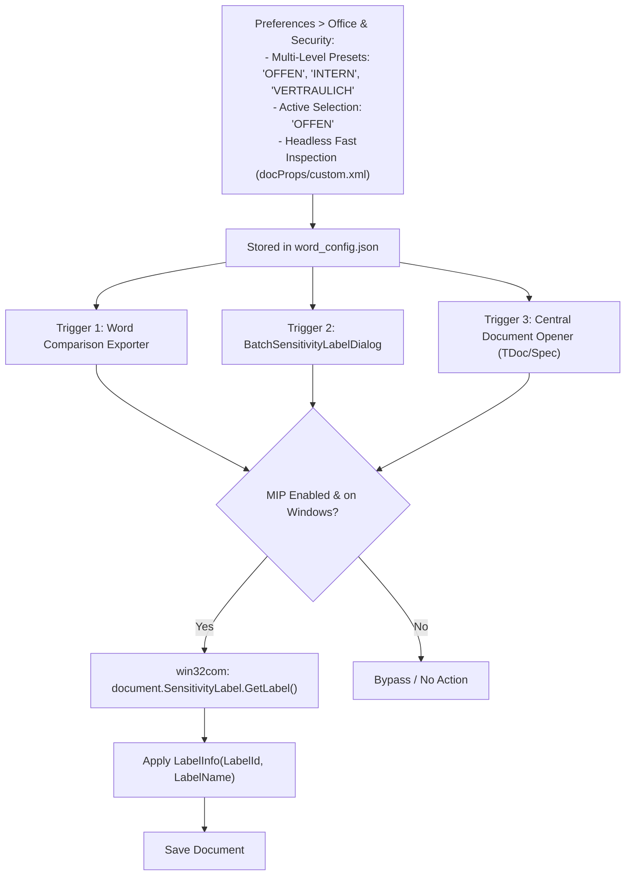

# F-06: Microsoft Information Protection (MIP) / Purview Sensitivity Label Setter

## 1. Executive Summary & Objective

Many enterprise operators and telecommunications vendors (e.g., Deutsche Telekom, Orange, Ericsson, Qualcomm) enforce mandatory data security policies using **Microsoft Purview Information Protection (MIP)**. In these enterprise IT environments, documents created or edited locally without a valid classification label cannot be saved, attached to Outlook emails, or synced to cloud repositories without triggering Data Loss Prevention (DLP) blocks.

Because 3GPP contributions are public, unclassified international standards documents, delegates frequently encounter corporate workflow blocks when:
* Saving downloaded TDocs after making local notes.
* Exporting generated Word redlines or summaries to colleagues.
* Attaching modified CRs to Outlook emails sent to external reflectors.

The legacy application provided a dedicated utility and background hook that leveraged Microsoft Office's native COM `SensitivityLabel` API to automatically apply a single hardcoded label (`"OFFEN"` / Public, GUID `55339bf0-f345-473a-9ec8-6ca7c8197055`) to Word documents in a folder.

In **3GPP Tools**, **F-06 is fully implemented and superseded**: it provides multi-level sensitivity preset configuration (`OFFEN`, `INTERN`, `VERTRAULICH - unverschlüsselt`, or custom tenants), full in-UI label editing (`SensitivityLabelEditDialog`), dual-mode batch labeling for both entire folders and arbitrary sets of documents (`BatchSensitivityLabelDialog`), sub-millisecond headless OpenXML classification inspection, active Word COM live testing, and automated background labeling across all opening/exporting pipelines.

---

## 2. Legacy Codebase Analysis

### Files & Locations
* `3GPP Meeting Helper/sensitivity_label_setter.py`
* `3GPP Meeting Helper/application/sensitivity_label.py`
* `3GPP Meeting Helper/How to run Sensitivity Label Setter.docx`
* `3GPP Meeting Helper/config/word.py` (`WordConfig`)

### Mechanism & Implementation Details

#### Office COM Sensitivity API Integration
The script interfaced directly with Microsoft Office's `LabelInfo` and `SensitivityLabel` COM properties:

```python
# application/sensitivity_label.py
class MsoAssignmentMethod(Enum):
    NOT_SET = -1     # Label is not set
    STANDARD = 0     # Applied by default policy
    PRIVILEGED = 1   # Manually or explicitly selected
    AUTO = 2         # Applied automatically by scanner

def set_sensitivity_label(document: Any):
    if WordConfig.sensitivity_level_label_name is None or WordConfig.sensitivity_level_label_id is None:
        return document

    try:
        sensitivity_label = document.SensitivityLabel.GetLabel()
        assignment_method = MsoAssignmentMethod.from_int(sensitivity_label.AssignmentMethod)
        
        # Only set if not already assigned
        if assignment_method == MsoAssignmentMethod.NOT_SET:
            new_sl = document.SensitivityLabel.CreateLabelInfo()
            new_sl.ActionId = str(uuid.uuid1())
            new_sl.AssignmentMethod = 1  # Privileged
            new_sl.ContentBits = 0
            new_sl.IsEnabled = True
            new_sl.Justification = ''
            new_sl.LabelId = WordConfig.sensitivity_level_label_id
            new_sl.LabelName = WordConfig.sensitivity_level_label_name
            new_sl.SetDate = '2022-08-18T09:04:30Z'
            new_sl.SiteId = str(uuid.uuid1())
            
            document.SensitivityLabel.SetLabel(new_sl, new_sl)
            if WordConfig.save_document_after_setting_sensitivity_label:
                document.Save()
    except Exception as e:
        # Graceful fallback if enterprise does not use MIP
        pass

    return document
```

#### Standalone Folder Batch Processor (`sensitivity_label_setter.py`)
Provided a standalone GUI allowing delegates to pick a folder and batch-apply labels across all `.doc` and `.docx` files:
```python
doc_files = [f for f in os.listdir(folder) if (f.endswith('.doc') or f.endswith('.docx')) and not f.startswith('~')]
for doc_file in doc_files:
    doc = word_instance.Documents.Open(os.path.join(folder, doc_file))
    set_sensitivity_label(doc)
    doc.Save()
    doc.Close()
```

---

## 3. Current State in 3GPP Tools

* Fully implemented and integrated:
  * **Core Engine:** `src/modules/word_tools/core/sensitivity_label.py` supporting `set_sensitivity_label()`, headless OpenXML inspection `get_document_sensitivity_label()`, and asynchronous `batch_set_sensitivity_label()`.
  * **Multi-Level Configuration:** `src/modules/word_tools/core/word_config.py` and `src/config/word_config.json` supporting multiple enterprise presets (`OFFEN`, `INTERN`, `VERTRAULICH - unverschlüsselt`) with active level selection.
  * **Settings UI:** `WordSettingsDialog` (`src/modules/word_tools/ui/word_settings_dialog.py`) with preset combobox, in-place label adding/removing, file label inspector, and test button for active Word documents.
  * **Batch Tool:** `BatchSensitivityLabelDialog` (`src/modules/word_tools/ui/batch_label_dialog.py`) integrated into `WordExtractorTab` settings menu (`🛡️ Batch Apply Sensitivity Label to Folder...`).
  * **Pipeline Integration:** Active across `document_opener.py` (when opening TDocs or specs), `word_comparator.py`, `docx_splitter.py`, `cr_pcr_generator.py`, and `DocumentSelectorPane`.

---

## 4. Modern Architecture & Design Specification

### Architectural Placement



### Active Configuration Schema (`src/config/word_config.json`)
```json
{
  "enable_sensitivity_labels": true,
  "active_sensitivity_label_id": "55339bf0-f345-473a-9ec8-6ca7c8197055",
  "sensitivity_level_label_id": "55339bf0-f345-473a-9ec8-6ca7c8197055",
  "sensitivity_level_label_name": "OFFEN",
  "save_document_after_setting_sensitivity_label": false,
  "sensitivity_labels": [
    {
      "id": "55339bf0-f345-473a-9ec8-6ca7c8197055",
      "name": "OFFEN",
      "description": "Public / Non-confidential (Default for 3GPP Contributions)"
    },
    {
      "id": "5c6efe59-7e7c-4bd6-ba39-1850710f2efa",
      "name": "INTERN",
      "description": "Internal / Company-wide"
    },
    {
      "id": "5d95d744-d996-4a3c-a104-fbf2486a4c52",
      "name": "VERTRAULICH - unverschlüsselt",
      "description": "Confidential - unencrypted"
    }
  ]
}
```

### UI Integration
1. **Settings Dialog (`src/modules/word_tools/ui/word_settings_dialog.py`):**
   * Multi-level preset dropdown with Add/Remove custom presets.
   * "🔍 Inspect Document Label..." button to inspect any `.docx`/`.doc` file.
   * "🧪 Test on Active Word" button to verify corporate COM compatibility.
2. **Tools Action:** Menu item under `⚙️ Word Settings ▾` -> `"🛡️ Batch Apply Sensitivity Label to Folder..."` launching `BatchSensitivityLabelDialog`.
3. **Document Selector Pane:** Automatically renders detected sensitivity badge (e.g. `| 🛡️ OFFEN`) upon dropping or browsing documents.

---

## 5. Implementation Roadmap & Acceptance Criteria

### Step-by-Step Implementation Tasks
1. [x] Implement `src/modules/word_tools/core/sensitivity_label.py` with `set_sensitivity_label(document, label_id, label_name)`, headless `get_document_sensitivity_label()`, and `batch_set_sensitivity_label(folder_path)`.
2. [x] Add multi-level `sensitivity_labels` schema and active label selection to `word_config.json` and `word_config.py`.
3. [x] Integrate label application into Word comparison exports, document opener, CR generator, and docx splitter.
4. [x] Build `BatchSensitivityLabelDialog` in `src/modules/word_tools/ui/batch_label_dialog.py` and connect to `WordExtractorTab`.
5. [x] Implement headless OpenXML inspection in `DocumentSelectorPane` and `WordSettingsDialog`.

### Acceptance Criteria
* [x] Completely transparent and non-blocking for users whose organizations do not use Microsoft Purview.
* [x] For users with Purview policies, prevents DLP save/email blocks by automatically assigning the Public/Unclassified label.
* [x] Batch folder processor labels 50 documents in under 15 seconds.
