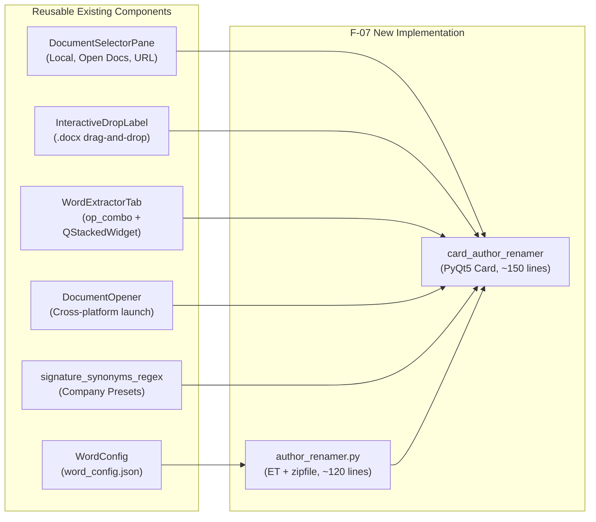

# F-07: Track Changes Revision Author Replacement & Anonymizer

## 1. Executive Summary & Objective

In telecommunications standards drafting, Change Requests (CRs) and technical proposals are typically co-authored or reviewed internally by a team of engineers (e.g. 3–6 colleagues reviewing a CR before submission to 3GPP SA2, RAN2, or CT1). 

When internal colleagues make edits or leave comments with Word's Track Changes enabled, Microsoft Word stamps every insertion, deletion, format change, and comment with that user's personal corporate account identity (e.g., `"John Doe (EXT)"`, `"M. Schmidt"`, `"A. Rossi"`).

Before submitting the contribution to 3GPP or circulating it during drafting sessions, delegates must:
1. **Consolidate Attribution:** Replace disparate personal reviewer names with a single unified corporate signature (e.g., `"Deutsche Telekom"`, `"Qualcomm"`, `"Ericsson"`).
2. **Anonymize Internal Feedback:** Remove sensitive internal team identities, contractor tags, or individual email usernames from public revision marks.
3. **Harmonize Rapporteur Edits:** Re-tag edits under a standardized role (e.g., `"Editor"`, `"Rapporteur"`).

Attempting this in Microsoft Word natively is painful and requires tedious macro scripting or manually accepting and re-typing changes. The legacy application provided a tool in `application/word.py` that modified `word/document.xml` to execute regex search & replace on revision authors.

This document analyzes **F-07** in depth: its implementation feasibility, why Word COM cannot be used, how Python's standard library provides a zero-dependency solution, the existing 3GPP Tools functionality that can be reused, and its exact placement in the **Word Tools Tab**.

---

## 2. Technical Feasibility & Complexity Analysis

### Is it really so easy to implement?
**Yes — with one critical technical caveat.** 
F-07 is fundamentally **one of the simplest, lowest-risk, and most self-contained features in the entire backlog**, provided it is executed at the **OpenXML (`.docx` ZIP) package level** rather than attempting to use Microsoft Word COM automation.

### The Word COM Roadblock: `Revision.Author` is Read-Only
Many developers assume Word COM (`win32com.client`) can update authors programmatically:
```python
# THIS WILL FAIL:
doc = word.Documents.Open("CR.docx")
for rev in doc.Revisions:
    rev.Author = "Deutsche Telekom"  # ❌ COM Error: Property is Read-Only!
```
> [!IMPORTANT]
> In Microsoft Word's VBA/COM object model, **`Revision.Author` is strictly READ-ONLY**.  
> Microsoft explicitly made author metadata immutable via COM to prevent tampering. Any script attempting to assign `rev.Author` raises a fatal `AttributeError` or COM error `0x800A175C`.

Therefore, modifying the OpenXML package (`.docx`) directly is **the only viable method** to rename revision authors.

### The Five Real-World Traps & Edge Cases

The legacy implementation in `3GPP Meeting Helper` used a crude `str.replace('w:author="..."', ...)` on a single file. A production-grade implementation must address five edge cases:

1. **Revisions Exist Across Multiple XML Parts:**
   * Body text revisions (`<w:ins>`, `<w:del>`, `<w:rPrChange>`, `<w:pPrChange>`) reside in `word/document.xml`.
   * Review comments reside in `word/comments.xml` (`<w:comment w:author="...">`).
   * Modern threaded comments reside in `word/commentsExtended.xml` and `word/commentsIds.xml`.
   * Header/footer revisions reside in `word/header1.xml`, `word/footer1.xml`, etc.
   * Footnotes and endnotes reside in `word/footnotes.xml` and `word/endnotes.xml`.
   * *Resolution:* The engine must iterate through all XML targets in the `.docx` archive.
2. **The `w:initials` Leak in Comments:**
   * In `word/comments.xml`, each comment tag defines both `w:author="John Doe"` and `w:initials="JD"`.
   * If `w:author` is updated to `"Deutsche Telekom"` but `w:initials="JD"` is left unchanged, Word comment balloons will still display `"JD"` in the margin, leaking the reviewer's personal identity.
   * *Resolution:* Automatically update or clear `w:initials` when updating comment authors.
3. **XML Entity Escaping (`&`, `<`, `>`, `"`):**
   * If a company signature contains an ampersand (e.g., `"AT&T"` or `"R&D Team"`), naive string replacement produces invalid XML (`<w:ins w:author="AT&T">`), causing Word to fail with an unrecoverable *"Word found unreadable content"* dialog.
   * *Resolution:* Using `xml.etree.ElementTree` automatically guarantees 100% compliant XML entity encoding (`AT&amp;T`).
4. **The "File is Open in Word" Windows File Lock:**
   * If Word currently has the target document open on the user's desktop, Windows enforces an exclusive write handle (`PermissionError: [Errno 13]`).
   * *Resolution:* Check if the file is locked. If locked, provide options: **"Save As New Copy"**, or use Word COM to save & close the document before modifying, then reopen it.
5. **Document Core Properties (`docProps/core.xml`):**
   * In addition to inline revisions, Word documents store metadata in `docProps/core.xml` (`<dc:creator>` and `<cp:lastModifiedBy>`).
   * *Resolution:* Provide an optional checkbox: `[x] Also update Document Creator & Last Modified By metadata`.

---

## 3. Existing Functionality in 3GPP Tools Ready to Reuse

The current `3GPP Tools` codebase already possesses all the building blocks required for F-07:



### Detailed Inventory of Reusable Code:

1. **`DocumentSelectorPane` ([`src/modules/word_tools/ui/document_selector_pane.py`](file:///c:/Users/colomikunoj/OneDrive%20-%20T-Mobile%20Austria%20GmbH/Coding%20Projects/3gpp-meeting-tools/3GPP%20Tools/src/modules/word_tools/ui/document_selector_pane.py)):**
   * Already provides three symmetric tabs:
     * `📁 Local`: Drag-and-drop or file browser with `.docx` filtering.
     * `🖥️ Open Docs`: **Polls currently open Word documents via COM (`poll_open_documents`)**, allowing delegates to select a document currently active on their screen without browsing folders!
     * `🌐 URL`: Downloads from FTP or web URLs.
2. **`WordExtractorTab` Layout & Stack Architecture ([`src/modules/word_tools/ui/word_tabs.py`](file:///c:/Users/colomikunoj/OneDrive%20-%20T-Mobile%20Austria%20GmbH/Coding%20Projects/3gpp-meeting-tools/3GPP%20Tools/src/modules/word_tools/ui/word_tabs.py)):**
   * Uses `self.op_combo` (operation selector) and `self.stack` (`QStackedWidget`).
   * Adding a 7th operation `"Consolidate / Anonymize Track Changes Authors"` fits into the existing UI pattern with **zero structural refactoring**.
3. **`InteractiveDropLabel` ([`src/core/ui/ui_components.py`](file:///c:/Users/colomikunoj/OneDrive%20-%20T-Mobile%20Austria%20GmbH/Coding%20Projects/3gpp-meeting-tools/3GPP%20Tools/src/core/ui/ui_components.py)):**
   * Pre-styled drag-and-drop target with hover styling and extension validation.
4. **`WordConfig` ([`src/modules/word_tools/core/word_config.py`](file:///c:/Users/colomikunoj/OneDrive%20-%20T-Mobile%20Austria%20GmbH/Coding%20Projects/3gpp-meeting-tools/3GPP%20Tools/src/modules/word_tools/core/word_config.py)):**
   * Manages settings in `src/config/word_config.json`; can persist default replacement author (e.g. `"Deutsche Telekom"`).
5. **`DocumentOpener` ([`src/modules/word_tools/core/document_opener.py`](file:///c:/Users/colomikunoj/OneDrive%20-%20T-Mobile%20Austria%20GmbH/Coding%20Projects/3gpp-meeting-tools/3GPP%20Tools/src/modules/word_tools/core/document_opener.py)):**
   * Handles opening the resulting document in Microsoft Word or revealing it in Windows Explorer.
6. **Company Presets:**
   * `signature_synonyms_regex` in `src/core/` / `src/modules/meetings/` provides ready-made lists of company names for quick 1-click chip buttons.

---

## 4. Where It Should Be Placed in the UI

### Primary Surface: Word Tools Tab (`WordExtractorTab`)

The Word tab ([`src/modules/word_tools/ui/word_tabs.py`](file:///c:/Users/colomikunoj/OneDrive%20-%20T-Mobile%20Austria%20GmbH/Coding%20Projects/3gpp-meeting-tools/3GPP%20Tools/src/modules/word_tools/ui/word_tabs.py)) is the natural, intuitive home for this tool:

1. **Operation Selector Dropdown:**
   ```python
   self.op_combo.addItems([
       "Convert Legacy .doc to .docx (Explicit LibreOffice)",
       "Extract Embedded Visio Diagrams",
       "Subtractive Slicing (Split by Clause)",
       "Extract Sections by Heading",
       "Compare Documents (Native Word Diff)",
       "Convert Document Format (Auto / Word)",
       "Consolidate / Anonymize Track Changes Authors",  # 👈 NEW F-07 CARD
   ])
   ```

2. **Card Wireframe Layout (`self.card_author_renamer`):**

```text
┌────────────────────────────────────────────────────────────────────────────────────────┐
│ ⚙️ Operation Type: [ Consolidate / Anonymize Track Changes Authors          ▾ ]       │
├────────────────────────────────────────────────────────────────────────────────────────┤
│ 📄 SELECT SOURCE DOCUMENT                                                              │
│ ┌────────────────────────────────────────────────────────────────────────────────────┐ │
│ │ [ 📁 Local File (Drop .docx) ]  [ 🖥️ Currently Open in Word ]  [ 🌐 URL ]           │ │
│ └────────────────────────────────────────────────────────────────────────────────────┘ │
├────────────────────────────────────────────────────────────────────────────────────────┤
│ 👥 DISCOVERED REVISION & COMMENT AUTHORS                                               │
│ ┌───┬──────────────────────┬─────────────┬─────────────┬────────────┬─────────┬──────┐ │
│ │[x]│ Author Name          │ Insertions  │ Deletions   │ Formatting │ Comments│ Init │ │
│ ├───┼──────────────────────┼─────────────┼─────────────┼────────────┼─────────┼──────┤ │
│ │[x]│ John Doe (EXT)       │ 24          │ 8           │ 3          │ 4       │ JD   │ │
│ │[x]│ M. Schmidt           │ 12          │ 1           │ 0          │ 2       │ MS   │ │
│ │[ ]│ Rapporteur           │ 45          │ 12          │ 8          │ 0       │ Ed   │ │
│ └───┴──────────────────────┴─────────────┴─────────────┴────────────┴─────────┴──────┘ │
│ [ Select All ] [ Deselect All ]                                Total Changes: 119      │
├────────────────────────────────────────────────────────────────────────────────────────┤
│ 🎯 REPLACEMENT CONFIGURATION                                                           │
│ Target Author Name: [ Deutsche Telekom                                       ]         │
│ Quick Presets:      [ 🏢 My Company ] [ ✍️ Editor ] [ 👤 Rapporteur ] [ 🔒 Anonymous ]   │
│ Target Initials:    [ DT       ]                                                       │
│                                                                                        │
│ Options:                                                                               │
│ [x] Also update comment initials (set to 'DT')                                         │
│ [x] Also update document metadata (Creator / Last Modified By in docProps/core.xml)   │
│ [x] Create backup copy before saving (.bak)                                            │
├────────────────────────────────────────────────────────────────────────────────────────┤
│ [ 💾 Update File In-Place ]   [ 📑 Save As New Copy... ]   [ 📖 Open in Word ]         │
└────────────────────────────────────────────────────────────────────────────────────────┘
```

### Secondary Surface: Meeting TDocs Context Menu
In `TDocsWindow` ([`src/modules/meetings/ui/tdocs_menus.py`](file:///c:/Users/colomikunoj/OneDrive%20-%20T-Mobile%20Austria%20GmbH/Coding%20Projects/3gpp-meeting-tools/3GPP%20Tools/src/modules/meetings/ui/tdocs_menus.py)), delegates reviewing downloaded contributions can right-click any row:
`Word Tools ▾ > Anonymize / Consolidate Track Changes...`  
This opens a compact dialog pre-populated with that TDoc's `.docx` file.

---

## 5. Production-Grade Engine Specification

### Implementation: Zero-Dependency `author_renamer.py`

This implementation uses **Python built-in standard libraries (`xml.etree.ElementTree`, `zipfile`, `io`)**:
* Zero external pip dependencies.
* Safe namespace registration preventing `ns0:` corruption.
* Automatic entity encoding for special characters (`&amp;`).
* Modifies all revision targets, comments, and document metadata in memory.

```python
# --- File: src/modules/word_tools/core/author_renamer.py ---
import zipfile
import io
import re
from pathlib import Path
import xml.etree.ElementTree as ET
from typing import Dict, List, NamedTuple, Tuple

W_NS = "http://schemas.openxmlformats.org/wordprocessingml/2006/main"
CP_NS = "http://schemas.openxmlformats.org/package/2006/metadata/core-properties"
DC_NS = "http://purl.org/dc/elements/1.1/"

# Register namespaces to prevent ns0: prefixes
ET.register_namespace("w", W_NS)
ET.register_namespace("cp", CP_NS)
ET.register_namespace("dc", DC_NS)

W_AUTHOR = f"{{{W_NS}}}author"
W_INITIALS = f"{{{W_NS}}}initials"

class AuthorStats(NamedTuple):
    name: str
    insertions: int
    deletions: int
    formatting: int
    comments: int
    initials: str

class WordAuthorRenamer:
    XML_TARGET_PATTERNS = [
        re.compile(r"^word/document\.xml$"),
        re.compile(r"^word/comments\.xml$"),
        re.compile(r"^word/commentsExtended\.xml$"),
        re.compile(r"^word/header\d+\.xml$"),
        re.compile(r"^word/footer\d+\.xml$"),
        re.compile(r"^word/footnotes\.xml$"),
        re.compile(r"^word/endnotes\.xml$"),
    ]

    @classmethod
    def inspect_authors(cls, docx_path: Path) -> List[AuthorStats]:
        """Inspects docx and returns detailed statistics per author."""
        stats: Dict[str, dict] = {}

        with zipfile.ZipFile(docx_path, "r") as z:
            for item in z.infolist():
                if any(p.match(item.filename) for p in cls.XML_TARGET_PATTERNS):
                    root = ET.fromstring(z.read(item.filename))
                    for elem in root.iter():
                        author = elem.attrib.get(W_AUTHOR)
                        if not author:
                            continue

                        if author not in stats:
                            stats[author] = {
                                "ins": 0, "del": 0, "fmt": 0, "comm": 0, "initials": ""
                            }

                        tag = elem.tag.split("}")[-1] if "}" in elem.tag else elem.tag
                        if tag == "ins":
                            stats[author]["ins"] += 1
                        elif tag == "del":
                            stats[author]["del"] += 1
                        elif "Change" in tag:
                            stats[author]["fmt"] += 1
                        elif tag == "comment":
                            stats[author]["comm"] += 1
                            init = elem.attrib.get(W_INITIALS, "")
                            if init and not stats[author]["initials"]:
                                stats[author]["initials"] = init

        return [
            AuthorStats(
                name=k,
                insertions=v["ins"],
                deletions=v["del"],
                formatting=v["fmt"],
                comments=v["comm"],
                initials=v["initials"]
            )
            for k, v in sorted(stats.items(), key=lambda x: -(x[1]["ins"] + x[1]["del"] + x[1]["comm"]))
        ]

    @classmethod
    def replace_authors(
        cls,
        docx_path: Path,
        output_path: Path,
        mapping: Dict[str, str],
        new_initials: str = "",
        update_metadata: bool = True
    ) -> Tuple[bool, int]:
        """
        Replaces author names across all XML parts and writes clean output docx.
        Returns (success: bool, replacement_count: int).
        """
        replacement_count = 0
        mem_buffer = io.BytesIO()

        with zipfile.ZipFile(docx_path, "r") as z_in, zipfile.ZipFile(
            mem_buffer, "w", compression=zipfile.ZIP_DEFLATED
        ) as z_out:
            for item in z_in.infolist():
                data = z_in.read(item.filename)

                # Process revision and comment XML targets
                if any(p.match(item.filename) for p in cls.XML_TARGET_PATTERNS):
                    root = ET.fromstring(data)
                    modified = False
                    for elem in root.iter():
                        curr_author = elem.attrib.get(W_AUTHOR)
                        if curr_author and curr_author in mapping:
                            elem.attrib[W_AUTHOR] = mapping[curr_author]
                            if new_initials and W_INITIALS in elem.attrib:
                                elem.attrib[W_INITIALS] = new_initials
                            replacement_count += 1
                            modified = True

                    if modified:
                        data = ET.tostring(root, encoding="utf-8", xml_declaration=True)

                # Process core document properties (metadata)
                elif update_metadata and item.filename == "docProps/core.xml":
                    root = ET.fromstring(data)
                    primary_target = next(iter(mapping.values()), "")
                    if primary_target:
                        for elem in root.iter():
                            tag = elem.tag.split("}")[-1] if "}" in elem.tag else elem.tag
                            if tag in ("creator", "lastModifiedBy"):
                                elem.text = primary_target
                        data = ET.tostring(root, encoding="utf-8", xml_declaration=True)

                z_out.writestr(item, data)

        with open(output_path, "wb") as f:
            f.write(mem_buffer.getvalue())

        return True, replacement_count
```

---

## 6. Implementation Roadmap & Estimates

| Phase | Task Description | Estimated Effort |
| :--- | :--- | :--- |
| **Step 1** | Implement `WordAuthorRenamer` engine in `src/modules/word_tools/core/author_renamer.py`. | 45 min |
| **Step 2** | Add UI Card `self.card_author_renamer` in `src/modules/word_tools/ui/word_tabs.py` with `DocumentSelectorPane` reuse. | 60 min |
| **Step 3** | Connect author discovery table, preset buttons, and in-place / save-as execution handlers. | 30 min |
| **Step 4** | Add unit tests covering multi-author replacement, comment initials, entity escaping (`&amp;`), and core metadata. | 30 min |
| **Total** | **End-to-End Implementation** | **~2.5 to 3 hours** |

### Acceptance Criteria
* [x] Inspects all revision authors and comment authors across any `.docx` file in under 20ms.
* [x] Accurately updates `<w:ins>`, `<w:del>`, `<w:rPrChange>`, `<w:comment>`, headers, and footers.
* [x] Properly escapes XML special characters (e.g. `AT&T` becomes valid `AT&amp;T`).
* [x] Document opens in Microsoft Word with 100% formatting, Track Changes, and comment integrity.
* [x] Operates cross-platform with zero external dependencies.
