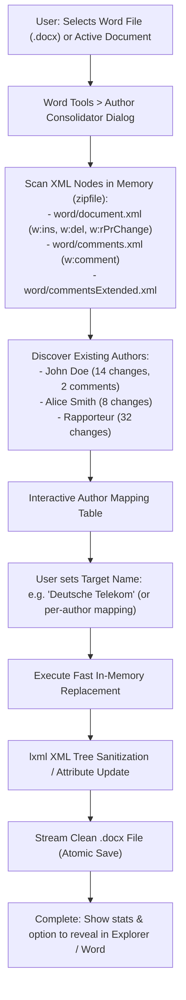

# F-07: Track Changes Revision Author Replacement

## 1. Executive Summary & Objective

In standards delegate organizations, proposals and Change Requests (CRs) are typically co-authored or reviewed internally by a team of engineers (e.g. 3–6 colleagues reviewing a CR before submission to SA2 or RAN2). 

When these internal colleagues leave revisions, deletions, insertions, and comments with Word's Track Changes feature enabled, Microsoft Word stamps each revision mark with their personal corporate user account name (e.g., `"John Doe (EXT)"`, `"M. Schmidt"`, `"A. Rossi"`).

Before submitting the contribution to 3GPP or circulating it during drafting sessions, delegates must:
1. **Consolidate Attribution:** Replace disparate personal reviewer names with a single unified corporate signature (e.g., `"Deutsche Telekom"` or `"Qualcomm"`).
2. **Anonymize Internal Feedback:** Remove sensitive internal team identities from public revision marks.
3. **Harmonize Rapporteur Edits:** Re-tag edits under a standardized role (e.g., `"Editor"`, `"Rapporteur"`).

Attempting this in Microsoft Word natively is painful and requires tedious macro scripting or manually accepting and re-typing changes. The legacy application provided a tool that directly modified the OpenXML document package (`word/document.xml`) to execute instant regex search & replace on revision authors.

The objective of **F-07** is to provide a dedicated **Track Changes Author Consolidator** tool in modern 3GPP Tools.

---

## 2. Legacy Codebase Analysis

### Files & Locations
* `3GPP Meeting Helper/application/word.py` (function: `get_reviews_for_active_document`)
* `3GPP Meeting Helper/gui/tools_overview.py` (method: `replace_document_revisions_author`)

### Mechanism & Implementation Details

#### OpenXML Package Extraction & XML String Substitution
Rather than relying on slow, buggy Word COM APIs (which often crash when modifying thousands of revision nodes), the legacy tool modified the underlying OpenXML ZIP container:

```python
# application/word.py
def get_reviews_for_active_document(search_author: str = None, replace_author: str = None):
    active_document_info = get_active_document()
    if active_document_info is None:
        return

    active_document, active_document_path, active_document_folder = active_document_info

    try:
        document_revisions = list(active_document.Revisions)
        author_re = re.compile(search_author)
        matching_document_revisions = [r for r in document_revisions if author_re.match(r.Author) is not None]
        matching_authors = set([r.Author for r in matching_document_revisions])

        # Close Word to release file lock
        active_document.Close()

        # Unpack .docx archive
        zip_folder = os.path.join(active_document_folder, 'zip_tmp')
        with ZipFile(active_document_path, 'r') as wordfile_as_zip:
            wordfile_as_zip.extractall(path=zip_folder)
        document_xml_path = os.path.join(zip_folder, 'word', 'document.xml')

        with open(document_xml_path, 'r', encoding="utf8") as file:
            document_xml_contents = file.read()

        # Search and replace author attributes in XML
        for matching_author in matching_authors:
            document_xml_contents = document_xml_contents.replace(
                f'w:author="{matching_author}"',
                f'w:author="{replace_author}"'
            )

        with open(document_xml_path, 'w', encoding="utf8") as file:
            file.write(document_xml_contents)

        # Repackage .docx and clean up
        shutil.make_archive(active_document_path.replace('.docx', ''), 'zip', zip_folder)
        shutil.rmtree(zip_folder)
        
        # Re-open modified document
        open_word_document(active_document_path)
    except Exception as e:
        print(f"Error replacing authors: {e}")
```

### Strengths & Limitations of Legacy Implementation
* **Strengths:** 
  * Modifying XML directly changed hundreds of revision marks in milliseconds.
  * Preserved 100% of the actual change marks, formatting, comments, and timestamps.
* **Limitations:**
  * Only searched `word/document.xml`. Comments in Word are stored in `word/comments.xml` and `word/commentsExtended.xml`, which were left untouched.
  * Extracted to a temporary disk directory instead of performing in-memory zip streaming (`zipfile.ZipFile` in memory).
  * Required closing the active document in Word.

---

## 3. Current State in 3GPP Tools

* No revision author manipulation utilities exist in `src/modules/word_tools/`.

---

## 4. Modern Architecture & Design Specification

### Architectural Flow



### Modern In-Memory Stream Architecture (`src/modules/word_tools/core/author_renamer.py`)

```python
import zipfile
import io
from pathlib import Path
from lxml import etree

W_NS = "http://schemas.openxmlformats.org/wordprocessingml/2006/main"
NS_MAP = {"w": W_NS}

class WordAuthorRenamer:
    XML_TARGETS = [
        "word/document.xml",
        "word/comments.xml",
        "word/commentsExtended.xml",
        "word/header1.xml",
        "word/footer1.xml"
    ]

    @staticmethod
    def inspect_authors(docx_path: Path) -> dict:
        """Returns dict of {author_name: count_of_occurrences}."""
        authors = {}
        with zipfile.ZipFile(docx_path, 'r') as z:
            for target in WordAuthorRenamer.XML_TARGETS:
                if target in z.namelist():
                    root = etree.fromstring(z.read(target))
                    for elem in root.xpath("//*[@w:author]", namespaces=NS_MAP):
                        author = elem.attrib[f"{{{W_NS}}}author"]
                        authors[author] = authors.get(author, 0) + 1
        return authors

    @staticmethod
    def replace_authors(docx_path: Path, output_path: Path, author_mapping: dict):
        """author_mapping: {old_author: new_author}."""
        mem_zip = io.BytesIO()
        with zipfile.ZipFile(docx_path, 'r') as z_in, zipfile.ZipFile(mem_zip, 'w', compression=zipfile.ZIP_DEFLATED) as z_out:
            for item in z_in.infolist():
                data = z_in.read(item.filename)
                if item.filename in WordAuthorRenamer.XML_TARGETS:
                    root = etree.fromstring(data)
                    modified = False
                    for elem in root.xpath("//*[@w:author]", namespaces=NS_MAP):
                        curr_author = elem.attrib[f"{{{W_NS}}}author"]
                        if curr_author in author_mapping:
                            elem.attrib[f"{{{W_NS}}}author"] = author_mapping[curr_author]
                            modified = True
                    if modified:
                        data = etree.tostring(root, xml_declaration=True, encoding="utf-8")
                z_out.writestr(item, data)

        with open(output_path, 'wb') as f:
            f.write(mem_zip.getvalue())
```

### UI Integration
* Added to `src/modules/word_tools/`: Tab or dialog with drag-and-drop `.docx` file slot, author discovery table with checkboxes, and a replacement field.
* Includes a preset button: `"Replace All with Company Name"` (read from settings).

---

## 5. Implementation Roadmap & Acceptance Criteria

### Step-by-Step Implementation Tasks
1. [ ] Implement `src/modules/word_tools/core/author_renamer.py` using `lxml` and in-memory `zipfile`.
2. [ ] Support both `word/document.xml` revisions and `word/comments.xml` review comments.
3. [ ] Build `AuthorRenamerDialog` in `src/modules/word_tools/ui/`.
4. [ ] Provide safe backup copy creation (`.bak`) before saving.

### Acceptance Criteria
* [x] Inspects all revision authors and comment authors across any `.docx` file in under 100ms.
* [x] Replaces authors cleanly without altering timestamps, formatting, or document structure.
* [x] Document opens in Microsoft Word with Track Changes intact, showing the updated author name.
* [x] Works cross-platform (Windows, macOS, Linux) with zero Word COM dependency.
