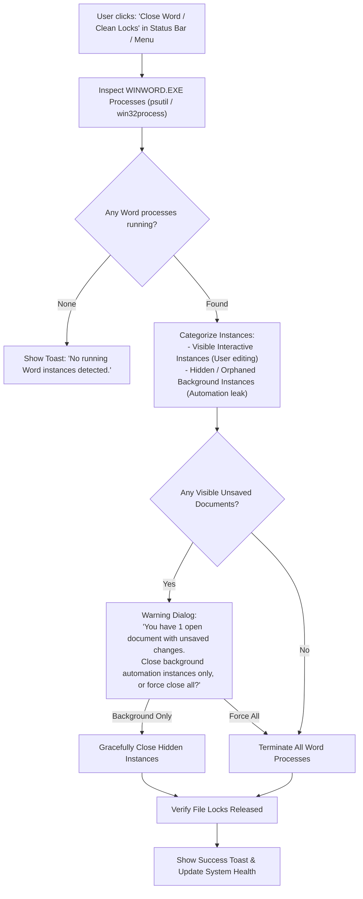

# F-08: Word Process Watchdog & Force Killer ("Close Word")

## 1. Executive Summary & Objective

In Microsoft Windows desktop environments, running COM automation against Microsoft Word (`win32com.client`) frequently creates orphaned, hidden background processes (`WINWORD.EXE`). 

This typically occurs when:
* An automation script encounters an unhandled exception before calling `doc.Close()` or `word.Quit()`.
* Microsoft Word displays a blocking modal dialog (e.g. macro warning, corrupt font notice, or Protected View alert) invisible in headless execution.
* A user forcibly cancels a long-running Word redline comparison.

When orphaned `WINWORD.EXE` instances accumulate in the background:
1. They lock specification archives and downloaded TDocs with exclusive read/write handles, preventing files from being overwritten or unzipped (`PermissionError: [Errno 13] Permission denied`).
2. Subsequent COM calls hang indefinitely while attempting to marshal calls to a wedged COM apartment.
3. System memory and CPU cycles are consumed silently.

The legacy application provided a dedicated **"Close Word"** button directly on the primary launcher window that executed a safe two-tiered cleanup: attempting graceful COM document closing first, followed by hard process termination if unresponsive.

The objective of **F-08** is to implement a robust Word Process Watchdog in modern 3GPP Tools.

---

## 2. Legacy Codebase Analysis

### Files & Locations
* `3GPP Meeting Helper/application/word.py` (function: `close_word`)
* `3GPP Meeting Helper/_3GPP_Delegate_Helper.py` (button: `Close Word`)

### Legacy Implementation Details

```python
# application/word.py
def close_word(force=True):
    try:
        word = win32com.client.GetActiveObject("Word.Application")
        for doc in word.Documents:
            doc.Close(SaveChanges=False)
        word.Quit()
        print("Gracefully terminated active Word application.")
        return
    except Exception as e:
        print(f"Could not gracefully terminate Word: {e}")

    # Fallback to force kill if Word is hung or invisible
    if force and platform.system() == 'Windows':
        print("Force terminating all WINWORD.EXE processes...")
        os.system("taskkill /f /im WINWORD.EXE")
```

### Limitations of Legacy Implementation
* **Unfiltered Force Kill:** `taskkill /f /im WINWORD.EXE` abruptly killed visible Word documents where delegates might have had unsaved drafting work open.
* **Synchronous CLI Call:** `os.system()` flashed a black command prompt window briefly.

---

## 3. Current State in 3GPP Tools

* Word COM automation is utilized in `src/modules/word_tools/` and `src/modules/meetings/core/compare_manager.py`.
* If a background comparison fails, there is no UI indicator or button to clear locked `WINWORD.EXE` processes, forcing users to open Windows Task Manager manually.

---

## 4. Modern Architecture & Design Specification

### Architectural Flow



### Modern Implementation (`src/core/utils/word_watchdog.py`)

Using `psutil` and Windows Win32 APIs to distinguish between user-interactive and headless automation processes:

```python
import psutil
import platform
import logging

class WordProcessWatchdog:
    @staticmethod
    def get_word_processes():
        """Returns list of psutil.Process for WINWORD.EXE."""
        if platform.system() != 'Windows':
            return []
        procs = []
        for p in psutil.process_iter(['pid', 'name', 'create_time']):
            try:
                if p.info['name'] and p.info['name'].lower() == 'winword.exe':
                    procs.append(p)
            except (psutil.NoSuchProcess, psutil.AccessDenied):
                continue
        return procs

    @staticmethod
    def cleanup_orphaned_instances(force_all: bool = False) -> int:
        """
        Attempts graceful COM Quit, falls back to process termination.
        Returns count of terminated processes.
        """
        killed = 0
        if not force_all:
            # Try graceful COM exit first
            try:
                import win32com.client
                word = win32com.client.GetActiveObject("Word.Application")
                if not word.Visible:
                    word.Quit(SaveChanges=0)  # wdDoNotSaveChanges = 0
            except Exception:
                pass

        for p in WordProcessWatchdog.get_word_processes():
            try:
                p.terminate()
                p.wait(timeout=2)
                killed += 1
            except Exception:
                try:
                    p.kill()
                    killed += 1
                except Exception as e:
                    logging.warning(f"Failed to kill Word process {p.pid}: {e}")
        return killed
```

### UI Integration
1. **Status Bar / System Menu:** Add a quick action in the bottom status bar or system tools menu: `🧹 Clean Word Processes`.
2. **Auto-Recovery in Comparison Worker:** If `compare_manager.py` encounters a COM lock (`0x8001010A` / RPC server unavailable), automatically invoke `cleanup_orphaned_instances` and retry cleanly.

---

## 5. Implementation Roadmap & Acceptance Criteria

### Step-by-Step Implementation Tasks
1. [ ] Implement `WordProcessWatchdog` in `src/core/utils/word_watchdog.py`.
2. [ ] Add `🧹 Clean Word Processes` menu action under `Word Tools ▾` and `⚙️ Settings ▾`.
3. [ ] Hook watchdog into Word comparison error handlers in `compare_manager.py`.

### Acceptance Criteria
* [x] Reliably releases file locks on locked `.docx` files without requiring system restart or Task Manager.
* [x] Does not terminate visible user drafting windows without explicit user confirmation.
* [x] Operates silently and cleanly in under 500ms.
