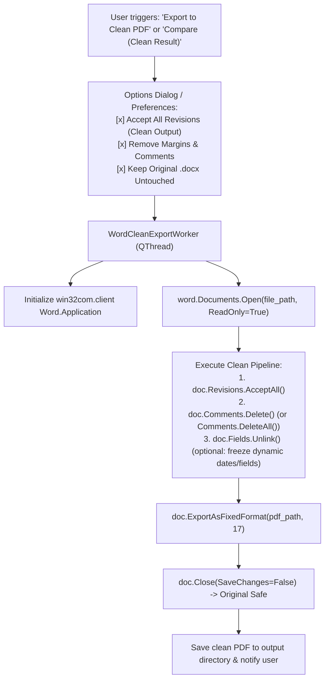

# F-10: Automated "Accept All Changes" Word Export Option

## 1. Executive Summary & Objective

In 3GPP standards drafting, Change Requests (CRs) are authored with Track Changes enabled, showing struck-through deletions, underlined additions, and marginal author comments. 

However, standards delegates frequently need clean, final versions of documents to:
1. **Verify Readability:** Review the text as it will actually appear when integrated into the normative technical specification, without visual clutter from change bars, strikethroughs, and revision colors.
2. **Export Final Reference PDFs:** Distribute approved CRs or agreed baseline text to management, technical teams, or external partners in a clean, legible PDF format.
3. **Feed AI Models Clean Text:** Avoid confusing local or external LLMs with interleaved deletion/addition tokens.

In the legacy application, `application.word.export_document()` featured an option `accept_all_changes=True` that automatically accepted all revision marks via Word COM and stripped comment markers prior to exporting clean PDF or HTML files.

In **3GPP Tools**, Word comparison and document exports currently retain all revision marks or require manual acceptance in Word. The objective of **F-10** is to restore the **"Accept All Changes"** option during Word PDF/HTML exports and redline comparisons.

---

## 2. Legacy Codebase Analysis

### Files & Locations
* `3GPP Meeting Helper/application/word.py` (function: `export_document`)

### Legacy Implementation Details

```python
# application/word.py
def export_document(
        word_files: List[str],
        export_format: ExportType = ExportType.PDF,
        exclude_if_includes='_rm.doc',
        remove_all_fields=False,
        accept_all_changes=False,
        do_after=ActionAfter.NOTHING,
        export_folder=None
) -> List[str]:
    ...
    for word_file in word_files:
        try:
            doc = word.Documents.Open(word_file)
            
            if accept_all_changes:
                print(f"Accepting all revision marks for {word_file}")
                # Microsoft Word COM Revisions collection
                doc.Revisions.AcceptAll()
                
            if remove_all_fields:
                print(f"Unlinking fields for {word_file}")
                doc.Fields.Unlink()
                
            # Export to PDF (wdExportFormatPDF = 17)
            # wdExportOptimizeForPrint = 0
            doc.ExportAsFixedFormat(
                OutputFileName=out_file,
                ExportFormat=17,
                OpenAfterExport=False,
                OptimizeFor=0
            )
            doc.Close(SaveChanges=False)
        except Exception as e:
            print(f"Export failed: {e}")
```

### Strengths & Limitations of Legacy Implementation
* **Strengths:** 
  * Leveraged Microsoft Word's native rendering engine, guaranteeing 100% font, formula, and table layout fidelity in the resulting PDF.
  * `doc.Close(SaveChanges=False)` ensured the original `.docx` file remained completely untouched on disk, preventing accidental loss of revision marks.
* **Limitations:**
  * Synchronous execution; if Word prompted a dialog, the UI stalled.

---

## 3. Current State in 3GPP Tools

* `src/modules/word_tools/` has document slicing and Word COM comparison.
* `src/modules/meetings/core/compare_manager.py` manages legal redline comparisons.
* When documents are exported to PDF or reviewed, there is no checkbox or option to automatically accept all changes and strip comments.

---

## 4. Modern Architecture & Design Specification

### Architectural Flow



### Implementation Details (`src/modules/word_tools/core/clean_exporter.py`)

```python
import platform
from pathlib import Path
import logging

class WordCleanExporter:
    @staticmethod
    def export_clean_pdf(docx_path: Path, output_pdf_path: Path, unlink_fields: bool = False) -> bool:
        """
        Opens docx in background Word instance, accepts all changes, strips comments,
        exports clean PDF, and closes document without saving changes to disk.
        """
        if platform.system() != 'Windows':
            logging.error("Clean Word PDF export requires Windows and Microsoft Word.")
            return False

        import pythoncom
        import win32com.client

        pythoncom.CoInitialize()
        word = None
        try:
            word = win32com.client.Dispatch("Word.Application")
            word.Visible = False
            word.DisplayAlerts = 0  # wdAlertsNone

            doc = word.Documents.Open(str(docx_path), ReadOnly=True)
            
            # 1. Accept all track changes
            if doc.Revisions.Count > 0:
                doc.Revisions.AcceptAll()

            # 2. Remove comments
            if doc.Comments.Count > 0:
                for c in list(doc.Comments):
                    c.Delete()

            # 3. Freeze fields
            if unlink_fields and doc.Fields.Count > 0:
                doc.Fields.Unlink()

            # 4. Export fixed PDF
            # wdExportFormatPDF = 17, wdExportOptimizeForPrint = 0
            doc.ExportAsFixedFormat(
                OutputFileName=str(output_pdf_path),
                ExportFormat=17,
                OpenAfterExport=False,
                OptimizeFor=0
            )
            doc.Close(SaveChanges=0)  # wdDoNotSaveChanges
            return True
        except Exception as e:
            logging.error(f"Clean PDF export failed for {docx_path}: {e}")
            return False
        finally:
            if word:
                try:
                    word.Quit(SaveChanges=0)
                except Exception:
                    pass
            pythoncom.CoUninitialize()
```

### UI Integration
* **TDocs Window Context Menu:** Right-click any TDoc -> `"Export Clean Final PDF (Accept All Changes)..."`
* **Word Tools Tab:** Add a clean export toggle in the Comparison and Document Slicer interfaces.

---

## 5. Implementation Roadmap & Acceptance Criteria

### Step-by-Step Implementation Tasks
1. [ ] Implement `WordCleanExporter` in `src/modules/word_tools/core/clean_exporter.py`.
2. [ ] Wrap execution in a non-blocking `QThread` (`WordCleanExportWorker`).
3. [ ] Add UI action in `tdocs_menus.py` and `src/modules/word_tools/ui/`.
4. [ ] Guarantee that original `.docx` files are strictly protected against modification (`ReadOnly=True`, `SaveChanges=0`).

### Acceptance Criteria
* [x] Resulting PDF has zero revision lines, strikethroughs, or comment bubbles.
* [x] The source `.docx` document retains all original revision marks when re-opened in Word.
* [x] Runs silently in the background with progress feedback.
