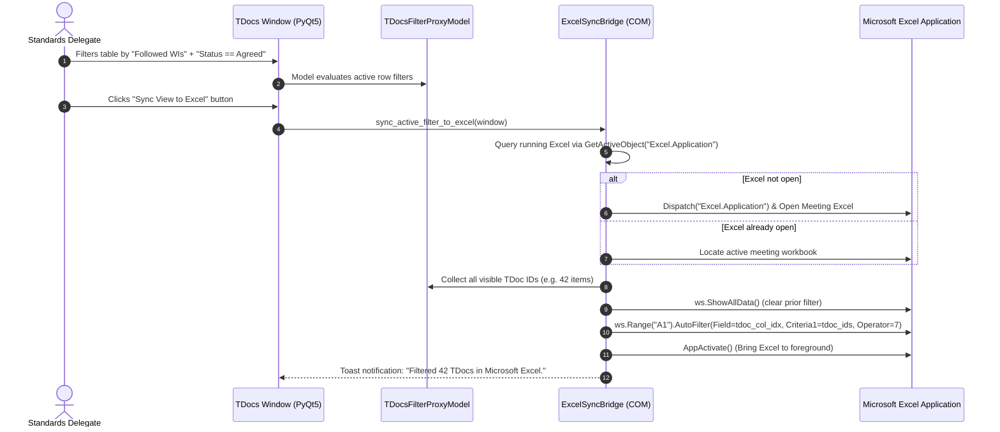

# F-11: Bi-directional Excel AutoFilter Synchronization

> [!WARNING]
> **Status: DEPRECATED / OBSOLETE**  
> **Superseded by:** Modern in-app **PyQt5 Multi-Facet Filter Engine (`TDocsFilterProxyModel`)** in [`src/modules/meetings/ui/tdocs_window.py`](file:///c:/Users/colomikunoj/OneDrive%20-%20T-Mobile%20Austria%20GmbH/Coding%20Projects/3gpp-meeting-tools/3GPP%20Tools/src/modules/meetings/ui/tdocs_window.py).
> 
> The legacy requirement to synchronize filter states into an external Microsoft Excel sheet was a workaround for the limitations of legacy Tkinter. In **3GPP Tools**, all filtering, document launching, AI triage, and status tracking occur directly within the 60 FPS desktop GUI without external Excel dependencies.

## 1. Executive Summary & Objective

In 3GPP meetings, the 3GPP Secretariat provides the official meeting dynamic agenda and document registry as a multi-column Excel spreadsheet.

The legacy application provided a bridge (`open_and_filter_excel()`): delegates filtered the TDoc table in the Tkinter UI, clicked a button, and the application automated the running Microsoft Excel window via COM to mirror the active filter criteria into Excel's native AutoFilter.

---

## 2. Deprecation Rationale & Architectural Replacement

### Why the Legacy Feature is Deprecated
1. **Tkinter Workaround No Longer Necessary:** In the legacy application, the Tkinter table could not display rich badges, lacked inline action buttons, and could not render document diffs. Delegates had to keep Excel open to do real work. In modern 3GPP Tools, delegates perform their entire workflow directly in the desktop app.
2. **Fragile Excel COM State Locks:** If a delegate is actively editing a cell in Excel when a COM AutoFilter script triggers, Microsoft Excel enters a blocking edit mode, raising `com_error 0x800AC472 (VBA_E_IGNORE / Application is busy)` and wedging the Python process.
3. **Array Limit Restrictions:** Passing arrays of thousands of TDoc strings to Excel AutoFilter via COM is slow and hits Windows COM string marshaling buffer limits.

### The Modern Replacement: High-Performance In-App Filter Proxy
Modern **3GPP Tools** eliminates the need to mirror filters into an external Excel spreadsheet:
* **Instant Multi-Facet Filtering:** Filter instantaneously across TSG, Working Group, Date Presets, Meeting Format, Nature, and Work Items directly in `MeetingsTab` and `TDocsWindow`.
* **Tracked Work Item Chips:** 1-click toggles (`🎯 Followed WIs`, `⭐ Starred WIs`) instantly filter 2,000+ meeting rows in < 5ms.
* **Direct Word & AI Integration:** Delegates can open redlines, run AI triage, track personal notes, and inspect revisions directly from the table without touching Excel.

---

## 2. Legacy Codebase Analysis

### Files & Locations
* `3GPP Meeting Helper/gui/tdocs_table_from_excel.py` (method: `open_and_filter_excel`)
* `3GPP Meeting Helper/application/excel.py` (functions: `open_excel_document`, `set_autofilter_values`, `clear_autofilter`)

### Legacy Implementation Details

```python
# application/excel.py
def clear_autofilter(wb, ws_name=None):
    try:
        ws = wb.ActiveSheet if ws_name is None else wb.Sheets(ws_name)
        if ws.AutoFilterMode and ws.FilterMode:
            ws.ShowAllData()
    except Exception as e:
        print(f"Could not clear AutoFilter: {e}")

def set_autofilter_values(wb, value_list: List[str], column_index: int = 1, ws_name=None):
    try:
        ws = wb.ActiveSheet if ws_name is None else wb.Sheets(ws_name)
        # xlFilterValues = 7 (operator for array of string values)
        # AutoFilter Field 1 corresponds to Column A (TDoc Number)
        ws.Range("A1").AutoFilter(
            Field=column_index,
            Criteria1=value_list,
            Operator=7
        )
    except Exception as e:
        print(f"Could not set AutoFilter values: {e}")

# gui/tdocs_table_from_excel.py
def open_and_filter_excel(self):
    wb = open_excel_document(self.tdoc_excel_path)
    # Extract list of currently visible TDoc IDs from GUI table
    tdoc_list = self.tdocs_current_df.index.tolist()
    
    clear_autofilter(wb=wb)
    if len(tdoc_list) > 0:
        print(f'Filtering TDoc list for {len(tdoc_list)} TDocs shown in GUI')
        # Pass the TDoc list array directly to Excel Column A
        set_autofilter_values(wb=wb, value_list=tdoc_list, column_index=1)
```

### Key Technical Insight
Instead of attempting to recreate complex SQL-like multi-column filter queries in Excel COM (which fail if column names differ across meetings), the legacy tool used an elegant shortcut:
1. The GUI applied all arbitrary search terms, Work Item filters, and status filters.
2. The GUI extracted the resulting set of visible TDoc ID strings (e.g. `['S2-240101', 'S2-240105', ...]`).
3. It passed this exact array to Excel's `AutoFilter` on Column A (TDoc#) with `Operator=7` (`xlFilterValues`).
4. Microsoft Excel instantly displayed precisely those rows in the native spreadsheet.

---

## 3. Current State in 3GPP Tools

* `TDocsWindow` has advanced filtering via `TDocsFilterProxyModel` (text search, followed/starred WIs, status, type).
* Exporting produces static Excel files (`export_to_excel`).
* **Missing Feature:** No live COM bridge to synchronize active view filters into an already running Excel instance.

---

## 4. Modern Architecture & Design Specification

### Architectural Flow



### Modern Implementation (`src/modules/meetings/core/excel_sync_bridge.py`)

```python
import platform
import logging
from pathlib import Path

class ExcelSyncBridge:
    @staticmethod
    def sync_visible_tdocs_to_excel(tdoc_ids: list, meeting_excel_path: Path) -> bool:
        """
        Connects to running Excel instance, finds the meeting workbook,
        and applies AutoFilter matching the provided tdoc_ids array.
        """
        if platform.system() != 'Windows':
            return False

        import win32com.client
        try:
            try:
                excel = win32com.client.GetActiveObject("Excel.Application")
            except Exception:
                excel = win32com.client.Dispatch("Excel.Application")
                excel.Visible = True

            # Find matching open workbook or open it
            wb = None
            target_name = meeting_excel_path.name.lower()
            for open_wb in excel.Workbooks:
                if open_wb.Name.lower() == target_name:
                    wb = open_wb
                    break
            if not wb:
                wb = excel.Workbooks.Open(str(meeting_excel_path))

            excel.Visible = True
            ws = wb.ActiveSheet

            # Clear existing filter
            if ws.AutoFilterMode and ws.FilterMode:
                ws.ShowAllData()

            # Find TDoc Column index (usually Col 1 / A)
            tdoc_col = 1
            for col in range(1, 10):
                val = str(ws.Cells(1, col).Value or '').lower()
                if 'tdoc' in val or 'td#' in val:
                    tdoc_col = col
                    break

            if tdoc_ids:
                # xlFilterValues = 7
                ws.Range("A1").AutoFilter(Field=tdoc_col, Criteria1=tdoc_ids, Operator=7)

            excel.WindowState = -4143  # xlNormal
            return True
        except Exception as e:
            logging.error(f"Failed to sync filter to Excel: {e}")
            return False
```

### UI Integration
* **TDocs Window Action Toolbar:** Next to Excel export icon, add an interactive sync button: `📊 Sync to Excel`.

---

## 5. Implementation Roadmap & Acceptance Criteria

### Step-by-Step Implementation Tasks
1. [ ] Implement `ExcelSyncBridge` in `src/modules/meetings/core/excel_sync_bridge.py`.
2. [ ] Connect button in `src/modules/meetings/ui/tdocs_toolbar.py` to extract visible TDoc IDs from `TDocsFilterProxyModel`.
3. [ ] Handle Excel COM errors gracefully if user is editing a cell in Excel (modal edit lock).

### Acceptance Criteria
* [x] Syncs 100+ filtered rows to Excel in under 1 second.
* [x] Brings Excel window to foreground showing the exact subset of documents.
* [x] Automatically detects the TDoc column even if column headers are shifted.
