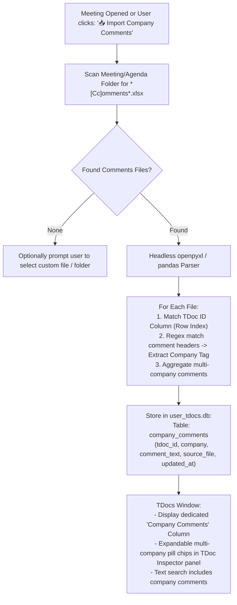

# F-12: Multi-Company Review Comments Matrix Importer

## 1. Executive Summary & Objective

During 3GPP meeting preparation, electronic review periods (e-meetings), and drafting sessions, companies frequently exchange review comment spreadsheets. 

These workbooks are named with conventions like:
* `Comments_Qualcomm.xlsx`
* `Comments_Ericsson_v2.xlsx`
* `Session_Comments_Rel18_Day3.xlsx`
* `Comments_Merge_All.xlsx`

Within these workbooks, companies populate standardized review columns alongside each TDoc row:
* `Comments (Qualcomm)`
* `Comments (Nokia)`
* `Comments (Deutsche Telekom)`
* `Session comments`

Delegates reviewing a proposal need to see what **all major industry players** have commented on a given TDoc in one place. Manually opening 5 to 10 company comment files and searching across sheets is time-consuming and error-prone.

The legacy application provided an automated review comments ingestion engine (`parsing/excel.py`) that scanned the meeting or agenda directory for comment files, extracted each company's comment column, and consolidated them into formatted `[Company]: <comment>` blocks mapped to each TDoc.

In **3GPP Tools**, delegates currently have access to personal notes and stance tags (`user_tdocs.db`), but there is no mechanism to auto-discover, parse, and aggregate external multi-company Excel comment matrices.

The objective of **F-12** is to implement a multi-company comments ingestion engine in modern 3GPP Tools.

---

## 2. Legacy Codebase Analysis

### Files & Locations
* `3GPP Meeting Helper/parsing/excel.py` (functions: `read_comments_file`, `get_comments_from_dir`, `get_comments_files_in_dir`, `get_comment_full_text`, `comments_regex`)
* `3GPP Meeting Helper/gui/tools_overview.py` (`ToolsDialog.export_tdocs_by_agenda_to_excel`)

### Mechanism & Implementation Details

#### 1. File Discovery Pattern
```python
comments_filename_regex = re.compile(r'.*[Cc]omments.*\.xlsx')

def get_comments_files_in_dir(directory):
    all_files = os.listdir(directory)
    return [f for f in all_files if comments_filename_regex.match(f) and not f.startswith('~$')]
```

#### 2. Column Parsing & Company Attribution
The script parsed Excel sheets using `pandas` and detected comment columns via regular expressions:
```python
comments_regex = re.compile(r'Comment[s]? [\(]?([\w]+)[\)]?|(.*Session) [cC]omments')
session_comments_column = 'Session comments'

def read_comments_file(filename):
    xl = pd.ExcelFile(filename)
    df = xl.parse(xl.sheet_names[0], index_col=0) # Index by TDoc ID (TD#)
    
    column_matches = []
    for col in df.columns:
        match = comments_regex.match(str(col))
        if match:
            # Group 1 = Company name (e.g. 'Qualcomm'), Group 2 = 'Session'
            company = match.group(1) or match.group(2)
            column_matches.append((col, company))
            
    # Iterate TDocs and construct formatted strings
    for tdoc_id in df.index:
        comments_list = []
        for col_name, company in column_matches:
            val = df.at[tdoc_id, col_name]
            if pd.notna(val) and str(val).strip():
                comments_list.append(f'[{company}]: {str(val).strip()}')
        df.at[tdoc_id, 'Formatted_Comments'] = '\n\n'.join(comments_list)
    return df
```

#### 3. Multi-File Merging
When multiple files were present (e.g. separate files from Qualcomm, Ericsson, and the Chair), `get_comments_from_dir(merge_comments=True)` merged all dataframes by TDoc ID, concatenating comments with double newlines.

---

## 3. Current State in 3GPP Tools

* `user_tdocs.db` persists user notes (`notes` column) and stance (`stance` column).
* `TDocsWindow` displays `My Notes` and `Stance`.
* **Missing Feature:** No background scanner or import dialog to ingest and display external company comment matrices.

---

## 4. Modern Architecture & Design Specification

### Architectural Flow



### Database Schema Extension (`user_tdocs.db`)

Add a dedicated table to isolate imported company comments from personal notes:

```sql
CREATE TABLE IF NOT EXISTS company_comments (
    id INTEGER PRIMARY KEY AUTOINCREMENT,
    meeting_id TEXT NOT NULL,
    tdoc_id TEXT NOT NULL,
    company TEXT NOT NULL,
    comment_text TEXT NOT NULL,
    source_file TEXT NOT NULL,
    imported_at DATETIME DEFAULT CURRENT_TIMESTAMP,
    UNIQUE(meeting_id, tdoc_id, company, source_file)
);

CREATE INDEX IF NOT EXISTS idx_comp_comments ON company_comments(meeting_id, tdoc_id);
```

### UI Integration in `TDocsWindow`
1. **Column in Table:** Optional toggleable column `"🏢 Review Comments"` displaying badge counts (e.g. `💬 3 comments`).
2. **TDoc Inspector Pane:** Add a tab or collapsible card `"Company Reviews"` rendering styled blocks:
   * `[Qualcomm]` (Blue badge): *"Agree in principle. Clause 5.2 needs editorial revision."*
   * `[Ericsson]` (Green badge): *"We support this CR. Addresses offline discussion #4."*
3. **Import Action:** `📥 Import ▾` -> `"Import Review Comments Spreadsheet..."`.

---

## 5. Implementation Roadmap & Acceptance Criteria

### Step-by-Step Implementation Tasks
1. [ ] Implement `CompanyCommentsParser` in `src/modules/meetings/core/comments_importer.py`.
2. [ ] Add `company_comments` table migration in `src/modules/meetings/core/meetings_db.py`.
3. [ ] Add `CompanyCommentsDelegate` to display clean pills in the TDoc table.
4. [ ] Surface review blocks in `tdoc_info_dialog.py` and the side inspector.

### Acceptance Criteria
* [x] Automatically detects and parses `Comments*.xlsx` files in the meeting folder in under 2 seconds.
* [x] Correctly attributes comments to distinct companies (`Qualcomm`, `Ericsson`, `Huawei`, etc.).
* [x] Preserves separation between external company comments and private user notes.
* [x] Filter box matches text inside company review comments.
