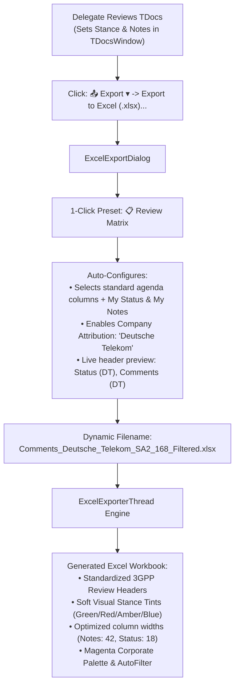

# F-12: Company Review Comments Matrix & Delegation Exporter

## 1. Executive Summary & Evolution

During 3GPP meeting preparation, electronic review periods (e-meetings), and drafting sessions, delegates review contributions and establish their company's positions and feedback.

In the legacy application (`3GPP Meeting Helper`), an ingestion engine (`parsing/excel.py`) was originally written to scan for external comment workbooks (`Comments_Qualcomm.xlsx`, `Comments_Ericsson.xlsx`, etc.) that were historically circulated over email reflectors.

### Modern 3GPP Workflow Reality
* In modern 3GPP working groups, delegates **no longer exchange raw comment spreadsheets via email attachments**.
* Instead, the primary operational requirement is **producing standardized company review matrices** from in-app notes and stances to share with corporate delegations, national coordination bodies, or to submit directly to the session chair/rapporteur.
* Within these workbooks, standardized review headers and visual stance highlighting are expected:
  * `Status (Deutsche Telekom)`
  * `Comments (Deutsche Telekom)`

In **3GPP Tools**, F-12 is implemented as a first-class **Company Review Matrix & Delegation Export Engine** integrated directly into the Excel export pipeline.

---

## 2. Modern Architecture & Implementation

---

## 3. Component Details

### 3.1. `ExcelExportDialog` (`src/modules/meetings/ui/excel_export_dialog.py`)
* **1-Click Review Matrix Preset (`_apply_review_preset`):** Instantly selects `TDoc`, `Title`, `Source`, `Type`, `Agenda Item`, `TDoc Status`, `My Status`, and `My Notes`.
* **Company Attribution Section (`3. Delegation && Review Matrix Options`):**
  * Checkbox: `[x] Format review columns with company attribution`.
  * Line edit: Configurable corporate name, auto-populated from `WordConfig` (`default_source_company`) or persisted in `export_config.json` (defaults to `"Deutsche Telekom"`).
  * Live Preview: Interactively displays `"Export headers: 'Status (Deutsche Telekom)' and 'Comments (Deutsche Telekom)'"`.
* **Standard Agenda Preset (`_apply_standard_preset`):** 1-click fallback to the standard clean meeting agenda columns without personal review notes.

### 3.2. `ExcelExporterThread` (`src/modules/meetings/core/excel_exporter.py`)
* **Dynamic Header Aliasing:** Replaces internal data keys (`My Status`, `My Notes`) with the attributed corporate headers (`Status (<Company>)`, `Comments (<Company>)`).
* **Visual Stance Highlight Palette:** Soft corporate fills and bold colored text matching standard telecommunications review conventions:
  * **Support (`🟢 Support`):** Soft green fill (`#E6F4EA`), dark green text (`#137333`).
  * **Object (`🔴 Object`):** Soft red fill (`#FCE8E6`), dark red text (`#C5221F`).
  * **Monitor / Discuss (`🟡 Monitor`):** Soft amber fill (`#FEF7E0`), dark amber text (`#B06000`).
  * **My TDoc (`🔵 My TDoc`):** Soft blue fill (`#E8F0FE`), dark blue text (`#1A73E8`).
  * **Neutral (`⚪ Neutral`):** Sanitized to an empty cell with standard zebra fill.
* **Ergonomic Column Widths:** Automatically expands the comments column to `42` characters with multi-line text wrapping enabled, and status column to `18` characters with centered alignment.

### 3.3. `TDocsExportController` (`src/modules/meetings/ui/tdocs_export_controller.py`)
* **Smart Filename Heuristics:** When review columns are included with company attribution, defaults the save dialog filename to `Comments_<Company>_<WG>_<Meeting>_<Scope>.xlsx` (e.g. `Comments_Deutsche_Telekom_SA2_168_Filtered.xlsx`).

---

## 4. Verification & Testing

Automated test suite: [`tests/test_excel_company_review_export.py`](file:///tests/test_excel_company_review_export.py)
* **Preset & Header Verification:** Tests Review Matrix preset selection, Standard Agenda preset reset, dynamic company attribution renaming, and disabling attribution.
* **Workbook Generation & Cell Styling:** Inspects generated `.xlsx` package using `openpyxl`, validating header text, soft color fills, font weights, status sanitization, and column dimensions.
