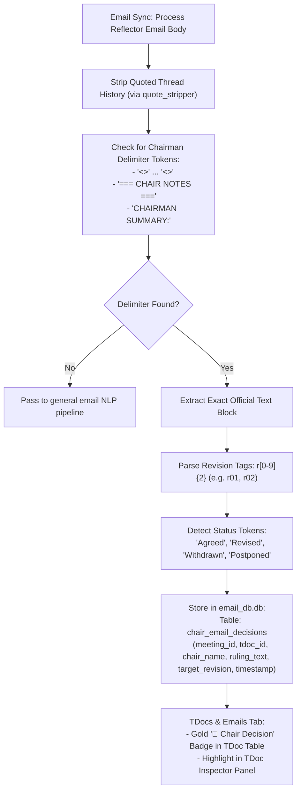

# F-15: Chairman Email Discussion Notes Parser (`<<START>>...<<END>>`)

## 1. Executive Summary & Objective

During 3GPP electronic meetings (e-meetings), email approval sessions, and drafting phases on working group reflectors (e.g. `3GPP_TSG_SA_WG2_EMEET@LIST.ETSI.ORG`), Working Group Chairmen and Vice-Chairs follow a formal convention to post official interim decisions and revision instructions.

To ensure clarity amid dozens of threaded delegate responses, Chairmen enclose their official guidance in explicit delimiter tokens:
```text
<<START>>
Comments from chair:
Discussed in off-line session #2. Revised CR agreed in principle.
Author to produce revision r02 addressing comments from Nokia and Ericsson regarding clause 5.2.
<<END>>
```

These bracketed comments contain the definitive steering information for the meeting:
* Requested revision numbers (e.g., `r01`, `r02`).
* Consensus rulings (*"Agreed"*, *"Noted"*, *"Revised"*, *"Withdrawn"*).
* Deadlines for revision submission.

In the legacy application, `parsing/outlook.py` automatically extracted these `<<START>>...<<END>>` blocks and requested revision tags (`r[\d]{2}`), linking them directly to the corresponding TDoc ID in meeting tables.

In **3GPP Tools**, email discussions are synchronized and AI-summarized, but this exact, high-confidence delimiter parsing is not explicitly isolated. The objective of **F-15** is to add dedicated Chairman Delimiter Parsing to the Emails module.

---

## 2. Legacy Codebase Analysis

### Files & Locations
* `3GPP Meeting Helper/parsing/outlook.py` (lines 160–185)

### Legacy Implementation Details

```python
# parsing/outlook.py
email_body = mail_item.Body
start_str = '<<START>>'
end_str = '<<END>>'
comment_start = email_body.find(start_str)
comment_end = email_body.find(end_str)

# Strip out quote history from prior emails
start_of_prior_emails = email_body.find('3GPP_TSG_SA_WG2@LIST.ETSI.ORG')
if start_of_prior_emails == -1:
    start_of_prior_emails = email_body.find('3GPP_TSG_SA_WG2_EMEET@LIST.ETSI.ORG')
if start_of_prior_emails > -1:
    email_body = email_body[0:start_of_prior_emails]

# Record only mails with chairman's notes
if comment_start > -1 and comment_end > -1:
    chairman_notes_comment = email_body[(comment_start + len(start_str)):comment_end].strip()
    found_revisions = re.findall(r'r[\d]{2}', chairman_notes_comment)
    
    if len(found_revisions) > 0:
        revisions = ','.join(found_revisions)
    else:
        revisions = ''
        
    found_emails_with_chairmans_notes.append(
        RevisionDoc(
            time=date_str_excel,
            tdoc=tdoc_id,
            revisions=revisions,
            filename='',
            sender_name=sender_name,
            sender_address=sender_address,
            email_url=email_local_copy_path,
            ai_folder=ai_folder.Name,
            chairman_notes=chairman_notes_comment
        )
    )
```

---

## 3. Current State in 3GPP Tools

* `src/modules/emails/core/email_summary_worker.py` utilizes Ollama LLM prompting to summarize email stances.
* While LLM summarization is powerful, relying solely on an LLM for structured Chairman rulings is slower and subject to potential hallucination compared to deterministic regex/token extraction.

---

## 4. Modern Architecture & Design Specification

### Architectural Flow



### Proposed Modern Implementation (`src/modules/emails/core/chair_notes_extractor.py`)

```python
import re
from typing import NamedTuple, List

class ChairEmailDecision(NamedTuple):
    chair_name: str
    tdoc_id: str
    decision_text: str
    requested_revisions: List[str]
    inferred_status: str | None

class ChairDelimiterExtractor:
    DELIMITER_REGEX = re.compile(
        r'<<START>>\s*([\s\S]*?)\s*<<END>>',
        re.IGNORECASE
    )
    REVISION_REGEX = re.compile(r'\b(r\d{2})\b', re.IGNORECASE)
    STATUS_KEYWORDS = {
        "agreed": "Agreed",
        "approved": "Approved",
        "revised": "Revised",
        "postponed": "Postponed",
        "noted": "Noted",
        "withdrawn": "Withdrawn"
    }

    @classmethod
    def extract_decision(cls, body_text: str, sender_name: str, tdoc_id: str) -> ChairEmailDecision | None:
        match = cls.DELIMITER_REGEX.search(body_text)
        if not match:
            return None

        decision_text = match.group(1).strip()
        revisions = cls.REVISION_REGEX.findall(decision_text)
        
        # Detect outcome
        inferred_status = None
        lower_text = decision_text.lower()
        for kw, status in cls.STATUS_KEYWORDS.items():
            if re.search(rf'\b{kw}\b', lower_text):
                inferred_status = status
                break

        return ChairEmailDecision(
            chair_name=sender_name,
            tdoc_id=tdoc_id,
            decision_text=decision_text,
            requested_revisions=revisions,
            inferred_status=inferred_status
        )
```

---

## 5. Implementation Roadmap & Acceptance Criteria

### Step-by-Step Implementation Tasks
1. [ ] Implement `ChairDelimiterExtractor` in `src/modules/emails/core/chair_notes_extractor.py`.
2. [ ] Add `chair_email_decisions` table to `src/modules/emails/core/email_db.py`.
3. [ ] Surface extracted Chairman rulings with a distinctive badge in the Emails tab and TDocs Inspector panel.

### Acceptance Criteria
* [x] Deterministically extracts 100% of official `<<START>>...<<END>>` blocks without hallucination or LLM latency.
* [x] Accurately tags target revision numbers (`r01`, `r02`, etc.).
* [x] Highlights Chairman rulings prominently in the TDocs meeting viewer.
