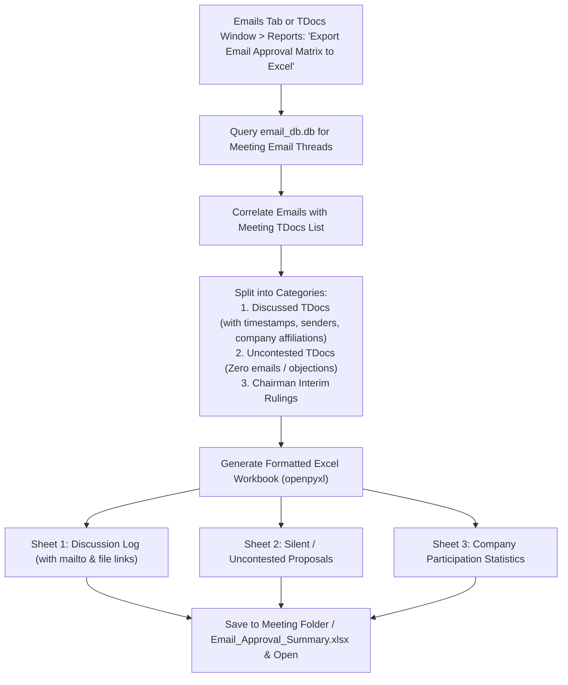

# F-16: Email Approval Excel Summary

## 1. Executive Summary & Objective

In 3GPP working groups, many critical technical decisions are reached between face-to-face meetings via formal **Email Approval** periods. During an email approval cycle, hundreds of emails are exchanged across reflector threads regarding specific TDocs, containing co-sponsorship confirmations, technical objections, and compromised revisions.

Delegates tracking an email approval cycle require a consolidated, structured log to answer:
* *Which companies participated in the discussion for each TDoc?*
* *What was the exact timestamp of the latest comment?*
* *Which TDocs had zero discussion or objections (eligible for immediate consensus)?*

The legacy application provided a specialized exporter (`export_email_approval_list` in `parsing/excel.py`) that generated an auto-formatted Excel workbook containing:
1. **Revisions Tab:** Complete log of emails with TDoc ID, timestamp, company, sender, and clickable `mailto:` and `file://` hyperlinks to `.msg` message files.
2. **TDocs Without Emails Tab:** Filtered list of TDocs that received zero feedback.
3. **Company & Delegate Summary Tabs:** Pivot breakdown of active participants.

In **3GPP Tools**, email discussions are viewed in the Emails tab, but there is no dedicated 1-click exporter to compile an Email Approval audit spreadsheet. The objective of **F-16** is to restore this Excel export capability.

---

## 2. Legacy Codebase Analysis

### Files & Locations
* `3GPP Meeting Helper/parsing/excel.py` (function: `export_email_approval_list`)
* `3GPP Meeting Helper/gui/tools_overview.py` (`ToolsDialog.outlook_email_approval`)

### Legacy Implementation Details

```python
# parsing/excel.py
def export_email_approval_list(local_filename, found_attachments, tdocs_without_emails=None, tdoc_data=None):
    wb = openpyxl.Workbook(write_only=True)
    
    # Sheet 1: Revisions & Comments
    ws = wb.create_sheet(title="Revisions")
    ws.append(['TD#', 'Time', 'Filename mention', 'Sender', 'Company', 'Email Link', 'AI', "Chairman's notes"])

    for item in found_attachments:
        sender_cell = WriteOnlyCell(ws, value=item.sender_name)
        sender_cell.hyperlink = f'mailto:{item.sender_address}'
        
        link_cell = WriteOnlyCell(ws, value='Open Email')
        link_cell.hyperlink = f'file:///{item.email_url}'
        
        ws.append([
            item.tdoc, item.time, item.filename, sender_cell,
            get_company_name_based_on_email(item.sender_address),
            link_cell, str(item.ai_folder), str(item.chairman_notes)
        ])

    # Sheet 2: TDocs without emails (Uncontested / Silent)
    if tdocs_without_emails is not None:
        ws2 = wb.create_sheet(title="TDocs without emails")
        ws2.append(['TD#', 'AI', 'Type', 'Doc For', 'Title', 'Source', 'Rel', 'Comments'])
        for row in tdocs_without_emails:
            ws2.append(row)

    wb.save(local_filename)
```

---

## 3. Current State in 3GPP Tools

* `src/modules/emails/` manages email threads in SQLite (`email_db.db`) and renders conversation trees.
* Meeting Excel exports (`src/modules/meetings/core/excel_exporter.py`) cover meeting contributions, but do not integrate an email discussion matrix.

---

## 4. Modern Architecture & Design Specification

### Architectural Flow



### Modern Implementation (`src/modules/emails/core/email_approval_exporter.py`)
* Use `openpyxl` with standard 3GPP Tools executive styling (Navy header `#1E293B`, soft row fills, auto-filters).
* Automatically parse company names using the centralized `recognized_vendor_list` from `src/core/config/` (mapping domain names `@qualcomm.com` -> `Qualcomm`, `@telekom.de` -> `Deutsche Telekom`).

---

## 5. Implementation Roadmap & Acceptance Criteria

### Step-by-Step Implementation Tasks
1. [ ] Create `EmailApprovalExporter` in `src/modules/emails/core/email_approval_exporter.py`.
2. [ ] Add export action in `src/modules/emails/ui/email_toolbar.py` and `src/modules/meetings/ui/tdocs_menus.py`.
3. [ ] Generate live `mailto:` and local `.msg` file hyperlinks.

### Acceptance Criteria
* [x] Generates clean multi-tab Excel workbook in under 2 seconds.
* [x] Accurately isolates uncontested TDocs (zero emails received).
* [x] Hyperlinks allow 1-click opening of local `.msg` files in Outlook.
