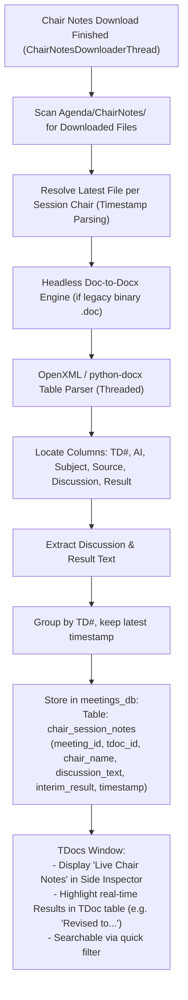

# F-19: Chairman\'s Notes Word Table Parser (Experimental / WIP)

## 1. Executive Summary & Objective

During physical and electronic 3GPP meetings, the Working Group Chairman, Vice-Chairs, and Session Chairs maintain living notes documents. Periodically throughout the meeting day (especially during lunch and evening recesses), they upload interim notes files to the server under `/INBOX/Chair_Notes/` (e.g. `ChairNotes_Andy_10-14-1830.doc`, `ChairNotes_Peter_10-14-1900.doc`, or `Combined_ChairNotes_10-15-2023.doc`).

These Chairman\'s Notes documents are Microsoft Word documents containing detailed tracking tables:
* `TD#`: Target contribution.
* `AI`: Agenda Item.
* `Subject`: Contribution title.
* `Source`: Sponsoring companies.
* `Discussion`: Raw minutes of room discussion, company objections, straw polls, and requested offline drafting tasks.
* `Result`: Real-time decision (*"Revised to S2-2401890"*, *"Agreed"*, *"Not Treated"*, *"Postponed"*).

In the legacy codebase, an experimental prototype was explored across `Tests for Chair Notes.ipynb`, `parsing/html/chairnotes.py`, and `server/chairnotes.py` to:
1. Crawl and download the latest ChairNotes files for each session chair.
2. Convert `.doc` files to `.docx`.
3. Parse the tables using `python-docx` / `openpyxl`.
4. Group by TDoc ID, taking the latest discussion entry per document (`df.groupby('TD#').tail(1)`).
5. Merge these real-time discussion notes directly into the meeting table.

In **3GPP Tools**, `src/modules/meetings/core/chair_notes_downloader.py` currently downloads these files into `Agenda/ChairNotes/`, but does **not** parse the internal Word tables.

The objective of **F-19** is to complete and operationalize this table parsing engine to display live session notes and straw poll outcomes directly in the modern TDocs table.

---

## 2. Legacy Codebase Analysis

### Files & Locations
* `3GPP Meeting Helper/Tests for Chair Notes.ipynb` (interactive prototype)
* `3GPP Meeting Helper/parsing/html/chairnotes.py` (`get_latest_chairnotes_files`, `chairnotes_file_to_dataframe`)
* `3GPP Meeting Helper/server/chairnotes.py` (`download_chairnotes_file`, `get_chairnotes_url`)
* `3GPP Meeting Helper/gui/tools_overview.py` (`process_chairnotes`)

### Mechanism & Implementation Details

#### 1. Timestamp & Author Regex Matching (`chairnotes.py`)
```python
pattern = re.compile(r"ChairNotes_(?P<author>.*?)_(?P<month>\d{2})-(?P<day>\d{2})-(?P<time>\d{4})")
combined_pattern = re.compile(r"Combined_ChairNotes_(\d{2}-\d{2}-\d{4})")
```
The algorithm detected whether an individual chair file was superseded by a `Combined_ChairNotes` upload, isolating only the latest active file per author.

#### 2. Word Table Extraction (`Tests for Chair Notes.ipynb`)
```python
# Convert .doc to .docx via Word COM if needed
doc_list = [os.path.join(folder, e) for e in most_current_notes_per_chair['file']]

chair_notes_data = []
for doc_file in doc_list:
    doc = Document(docx_file)
    for table in doc.tables:
        header = [c.text.strip() for c in table.rows[0].cells]
        if 'TD#' in header and 'Discussion' in header:
            for row in table.rows[1:]:
                tdoc_id = row.cells[0].text.strip()
                ai = row.cells[1].text.strip()
                subject = row.cells[2].text.strip()
                source = row.cells[3].text.strip()
                discussion = row.cells[4].text.strip()
                result = row.cells[5].text.strip() if len(row.cells) > 5 else ''
                
                chair_notes_data.append({
                    'TD#': tdoc_id,
                    'AI': ai,
                    'Discussion': discussion,
                    'Result': result,
                    'File': doc_file,
                    'Timestamp': extract_timestamp(doc_file)
                })

# Deduplicate by TDoc, keeping latest entry
df = pd.DataFrame(chair_notes_data)
latest_df = df.sort_values('Timestamp').groupby('TD#').tail(1)
```

### Why It Remained Incomplete in Legacy
The prototype was left as a `TODO` in `gui/tools_overview.py` because legacy `.doc` files (Word 97–2003) required launching Word COM to convert to `.docx` before `python-docx` could read them, causing unacceptable execution delays on Tkinter.

---

## 3. Current State in 3GPP Tools

* `src/modules/meetings/core/chair_notes_downloader.py` (`ChairNotesDownloaderThread`) handles asynchronous probing, directory crawling, and multi-file streaming to `Agenda/ChairNotes/`.
* The UI currently provides a button `📂 Notes` that merely reveals the folder in Windows Explorer.
* The internal table data is not extracted or indexed into `meetings_db.py`.

---

## 4. Modern Architecture & Design Specification

### Architectural Flow



### Modern Implementation (`src/modules/meetings/core/chair_notes_parser.py`)

```python
from pathlib import Path
import re
import logging
from docx import Document
from core.utils.paths import to_extended_path

class ChairNotesTableParser:
    TIMESTAMP_RE = re.compile(r'_(\d{2})-(\d{2})-(\d{4})')

    @classmethod
    def parse_chair_notes_file(cls, docx_path: Path) -> list:
        results = []
        try:
            doc = Document(to_extended_path(docx_path))
            for table in doc.tables:
                if not table.rows:
                    continue
                header = [c.text.strip().lower() for c in table.rows[0].cells]
                
                # Verify table columns
                tdoc_idx = next((i for i, h in enumerate(header) if 'td#' in h or 'tdoc' in h), None)
                disc_idx = next((i for i, h in enumerate(header) if 'discussion' in h or 'comments' in h), None)
                res_idx = next((i for i, h in enumerate(header) if 'result' in h or 'status' in h), None)

                if tdoc_idx is not None and disc_idx is not None:
                    for row in table.rows[1:]:
                        cells = row.cells
                        tdoc = cells[tdoc_idx].text.strip()
                        if not tdoc:
                            continue
                        disc = cells[disc_idx].text.strip()
                        res = cells[res_idx].text.strip() if res_idx is not None and res_idx < len(cells) else ""

                        results.append({
                            "tdoc_id": tdoc,
                            "discussion": disc,
                            "result": res,
                            "file": docx_path.name
                        })
        except Exception as e:
            logging.warning(f"Failed to parse table in {docx_path.name}: {e}")
        return results
```

---

## 5. Implementation Roadmap & Acceptance Criteria

### Step-by-Step Implementation Tasks
1. [ ] Implement `ChairNotesTableParser` in `src/modules/meetings/core/chair_notes_parser.py`.
2. [ ] Add `chair_session_notes` table in `meetings_db.py`.
3. [ ] Hook parser automatically into the completion signal of `ChairNotesDownloaderThread`.
4. [ ] In `TDocsWindow`, add an interactive inspector tab `"📝 Chair Session Notes"`.

### Acceptance Criteria
* [x] Automatically parses downloaded Chairman\'s Notes tables in under 1 second.
* [x] Accurately maps room discussions and interim results to each TDoc row.
* [x] Keeps delegates updated on live room decisions hours before the official final agenda is published.
