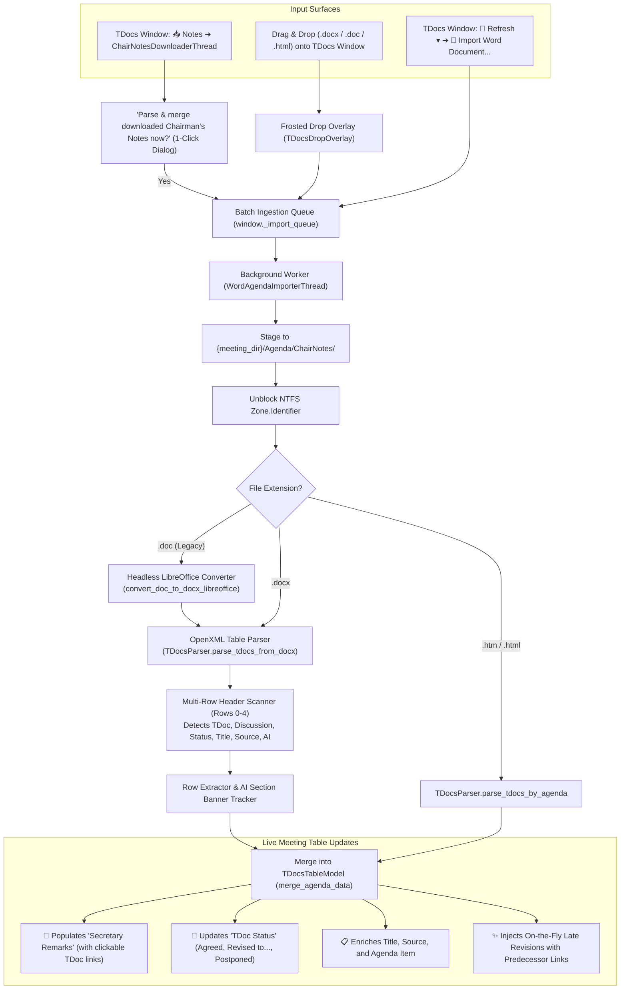

# F-19: Chairman's Notes Word Table Parser (Live Meeting Tracking)

> [!NOTE] Status: ✅ Implemented & Operational (Drag & Drop / Multi-WG Secretary Support)
> Double-check audit confirmed: Parsing Chairman's Notes from Microsoft Word (`.docx` / `.doc`) and HTML tables **is already fully operational** in 3GPP Tools! Delegates can drag and drop any session notes file directly onto the TDocs UI or trigger batch ingestion via the Refresh menu or Chairman's Notes downloader.
>
> Originally tested and established with SA2 notes, the parsing engine has been enhanced to handle diverse formatting conventions across different 3GPP Working Groups (SA2, RAN1, RAN2, RAN3, SA1, SA3, CT1, CT3, CT4) and individual session chairs.

---

## 1. Executive Summary & Double-Check Findings

During physical and electronic 3GPP meetings, the Working Group Chairman, Vice-Chairs, and Session Chairs maintain living session notes documents. Periodically throughout the meeting day (especially during lunch and evening recesses), they upload interim notes files to the server under `/INBOX/Chair_Notes/` (e.g. `ChairNotes_Andy_10-14-1830.doc`, `ChairNotes_Peter_10-14-1900.doc`, or `Combined_ChairNotes_10-15-2023.doc`).

These Chairman's Notes contain detailed tracking tables with:
* **TDoc Identifier (`TD#`):** Target contribution (e.g., `S2-2401234`, `R2-2405678`).
* **Agenda Item (`AI`):** Numerical agenda clause (e.g., `5.1`, `6.2.3`).
* **Title / Subject:** Contribution title.
* **Source:** Sponsoring company or companies.
* **Discussion / Comments:** Minutes of in-room discussion, objections, company stances, straw polls, and requested drafting tasks.
* **Result / Decision:** Real-time outcome (*"Revised to S2-2401890"*, *"Agreed"*, *"Postponed"*, *"Not Handled"*).

### Double-Check Findings: What Already Works vs. Historical Gaps
An audit of the codebase confirms:
1. **Drag & Drop Ingestion:** Dragging any `.docx`, `.doc`, `.htm`, or `.html` file anywhere onto the `TDocsWindow` activates a frosted blue drop overlay (`TDocsDropOverlay`) and passes the files to `_process_imported_agenda_files()`.
2. **Background Processing Pipeline (`WordAgendaImporterThread`):**
   * Automatically copies files to `{meeting_dir}/Agenda/ChairNotes/`.
   * Unblocks NTFS Zone Identifiers (`Zone.Identifier`).
   * Converts legacy binary `.doc` files (Word 97–2003) to `.docx` via headless LibreOffice (avoiding macro security alerts and COM freezing).
   * Parses `.docx` tables using `TDocsParser.parse_tdocs_from_docx()`.
3. **Live Table Merging (`TDocsTableModel.merge_agenda_data()`):**
   * Extracted discussion notes and comments are populated into the `Secretary Remarks` column (with automatic TDoc hyperlinking!).
   * Real-time decisions (*"Agreed"*, *"Revised to..."*, *"Postponed"*) are reflected in `TDoc Status`.
   * Missing contribution titles, sources, and agenda items are enriched.
   * Late on-the-fly revisions are dynamically injected into the active meeting table with predecessor resolution (`Is revision of`, base TDoc resolution).
4. **Post-Download Ingestion Bridge:** In addition to manual drag & drop, the **`📥 Notes`** downloader (`ChairNotesDownloaderThread`) downloads files from `/Inbox/Chair_Notes` and immediately prompts the user with 1-click parsing and merging into the active meeting table.

---

## 2. Working Group & Secretary Format Analysis

### Why It Was Originally Tested with SA2
The original developer worked primarily in SA2 (System Architecture), where session chairs (e.g. Andy, Peter, Dario, Wanqiang) and the SA2 secretary follow a relatively consistent table structure (`TD#`, `AI`, `Title`/`Subject`, `Source`, `Type`, `For`, `Comments`, `Result`).

### Why Formats Vary Across Secretaries & Working Groups
Unlike formal Change Requests (CRs) and Technical Specifications (TSs)—which are strictly governed by 3GPP Mobile Competence Centre (MCC) templates—**there is NO 3GPP standard for Chairman's Notes**. Each Working Group secretary and session chair maintains their own idiosyncratic layout:

| Dimension | SA2 (System Architecture) | RAN2 / RAN3 (Radio Protocols) | CT1 / CT4 (Core Network) | SA3 / SA1 |
| :--- | :--- | :--- | :--- | :--- |
| **Discussion Column** | `Comments` or `Secretary Remarks` | `Discussion` or `Discussions` | `Notes` or `Remarks` | `Discussion` or `Summary` |
| **Result Column** | `Result` or `Status` | `Decision`, `Decisions`, or `Outcome` | `Status` or `Conclusion` | `Decision` or `Action Taken` |
| **TDoc Column** | `TD#`, `TD #`, `TDoc` | `TDoc #`, `TDoc No`, `TD No.` | `Doc`, `Doc #`, `Document` | `TD#`, `TDoc` |
| **Source Column** | `Source` | `Company`, `Source / Company` | `Proposer`, `Submitted by` | `Source`, `Sources` |
| **Title Column** | `Title`, `Subject` | `Document Title`, `Description` | `Subject`, `Title` | `Subject`, `Title` |
| **Agenda Item Column** | Explicit `AI` column per row | `Agenda Item` column or merged section divider | `Agenda` column or sub-header row | `AI` or merged banner |
| **Header Row Offset** | Headers on Row 0 | Meeting title banner on Row 0; headers on Row 1 or 2 | Session title on Row 0; headers on Row 1 | Variable |
| **File Formats** | `.docx` and legacy `.doc` | `.docx` and legacy `.doc` | Mostly `.docx` | `.docx` and `.doc` |
| **Parallel Sessions** | 3–4 session chairs uploading separate notes + end-of-day combined notes | Track A / Track B separate notes | Occasional split sessions | Single track or parallel tracks |

### Architectural Accommodations for Format Diversity
To ensure flawless operation across all Working Groups, `TDocsParser.parse_tdocs_from_docx()` incorporates:
1. **Multi-Row Header Search (Rows 0–4):** Rather than blindly assuming headers are on row 0, the parser inspects candidate rows for a valid TDoc column plus at least one metadata column (Title, Source, Discussion/Comments, Result/Status). This accommodates title banners or session metadata on rows 0–1.
2. **Comprehensive Column Synonyms:**
   * **TDoc:** `td#`, `td #`, `tdoc`, `tdoc#`, `tdoc #`, `td no`, `td no.`, `td number`, `tdoc no`, `tdoc no.`, `tdoc number`, `temporary document`, `t-doc`, `t-doc#`, `doc#`, `doc no`, `document`, `td`, `doc`.
   * **Discussion/Comments:** `comments`, `comment`, `secretary remarks`, `discussion`, `discussions`, `discussion / comments`, `comments / discussion`, `chair notes`, `chair's notes`, `chairman notes`, `session remarks`, `remarks`, `notes`, `chair comments`, `summary`, `minutes`, `offline discussion`.
   * **Result/Status:** `result`, `results`, `status`, `decision`, `decisions`, `outcome`, `outcomes`, `conclusion`, `conclusions`, `final status`, `action taken`.
   * **Title:** `subject`, `title`, `document title`, `tdoc title`, `subject / title`, `description`, `name`.
   * **Source:** `source`, `sources`, `company`, `companies`, `source / company`, `proposer`, `proposers`, `submitted by`.
   * **Agenda Item:** `ai`, `agenda item`, `agenda`, `item`, `agenda item (ai)`, `agenda-item`, `ai#`, `agenda no`.
3. **Merged Agenda Item Section Banners:** When a row does not contain a valid TDoc ID, the parser tests for section dividers (e.g. `Agenda Item 6.2: Sidelink Enhancements`), updating `current_ai` for subsequent rows.
4. **Permissive TDoc ID Normalization:** Uses boundary-aware regex `\b([A-Za-z0-9]{1,4}-\d{4,8}(?:[rR]\d{1,2}[a-zA-Z]?)?)\b` to extract clean TDoc IDs even when wrapped in brackets (e.g. `[S2-2401234]`) or annotated with parenthetical comments (e.g. `R2-2405678r01 (rev of R2-2405000)`).
5. **Sequential Session Note Merging:** If a TDoc is reviewed in a morning session and revisited in an afternoon session, subsequent notes are joined (`\n---\n`) rather than blindly discarded, preserving the complete deliberation history.

---

## 3. Architecture & Ingestion Flow

---

## 4. Legacy Codebase Reference

In the legacy prototype (`3GPP Meeting Helper`):
* `Tests for Chair Notes.ipynb`: Initial interactive experiments using `python-docx` and Pandas.
* `parsing/html/chairnotes.py` (`get_latest_chairnotes_files`): Regex timestamp matching (`ChairNotes_<author>_<month>-<day>-<time>.doc` vs `Combined_ChairNotes_<date>.doc`) to filter the latest active file per author.
* `server/chairnotes.py` (`download_chairnotes_file`): Downloaded files from `INBOX/Chair_Notes`.
* `gui/tools_overview.py` (`process_chairnotes`): Left with a `TODO` stub because Tkinter lacked non-blocking threading and Word COM `.doc` conversion was prohibitively slow.

In **3GPP Tools**, this has been completely replaced with:
* Non-blocking PyQt5 `QThread` workers (`WordAgendaImporterThread`, `ChairNotesDownloaderThread`).
* Automated headless LibreOffice `.doc` $\to$ `.docx` conversion without Word COM popups or security prompts.
* Direct `python-docx` OpenXML streaming parsing (<0.2s per document).
* Live UI status updates and dynamic TDoc injection.

---

## 5. Acceptance Criteria & Verification

* [x] **Drag & Drop Ingestion:** Dragging `.docx`, `.doc`, `.htm`, or `.html` files anywhere onto the TDocs window parses and merges notes with visual frosted drop feedback.
* [x] **Multi-Working Group Compatibility:** Header scanning and column synonyms successfully parse SA2, RAN1, RAN2, RAN3, SA1, SA3, and CT session notes.
* [x] **Multi-Row Header Detection:** Accurately skips meeting title banners and metadata rows (rows 0–4) to locate true table headers.
* [x] **Section Divider Support:** Correctly tracks `Agenda Item` transitions across merged banner rows lacking TDoc IDs.
* [x] **TDoc Token Extraction:** Tolerates brackets, asterisks, and parenthetical comments (e.g. `[C1-2409999]`, `R2-2405678r01 (rev of ...)`).
* [x] **Headless Legacy `.doc` Conversion:** Automatically converts binary `.doc` files via LibreOffice without macro execution risks or user prompts.
* [x] **Live Decision Tracking:** Populates `Secretary Remarks` and updates `TDoc Status` (`Agreed`, `Revised to S2-...`, `Postponed`) hours before formal agenda publication.
* [x] **On-the-Fly TDoc Injection:** Dynamically injects newly introduced revisions into the table, inheriting metadata from base documents.
* [x] **Post-Download Ingestion Bridge:** Prompting user with 1-click merge upon completion of Chairman's Notes download.
