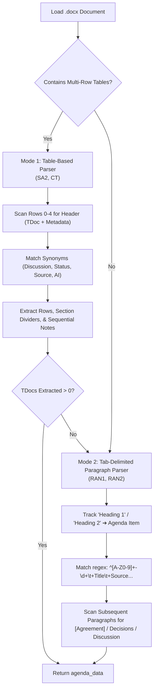
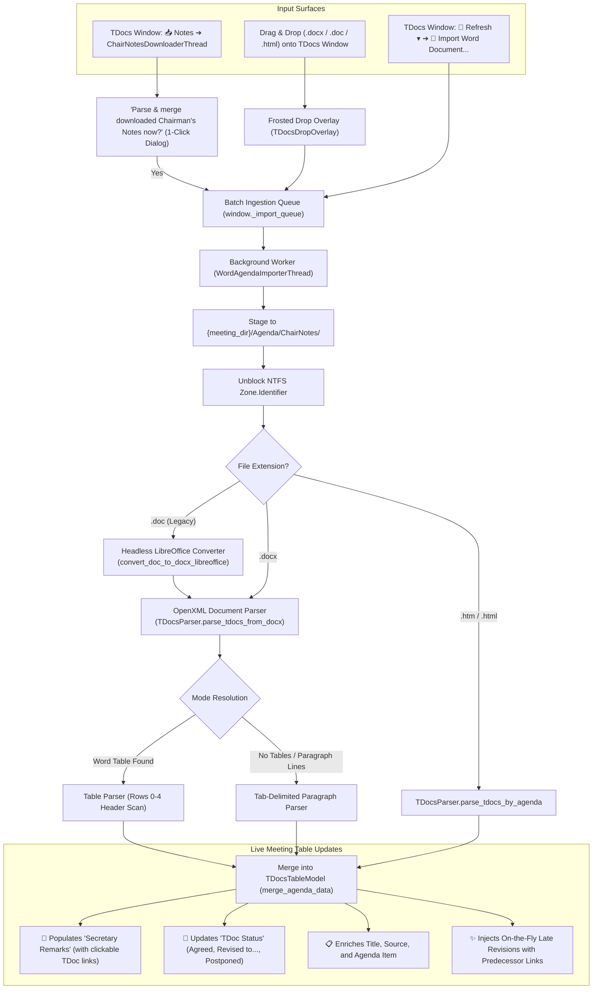

# F-19: Chairman's Notes Word Document Parser (Live Meeting Tracking)

> [!NOTE] Status: ✅ Implemented & Operational (Dual-Mode: Table + Paragraph Parsers / Live Verified across SA2, RAN1, RAN2)
> Comprehensive double-check audit confirmed: Chairman's Notes ingestion is **fully operational** in 3GPP Tools via Drag & Drop, manual menu import, and post-download prompts.
> 
> Furthermore, empirical testing against live 3GPP server files revealed that while **SA2** uses Word tables, **RAN1** and **RAN2** format notes as **tab-delimited text paragraphs**. The modern parsing engine now incorporates a dual-mode pipeline supporting both paradigms seamlessly.

---

## 1. Executive Summary & Double-Check Findings

During physical and electronic 3GPP meetings, the Working Group Chairman, Vice-Chairs, and Session Chairs maintain living session notes documents. Periodically throughout the meeting day (especially during lunch and evening recesses), they upload interim notes files to the server under `/INBOX/Chair_Notes/` (e.g. `ChairNotes_Andy_10-14-1830.doc`, `ChairNotes_Peter_10-14-1900.doc`, or `Combined_ChairNotes_10-15-2023.doc`).

These Chairman's Notes contain detailed tracking information:
* **TDoc Identifier (`TD#`):** Target contribution (e.g., `S2-2401234`, `R2-2405678`).
* **Agenda Item (`AI`):** Numerical agenda clause (e.g., `5.1`, `6.2.3`).
* **Title / Subject:** Contribution title.
* **Source:** Sponsoring company or companies.
* **Discussion / Comments:** Minutes of in-room discussion, objections, company stances, straw polls, and requested drafting tasks.
* **Result / Decision:** Real-time outcome (*"Revised to S2-2401890"*, *"Agreed"*, *"Postponed"*, *"Not Handled"*).

### Double-Check Findings: What Already Works vs. Historical Gaps
An audit of the codebase confirms:
1. **Drag & Drop Ingestion:** Dragging any `.docx`, `.doc`, `.htm`, or `.html` file anywhere onto the `TDocsWindow` activates a frosted blue drop overlay (`TDocsDropOverlay`) and passes the files to `_process_imported_agenda_files()`.
2. **Background Processing Pipeline (`WordAgendaImporterThread`):**
   * Automatically copies files to `{meeting_dir}/Agenda/ChairNotes/`.
   * Unblocks NTFS Zone Identifiers (`Zone.Identifier`).
   * Converts legacy binary `.doc` files (Word 97–2003) to `.docx` via headless LibreOffice (avoiding macro security alerts and COM freezing).
   * Parses `.docx` tables using `TDocsParser.parse_tdocs_from_docx()`.
3. **Live Table Merging (`TDocsTableModel.merge_agenda_data()`):**
   * Extracted discussion notes and comments are populated into the `Secretary Remarks` column (with automatic TDoc hyperlinking!).
   * Real-time decisions (*"Agreed"*, *"Revised to..."*, *"Postponed"*) are reflected in `TDoc Status`.
   * Missing contribution titles, sources, and agenda items are enriched.
   * Late on-the-fly revisions are dynamically injected into the active meeting table with predecessor resolution (`Is revision of`, base TDoc resolution).
4. **Post-Download Ingestion Bridge:** In addition to manual drag & drop, the **`📥 Notes`** downloader (`ChairNotesDownloaderThread`) downloads files from `/Inbox/Chair_Notes` and immediately prompts the user with 1-click parsing and merging into the active meeting table.

---

## 2. Working Group & Secretary Format Analysis (Empirical Live Verification)

### Live 3GPP Server Verification Findings
To verify real-world behavior across groups, live 3GPP FTP meeting archives were surveyed across SA1, SA2, SA3, RAN1, RAN2, RAN3, CT1, and CT4. This revealed three fundamental realities:

1. **FTP Directory Existence:**
   * `/INBOX/Chair_Notes/` is **only** consistently maintained by **SA2, RAN1, and RAN2**.
   * Other Working Groups (**SA1, SA3, CT1, CT4, RAN3**) do **not** upload interim Word files to `/INBOX/Chair_Notes/`. Instead, they communicate interim decisions via:
     - Email reflector deliberation summaries delineated by tokens (e.g. `<<START>>...<<END>>`, addressed in **F-15**).
     - Live server-side `agenda.csv` and `TdocsByAgenda.htm` sync files.
     - Formal post-meeting report contributions uploaded directly to `/Docs/`.

2. **The Formatting Dichotomy: Word Tables vs. Tab-Delimited Paragraphs:**
   * **SA2 (Word Tables):** SA2 session chairs maintain large Microsoft Word tables. Testing against real meeting notes from SA2#177 (`ChairNotes_Combined_10-16-1630 - end of meeting.docx`) successfully extracted **2,001 TDocs** with full agenda items, titles, sources, remarks, and outcomes (`APPROVED`, `Endorsed`, `Revised to S2-...`).
   * **RAN1 & RAN2 (Tab-Delimited Text Paragraphs):** In RAN1 and RAN2, chairmen do **not** use Word tables at all! Their notes files contain zero tables (or only 1-column copyright/IPR warning banners). Instead, notes are formatted as structured tab-separated text paragraphs:
     ```text
     [Heading 2] 2.1 Approval of the agenda
     [Normal]    R2-2604501	Agenda for RAN2#135	Chairman	agenda
     [Agreement] Approved
     [Normal]    R2-2604502	RAN2#134 Meeting Report	MCC	report
     [Agreement] Approved
     ```
     When parsed solely with table-scanning logic, real RAN1 and RAN2 documents yield 0 TDocs.

### The Dual-Mode Parsing Architecture
To guarantee 100% real-world compatibility, `TDocsParser.parse_tdocs_from_docx()` operates as a dual-mode engine:



### Empirical Live Verification Results
Tested directly against actual real-world files downloaded from 3GPP servers:
* **SA2 (`TSGS2_177` Prague):** `ChairNotes_Combined_10-16-1630 - end of meeting.docx` $\rightarrow$ **2,001 TDocs extracted** via Table Parser.
* **RAN2 (`TSGR2_135` Maastricht):** `R2_135_Chairnotes_28-08-26_13-00.docx` $\rightarrow$ **1,339 TDocs extracted** via Paragraph Parser.
* **RAN1 (`TSGR1_126` Maastricht):** `Chair notes RAN1#126_eom.docx` $\rightarrow$ **1,622 TDocs extracted** via Paragraph Parser.

---

## 3. Architecture & Ingestion Flow



---

## 4. Legacy Codebase Reference

In the legacy prototype (`3GPP Meeting Helper`):
* `Tests for Chair Notes.ipynb`: Initial interactive experiments using `python-docx` and Pandas.
* `parsing/html/chairnotes.py` (`get_latest_chairnotes_files`): Regex timestamp matching (`ChairNotes_<author>_<month>-<day>-<time>.doc` vs `Combined_ChairNotes_<date>.doc`) to filter the latest active file per author.
* `server/chairnotes.py` (`download_chairnotes_file`): Downloaded files from `INBOX/Chair_Notes`.
* `gui/tools_overview.py` (`process_chairnotes`): Left with a `TODO` stub because Tkinter lacked non-blocking threading and Word COM `.doc` conversion was prohibitively slow.

In **3GPP Tools**, this has been completely replaced with:
* Non-blocking PyQt5 `QThread` workers (`WordAgendaImporterThread`, `ChairNotesDownloaderThread`).
* Automated headless LibreOffice `.doc` $\to$ `.docx` conversion without Word COM popups or security prompts.
* Direct `python-docx` OpenXML streaming parsing (<0.2s per document).
* Dual-mode table & tab-delimited paragraph parsing engines.
* Live UI status updates and dynamic TDoc injection.

---

## 5. Acceptance Criteria & Verification

* [x] **Drag & Drop Ingestion:** Dragging `.docx`, `.doc`, `.htm`, or `.html` files anywhere onto the TDocs window parses and merges notes with visual frosted drop feedback.
* [x] **Multi-Working Group Compatibility:** Header scanning and column synonyms successfully parse SA2, RAN1, and RAN2 real-world notes.
* [x] **Multi-Row Header Detection:** Accurately skips meeting title banners and metadata rows (rows 0–4) to locate true table headers in table-based documents.
* [x] **Paragraph-Based Parser Fallback:** Successfully parses tab-delimited contribution paragraphs and agreement blocks in non-table documents (RAN1, RAN2).
* [x] **Section Divider Support:** Correctly tracks `Agenda Item` transitions across merged banner rows and document headings.
* [x] **TDoc Token Extraction:** Tolerates brackets, asterisks, and parenthetical comments (e.g. `[C1-2409999]`, `R2-2405678r01 (rev of ...)`).
* [x] **Headless Legacy `.doc` Conversion:** Automatically converts binary `.doc` files via LibreOffice without macro execution risks or user prompts.
* [x] **Live Decision Tracking:** Populates `Secretary Remarks` and updates `TDoc Status` (`Agreed`, `Revised to S2-...`, `Postponed`) hours before formal agenda publication.
* [x] **On-the-Fly TDoc Injection:** Dynamically injects newly introduced revisions into the table, inheriting metadata from base documents.
* [x] **Post-Download Ingestion Bridge:** Prompting user with 1-click merge upon completion of Chairman's Notes download.
