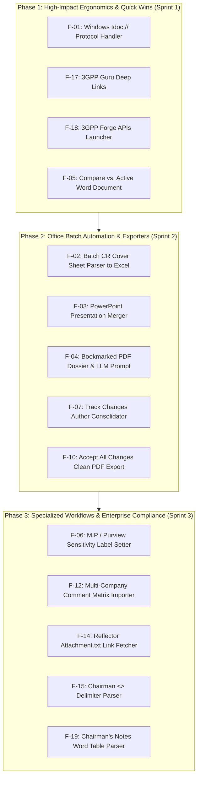

# Legacy Features & Gap Analysis Catalog

This directory contains in-depth architectural and technical specifications for each functionality originally implemented in the legacy **3GPP Meeting Helper** (`..\3GPP Meeting Helper`) that is not yet fully ported to the modernized **3GPP Tools** desktop environment.

> [!TIP]
> **Strategic Value & ROI Analysis:**  
> For an exhaustive, comparative business value and return-on-investment evaluation across all 19 features, see the dedicated [**Strategic Value & ROI Analysis (VALUE_ANALYSIS.md)**](VALUE_ANALYSIS.md).

Each document provides a comprehensive analysis covering:
1. **Executive Summary & Functional Objective**
2. **Value Analysis & Return on Investment (ROI)**
3. **Deep Code Analysis of Legacy Implementation** (Exact files, functions, lines of code, Win32 COM APIs, regexes, data structures)
4. **Current State & Gap in Modern Codebase**
5. **Target Modern Architecture & Design Specification** (PyQt5 classes, threading models, headless OpenXML / python-docx engines, UI integration)
6. **Architectural & Sequence / Workflow Diagrams** (Mermaid)
7. **Step-by-Step Implementation Roadmap & Acceptance Criteria**

---

## Master Catalog & Status Matrix

| ID | Specification Document | Feature Domain | Complexity | Value / ROI | Status |
| :---: | :--- | :--- | :---: | :---: | :---: |
| **F-01** | [F01: Windows `tdoc://` URL Protocol Handler](F01_windows_tdoc_url_handler.md) | OS Integration | Low (2.5h) | 🌟 9.0 (Exceptional) | Specification Ready |
| **F-02** | [F02: Batch CR Cover Sheet Parser to Excel](F02_batch_cr_cover_sheet_parser.md) | Word Automation | Med (5.0h) | 🔥 8.5 (Very High) | Specification Ready |
| **F-03** | [F03: PowerPoint Status Report & Presentation Merger](F03_powerpoint_presentation_merger.md) | Office Automation | Low (3.0h) | 🟢 7.5 (High) | Specification Ready |
| **F-04** | [F04: Bookmarked Multi-TDoc PDF Dossier & LLM Prompt](F04_bookmarked_pdf_dossier_llm_prompt.md) | PDF & AI Tools | Med (4.0h) | 🟢 8.0 (High) | Specification Ready |
| **F-05** | [F05: "Active Word vs. TDoc" Direct Comparison](F05_active_word_vs_tdoc_comparison.md) | Word Automation | Low (1.5h) | 🌟 9.5 (Exceptional) | Deep-Dive Complete |
| **F-06** | [F06: MIP / Purview Sensitivity Label Setter](F06_mip_sensitivity_label_setter.md) | Security & DLP | Med (3.0h) | 🟡 7.0 (Moderate) | Specification Ready |
| **F-07** | [F07: Track Changes Revision Author Replacement](F07_track_changes_author_renamer.md) | Word Automation | Low (3.0h) | 🔥 8.5 (Very High) | Deep-Dive Complete |
| **F-08** | [F08: Word Process Watchdog & Force Killer](F08_word_process_watchdog_killer.md) | System Watchdog | Low (1.5h) | ⚪ 3.0 (Low ROI) | 🔴 Deprecated (Superseded by Task Manager) |
| **F-09** | [F09: Word Meeting Contribution Summary Report (.docx)](F09_word_meeting_contribution_report.md) | Word Automation | High (4.0h) | ⚪ 4.0 (Low ROI) | 🔴 Deprecated (Superseded by HTML Dashboard) |
| **F-10** | [F10: "Accept All Changes" Clean Word Export Option](F10_word_accept_all_changes_export.md) | Word Automation | Low (2.0h) | 🟢 7.5 (High) | Specification Ready |
| **F-11** | [F11: Bi-directional Excel AutoFilter Synchronization](F11_excel_bidirectional_autofilter_sync.md) | Excel Bridge | Med (4.0h) | ⚪ 3.5 (Low ROI) | 🔴 Deprecated (Obsolete; PyQt5 In-App Filters) |
| **F-12** | [F12: Multi-Company Review Comments Matrix Importer](F12_company_comments_matrix_importer.md) | Review Collaboration | Med (4.5h) | 🟡 7.5 (Moderate) | Specification Ready |
| **F-13** | [F13: Native Excel COM Pivot Tables & Charts](F13_native_excel_pivot_tables_charts.md) | Excel Analytics | Med (3.5h) | ⚪ 3.0 (Low ROI) | 🔴 Deprecated (Superseded by HTML Analytics) |
| **F-14** | [F14: Reflector `Attachment.txt` Redirect Link Fetcher](F14_reflector_attachment_link_fetcher.md) | Email Reflector | Low (2.0h) | 🟢 7.0 (High) | Specification Ready |
| **F-15** | [F15: Chairman Email Discussion Notes Parser (`<<START>>...<<END>>`)](F15_chairman_email_notes_parser.md) | Email Reflector | Low (2.0h) | 🟡 6.5 (Moderate) | Specification Ready |
| **F-16** | [F16: Email Approval Excel Summary](F16_email_approval_excel_export.md) | Email Reflector | Med (3.0h) | 🟡 6.0 (Moderate) | Specification Ready |
| **F-17** | [F17: 3GPP Guru Web Viewer Integration](F17_3gpp_guru_web_viewer_integration.md) | Web Services | V.Low (0.5h) | 🌟 7.5 (Exceptional) | ✅ Implemented (Help & Resources Menu) |
| **F-18** | [F18: 3GPP Forge APIs Direct Launcher](F18_3gpp_forge_apis_launcher.md) | Web Services | V.Low (0.5h) | 🌟 7.0 (Exceptional) | ✅ Implemented (Help & Resources Menu) |
| **F-19** | [F19: Chairman's Notes Word Table Parser (Experimental / WIP)](F19_chairmans_notes_word_table_parser.md) | Meeting Live Notes | High (8.0h) | 🟡 7.5 (Moderate) | Specification Ready |

---

## Recommended Staged Implementation Roadmap

