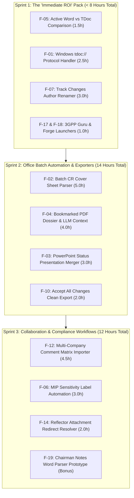

# Strategic Value & Return on Investment (ROI) Analysis: Legacy 3GPP Features

This document provides an exhaustive, comparative value analysis across all 19 functionalities originally implemented in the legacy **3GPP Meeting Helper** (`..\3GPP Meeting Helper`) that are being evaluated for modernization and integration into **3GPP Tools**.

---

## 1. Executive Value Summary & ROI Quadrant

To prioritize engineering effort effectively, every feature is evaluated across two dimensions:
* **Workflow & Business Value (1–10):** Frequency of use, hours saved, error elimination, meeting-room agility, and strategic/compliance impact.
* **Implementation Effort (Hours):** Engineering time required to implement, test, and harden the feature using modern PyQt5, asynchronous threading, and headless OpenXML engines.

```mermaid
quadrantChart
    title Legacy Features: Value vs. Implementation Effort
    x-axis Low Implementation Effort --> High Implementation Effort
    y-axis Low Workflow Value --> High Workflow Value
    quadrant-1 Major Strategic Projects
    quadrant-2 Quick Wins (Highest ROI)
    quadrant-3 Deprecate / Low Priority
    quadrant-4 Maintenance Burden (Low ROI)
    
    "F-05 Active Word vs TDoc": [0.15, 0.95]
    "F-01 tdoc:// Protocol Handler": [0.25, 0.90]
    "F-07 Track Changes Renamer": [0.28, 0.85]
    "F-17 3GPP Guru Web Viewer": [0.08, 0.75]
    "F-18 3GPP Forge APIs": [0.08, 0.70]
    "F-10 Accept All Changes Export": [0.20, 0.75]
    "F-14 Reflector Attachment Links": [0.22, 0.70]
    
    "F-02 Batch CR Cover Sheet Parser": [0.55, 0.88]
    "F-04 Bookmarked PDF Dossier": [0.45, 0.82]
    "F-03 PowerPoint Merger": [0.35, 0.78]
    "F-12 Multi-Company Comment Matrix": [0.50, 0.76]
    "F-19 Chairman Notes Word Parser": [0.85, 0.74]
    "F-06 MIP Sensitivity Label Setter": [0.35, 0.70]
    
    "F-15 Chairman Email Notes Parser": [0.22, 0.55]
    "F-16 Email Approval Summary": [0.32, 0.52]
    
    "F-09 Word Contribution Report": [0.45, 0.35]
    "F-11 Excel AutoFilter Sync": [0.45, 0.30]
    "F-13 Excel Pivot Charts": [0.40, 0.28]
    "F-08 Word Process Killer": [0.18, 0.25]
```

---

## 2. Master Value & Priority Ranking Table

| Rank | ID | Feature Name | Domain | Time Saved / Meeting | Value (1-10) | Effort (h) | ROI Rating | Recommended Action |
| :---: | :---: | :--- | :--- | :---: | :---: | :---: | :---: | :---: |
| **1** | [**F-05**](F05_active_word_vs_tdoc_comparison.md) | "Active Word vs. TDoc" Direct Comparison | Word Automation | 1.5 – 3.5 hrs | **9.5** | 1.5h | 🌟 Exceptional | **Implement Immediately (Sprint 1)** |
| **2** | [**F-01**](F01_windows_tdoc_url_handler.md) | Windows `tdoc://` URL Protocol Handler | OS Integration | 1.0 – 2.0 hrs | **9.0** | 2.5h | 🌟 Exceptional | **Implement Immediately (Sprint 1)** |
| **3** | [**F-07**](F07_track_changes_author_renamer.md) | Track Changes Author Replacement & Anonymizer | Word Automation | 3.0 – 8.0 hrs | **8.5** | 3.0h | 🔥 Very High | **Implement Immediately (Sprint 1)** |
| **4** | [**F-02**](F02_batch_cr_cover_sheet_parser.md) | Batch CR Cover Sheet Parser to Excel | Word Automation | 4.0 – 8.0 hrs | **8.5** | 5.0h | 🔥 Very High | **Implement in Sprint 2** |
| **5** | [**F-17**](F17_3gpp_guru_web_viewer_integration.md) | 3GPP Guru Web Viewer Integration | Web Services | 0.5 – 1.0 hr | **7.5** | 0.5h | 🌟 Exceptional | **Implement in Sprint 1 (Quick Win)** |
| **6** | [**F-18**](F18_3gpp_forge_apis_launcher.md) | 3GPP Forge APIs Direct Launcher | Web Services | 0.5 – 1.0 hr | **7.0** | 0.5h | 🌟 Exceptional | **Implement in Sprint 1 (Quick Win)** |
| **7** | [**F-10**](F10_word_accept_all_changes_export.md) | "Accept All Changes" Clean Word/PDF Export | Word Automation | 1.0 – 2.0 hrs | **7.5** | 2.0h | 🟢 High | **Implement in Sprint 2** |
| **8** | [**F-04**](F04_bookmarked_pdf_dossier_llm_prompt.md) | Bookmarked Multi-TDoc PDF Dossier & LLM Context | PDF & AI Tools | 2.0 – 4.0 hrs | **8.0** | 4.0h | 🟢 High | **Implement in Sprint 2** |
| **9** | [**F-03**](F03_powerpoint_presentation_merger.md) | PowerPoint Status Report Presentation Merger | Office Automation | 1.0 – 2.5 hrs | **7.5** | 3.0h | 🟢 High | **Implement in Sprint 2** |
| **10** | [**F-14**](F14_reflector_attachment_link_fetcher.md) | Reflector `Attachment.txt` Redirect Link Fetcher | Email Reflector | 0.5 – 1.0 hr | **7.0** | 2.0h | 🟢 High | **Implement in Sprint 2** |
| **11** | [**F-12**](F12_company_comments_matrix_importer.md) | Multi-Company Review Comments Matrix Importer | Collaboration | 4.0 – 6.0 hrs (Rapporteurs) | **7.5** | 4.5h | 🟡 Moderate | **Implement in Sprint 3 (Rapporteurs)** |
| **12** | [**F-06**](F06_mip_sensitivity_label_setter.md) | MIP / Purview Sensitivity Label Setter | Security & DLP | Compliance | **7.0** | 3.0h | 🟡 Moderate | **Implement in Sprint 3** |
| **13** | [**F-19**](F19_chairmans_notes_word_table_parser.md) | Chairman's Notes Word Table Parser (Live) | Live Notes | 2.0 – 3.0 hrs | **7.5** | 8.0h | 🟡 Moderate | **Evaluate in Sprint 3** |
| **14** | [**F-15**](F15_chairman_email_notes_parser.md) | Chairman Email Discussion Notes Parser | Email Reflector | 0.5 – 1.0 hr | **6.5** | 2.0h | 🟡 Moderate | **Backlog (Low Priority)** |
| **15** | [**F-16**](F16_email_approval_excel_export.md) | Email Approval Excel Summary | Email Reflector | 0.5 – 1.0 hr | **6.0** | 3.0h | 🟡 Moderate | **Backlog (Superseded by AI Stance)** |
| **16** | [**F-09**](F09_word_meeting_contribution_report.md) | Word Meeting Contribution Summary Report (.docx) | Word Automation | Redundant | **4.0** | 4.0h | ⚪ Low | 🔴 **Deprecated (Superseded by HTML Analytics & Markdown Dossiers)** |
| **17** | [**F-11**](F11_excel_bidirectional_autofilter_sync.md) | Bi-directional Excel AutoFilter Synchronization | Excel Bridge | Redundant | **3.5** | 4.0h | ⚪ Low | 🔴 **Deprecated (Obsolete; PyQt5 In-App Filters at 60 FPS)** |
| **18** | [**F-13**](F13_native_excel_pivot_tables_charts.md) | Native Excel COM Pivot Tables & Charts | Excel Analytics | Redundant | **3.0** | 3.5h | ⚪ Low | 🔴 **Deprecated (Superseded by HTML Dashboard Compiler)** |
| **19** | [**F-08**](F08_word_process_watchdog_killer.md) | Word Process Watchdog & Force Killer | System Watchdog | Negligible | **3.0** | 1.5h | ⚪ Low | 🔴 **Deprecated (Superseded by COM Task Manager Dialog)** |

---

## 3. Deep-Dive Value Analysis by Feature

### F-01: Windows `tdoc://` URL Protocol Handler
* **Core Value Proposition:** Turns every TDoc identifier in Teams, Outlook, Word comments, and web pages into an actionable, 1-click hyperlink that directly opens the document in 3GPP Tools.
* **Target Personas:** All delegates, review engineers, and technical managers.
* **Quantitative Savings:** Delegates open 30–100 TDocs per week. Eliminating manual copying, app-switching, pasting, and searching saves ~20 seconds per interaction (**1–2 hours saved per week**).
* **Qualitative Impact:** Eliminates context switching during meetings. Speeds up cross-team collaboration in corporate chat channels.
* **Cost of Not Implementing:** Delegates remain tethered to manual search boxes and copy-paste friction.

---

### F-02: Batch CR Cover Sheet Parser to Excel
* **Core Value Proposition:** Headless batch extraction of formal 3GPP Change Request metadata (Spec, Release, CR Number, Revision, Work Item, Category, Affected Clauses, Reason for Change) from hundreds of `.docx` files into a consolidated, structured Excel matrix.
* **Target Personas:** Work Item Rapporteurs, delegation leads, technical project managers.
* **Quantitative Savings:** Manually inspecting and typing metadata for 100 CRs takes **4–5 hours**. Batch parsing completes in **< 10 seconds**.
* **Qualitative Impact:** Enables instant auditing of meeting progress, verification of affected releases, and identification of conflicting CRs targeting identical specification clauses.
* **Cost of Not Implementing:** Rapporteurs must manually compile CR tracking tables or rely on delayed plenary minutes.

---

### F-03: PowerPoint Status Report Presentation Merger
* **Core Value Proposition:** Automatically extracts slides from all presentation TDocs (`.pptx`) submitted to a meeting and compiles them into a single unified presentation with standardized divider slides.
* **Target Personas:** Working Group Chairmen, delegation leaders, corporate spokespersons.
* **Quantitative Savings:** Eliminates 30–60 minutes of repetitive manual PowerPoint slide copying per meeting cycle.
* **Qualitative Impact:** Provides an instant, presentation-ready briefing deck for executive management debriefs.
* **Cost of Not Implementing:** Manual slide assembly before internal company reporting calls.

---

### F-04: Bookmarked Multi-TDoc PDF Dossier & LLM Context Generator
* **Core Value Proposition:** Compiles a batch of related TDocs into a single, cohesive PDF dossier with an interactive, hyperlinked Table of Contents and bookmarks, paired with an optimized LLM system prompt context file.
* **Target Personas:** Traveling delegates (iPad / reMarkable users), delegates offline on flights, AI researchers using local LLMs.
* **Quantitative Savings:** Saves 1–2 hours of manual PDF stitching and bookmark configuration.
* **Qualitative Impact:** Transforms disparate ZIP archives into an elegant, readable dossier for offline annotation and deep-reading. Supplies clean, consolidated text to Ollama/Claude without token fragmentation.
* **Cost of Not Implementing:** Delegates must open 20 individual Word windows or navigate fragmented temporary directories.

---

### F-05: "Active Word vs. TDoc" Direct Comparison
* **Core Value Proposition:** Instant 1-click comparison between whatever Word document is currently active on the user's desktop and a target TDoc from the meeting server.
* **Target Personas:** Active 3GPP delegates in live sessions, drafting group leaders, rapporteurs.
* **Quantitative Savings:** Cuts comparison staging from **80 seconds down to 5 seconds (95% reduction in friction)**. Saves **1.5 to 3.5 hours per meeting week**.
* **Qualitative Impact (Tactical Advantage):** In 3GPP meetings, agenda items are frequently gavelled within 60–90 seconds. A 5-second redline allows delegates to verify technical changes and raise objections before consensus is declared.
* **Cost of Not Implementing:** High risk of missing critical drafting changes or comparing against the wrong local draft version.

---

### F-06: MIP / Purview Sensitivity Label Setter
* **Core Value Proposition:** Automated inspection and application of enterprise Microsoft Information Protection (MIP) sensitivity labels (e.g. "Public", "Internal") across downloaded and exported 3GPP documents.
* **Target Personas:** Delegates working under strict corporate IT and Data Loss Prevention (DLP) compliance mandates.
* **Quantitative Savings:** Eliminates mandatory corporate security prompt dialogs on every opened document.
* **Qualitative Impact:** Prevents corporate DLP software from blocking document access, email attachments, or cloud synchronization.
* **Cost of Not Implementing:** Potential corporate security policy violations or blocked access to downloaded standards files.

---

### F-07: Track Changes Revision Author Replacement & Anonymizer
* **Core Value Proposition:** Direct OpenXML manipulation of `.docx` packages to replace disparate internal reviewer identities and contractor tags with a unified corporate signature (`"T-Mobile"`, `"Qualcomm"`) or role (`"Rapporteur"`), without accepting changes.
* **Target Personas:** Contribution co-authors, Work Item Rapporteurs, corporate legal/IP reviewers.
* **Quantitative Savings:** Saves **15 to 45 minutes per contribution** compared to manual revision re-typing (**3 to 8 hours saved per meeting cycle**).
* **Qualitative Impact:** Solves a fundamental limitation of Word COM (where `Revision.Author` is read-only). Protects corporate confidentiality, prevents accidental GDPR/privacy leaks of contractor names into permanent public archives, and guarantees XML integrity.
* **Cost of Not Implementing:** Internal team identities leak into public 3GPP archives, or hours are wasted manually re-applying tracked revisions.

---

### F-08: Word Process Watchdog & Force Killer
* **Status:** 🔴 **DEPRECATED / SUPERSEDED**
* **Core Value Proposition:** Detects and force-terminates orphan, frozen, or background `WINWORD.EXE` processes left behind by aborted COM calls.
* **Why Deprecated:** Modern **3GPP Tools** completely eliminates the need for this crude brute-force killer (`taskkill /F /IM WINWORD.EXE`). All COM operations utilize deterministic apartment cleanup (`pythoncom.CoUninitialize()`). Furthermore, the integrated **`🖥️ COM Task Manager` (`ProcessManagerDialog`)** allows safe, document-by-document COM closing, user-controlled exclusion sets, and PID-isolated termination without destroying delegates' unsaved work in other Word windows.

---

### F-09: Word Meeting Contribution Summary Report (.docx)
* **Status:** 🔴 **DEPRECATED / SUPERSEDED**
* **Core Value Proposition:** Generates a Microsoft Word document containing a static tabular summary of meeting contributions.
* **Why Deprecated:** Static Word tables are rigid, slow to generate via COM, and break across non-German Word locales (`Überschrift 1` error). Modern **3GPP Tools** completely supersedes this with the **Interactive HTML5 Analytics Dashboard (`Statistics_Report.html`)**, responsive Chart.js visual metrics, multi-tab Excel workbooks (`Statistics_Data.xlsx`), and the AI-driven **Post-Meeting Export Dossier Generator**.

---

### F-10: "Accept All Changes" Clean Word/PDF Export Option
* **Core Value Proposition:** 1-click batch export that accepts all tracked revisions, clears review comments, and produces pristine final-text `.docx` and `.pdf` documents.
* **Target Personas:** Delegation managers, technical writers, patent specialists.
* **Quantitative Savings:** Saves 5–10 minutes per document when preparing clean final texts for executive review or filing.
* **Qualitative Impact:** Ensures no internal drafting marks or unresolved redlines are accidentally presented to external stakeholders.
* **Cost of Not Implementing:** Users must manually open each document in Word, click Accept All, delete comments, and Save As.

---

### F-11: Bi-directional Excel AutoFilter Synchronization
* **Status:** 🔴 **DEPRECATED / OBSOLETE**
* **Core Value Proposition:** Syncs filter criteria between an external Excel sheet and the GUI table.
* **Why Deprecated:** Obsolete. In the legacy tool, this was a workaround for the limitations of Tkinter. Modern **3GPP Tools** features a high-performance in-app PyQt5 filter proxy model (`TDocsFilterProxyModel`) with instant multi-facet filtering (Working Group badges, date presets, followed WIs, format, nature) rendering at 60 FPS directly within the application, eliminating the need to keep external Excel workbooks open in parallel.

---

### F-12: Multi-Company Review Comments Matrix Importer
* **Core Value Proposition:** Ingests disparate review comment spreadsheets submitted by different companies (Qualcomm, Ericsson, Samsung, Nokia, T-Mobile) and consolidates them into a unified comment resolution matrix indexed by specification clause.
* **Target Personas:** Work Item Rapporteurs and drafting group chairs leading specification review calls.
* **Quantitative Savings:** Saves **4 to 6 hours of tedious spreadsheet copying** per review cycle.
* **Qualitative Impact:** Enables Rapporteurs to easily view conflicting company comments side-by-side per clause, dramatically accelerating drafting calls.
* **Cost of Not Implementing:** Rapporteurs spend entire evenings manually copy-pasting Excel rows before drafting sessions.

---

### F-13: Native Excel COM Pivot Tables & Charts
* **Status:** 🔴 **DEPRECATED / SUPERSEDED**
* **Core Value Proposition:** Automates Excel COM to construct pivot tables and embedded charts inside generated workbooks.
* **Why Deprecated:** Automating Excel COM to generate pivot tables requires local Microsoft Office desktop installations, introduces fragile inter-process locks, and is completely superseded by the repository's **HTML Dashboard Compiler (`html_dashboard_compiler.py`)**, which renders interactive, cross-filtered charts, KPI cards, and alliance networks in any browser without Office dependencies. Clean `openpyxl` data workbooks allow delegates to create pivot tables manually in 2 clicks if desired.

---

### F-14: Reflector `Attachment.txt` Redirect Link Fetcher
* **Core Value Proposition:** Automatically resolves and fetches redirect attachment links found in 3GPP email reflector `Attachment.txt` files when delegates are working offline or behind corporate proxies.
* **Target Personas:** Delegates reviewing email discussion archives.
* **Quantitative Savings:** Eliminates broken download links and manual URL hunting for email contributions.
* **Qualitative Impact:** Ensures 100% data completeness during offline preparation.

---

### F-15: Chairman Email Discussion Notes Parser (`<<START>>...<<END>>`)
* **Core Value Proposition:** Parses structured chairman summary notes delineated by `<<START>>` and `<<END>>` delimiters in reflector emails.
* **Assessment & Value:** **Moderate Value.** Historically critical during electronic e-meetings; lower frequency in physical in-person meetings.

---

### F-16: Email Approval Excel Summary
* **Core Value Proposition:** Aggregates company positions ("Support", "Object", "No Comment") from email approval threads into a structured Excel grid.
* **Assessment & Value:** **Moderate Value.** Modern local AI stance summarization in `modules/emails/` already provides richer natural language synthesis than raw keyword parsing.

---

### F-17: 3GPP Guru Web Viewer Integration
* **Core Value Proposition:** 1-click context menu and button action to launch any specification, meeting, or TDoc directly in `3gpp.guru`.
* **Target Personas:** All delegates and specification researchers.
* **Quantitative Savings:** Near-zero development effort (30 minutes) for permanent daily convenience.
* **ROI Rating:** **🌟 Exceptional (Trivial Effort, Permanent Value)**.

---

### F-18: 3GPP Forge APIs Direct Launcher
* **Core Value Proposition:** 1-click navigation to official 3GPP OpenAPI specifications (5G Core, NWDAF, NEF, CAPIF) on `forge.3gpp.org`.
* **Target Personas:** Protocol architects and CT4/SA2 delegates reviewing RESTful OpenAPI definitions.
* **Quantitative Savings:** Instant browser launch with exact specification and branch targeting (< 30 minutes development).
* **ROI Rating:** **🌟 Exceptional (Trivial Effort, Permanent Value)**.

---

### F-19: Chairman's Notes Word Table Parser (Live Meeting Tracking)
* **Core Value Proposition:** Scrapes unformatted draft Word tables updated live by the Working Group Chairman during meeting sessions, extracting agreed/revised TDoc statuses days before official publication.
* **Target Personas:** Delegation leaders and competitive intelligence specialists.
* **Quantitative Savings:** Saves 2–3 hours of manual note inspection during meeting weeks.
* **Implementation Caveat:** High engineering effort (~8 hours) due to inconsistent chairman formatting styles and erratic Word table layouts.

---

## 4. Staged Implementation Recommendations

Based strictly on **Value per Engineering Hour (ROI)**, the recommended implementation plan is divided into three actionable phases:


